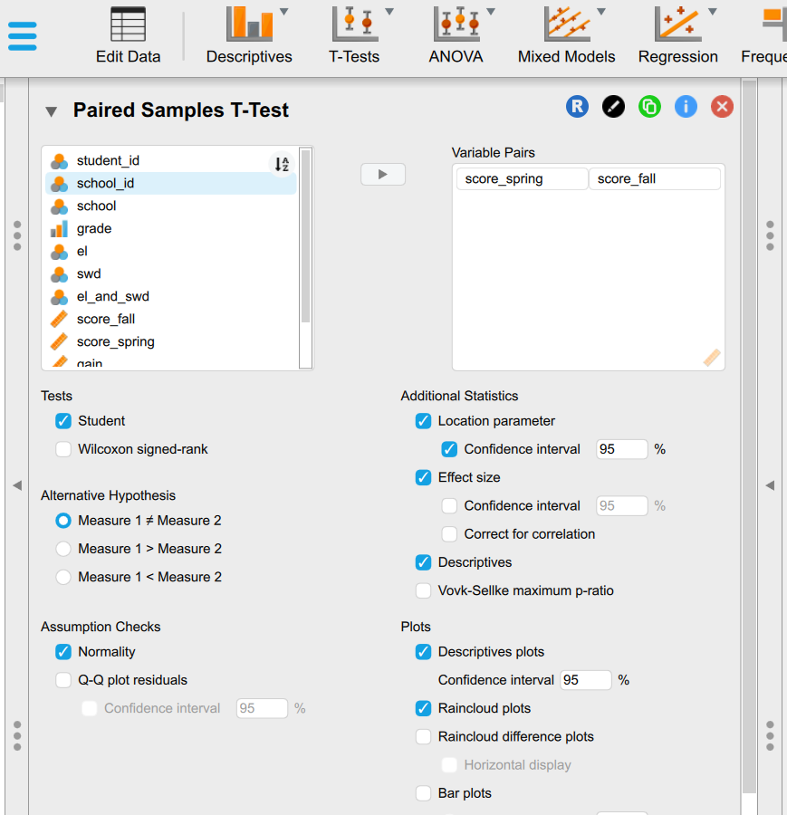
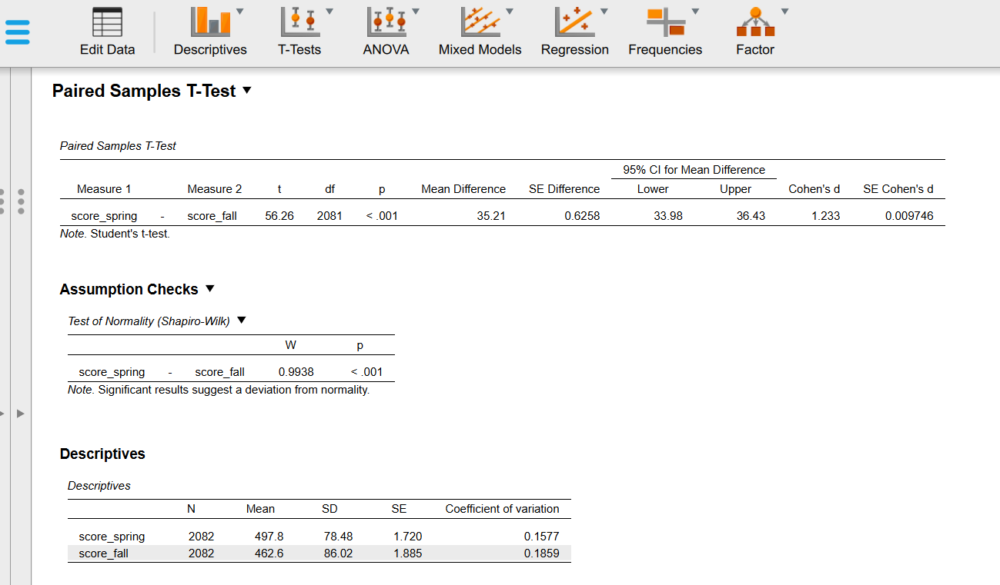

# Module 1: We observe only the program group, before and after

**Design:** One-group pre-post · **File:** [m01_pre_post.csv](data/m01_pre_post.csv) · **JASP analysis:** Paired Samples T-Test

## The problem

You have data only on the people who got the program: their scores before it started and their scores after. There is no untreated group.

- **What is missing.** How the program group would have scored in spring without the program (their Y₀).
- **The trial you wish you had.** The same schools, with a coin flip deciding which ones get ARISE in fall 2024.
- **The only stand-in available.** The same students' own scores from before the program.

This is the most common way people judge programs, and the easiest. But using "before" as the stand-in for "without" assumes that, without the program, nothing would have changed. That is almost never true for students, who learn all year regardless.

## Picture the design: filling in the missing world

Go back to the six students from Part 1. Pre-post uses only the three ARISE students, and it has to fill in each one's missing Y₀ (what they would have scored in spring without ARISE).

**The stand-in:** each student's own fall score. "Before" stands in for "without."

| Student | Fall score (stand-in for Y₀) | Spring score, observed (Y₁) | Pre-post "effect" | True effect |
| --- | --- | --- | --- | --- |
| Ava | 460 | 486 | +26 | +4 |
| Ben | 480 | 504 | +24 | +6 |
| Cruz | 500 | 525 | +25 | +5 |
| **Average** | **480** | **505** | **+25** | **+5** |

*Pre-post in the running example. Illustrative numbers, not ARISE data.*

**Reading the picture.** The orange line is what we observe. ARISE students rose from 480 to 505. The gray dashed line is the missing world. That is, without ARISE, they would have reached 500 anyway. Pre-post never sees that gray line. Instead it draws the flat blue line and treats 480 as the spring score without ARISE. The 20 points between the blue line and the gray line are normal growth, and pre-post counts all of it as the program's effect. So it reports +25 when the truth is +5, five times too large.

**What it can and cannot answer.** Pre-post answers "Did ARISE students' scores go up?" It cannot answer our evaluative question, "Did ARISE *make* them go up?", because it cannot separate ARISE from everything else that happened that year.

**Looking ahead.** Every later design is a different attempt to draw that gray line more accurately. Module 2 tries a different group of students.

## What must be true to believe it

Pre-post asks you to believe that the students' fall scores show what their spring scores would have been without ARISE. In symbols, the assumption is:

$$
E[Y_{0,\text{spring}} \mid D = 1] = E[Y_{\text{fall}} \mid D = 1]
$$

Read it as: among ARISE students (D = 1), the average spring score without the program equals the average fall score. In terms of the three conditions in Part 1, this is an exchangeability assumption, but between two times rather than two groups. "Before" must be interchangeable with "after, without the program." Over a school year it is broken by maturation (students learn in every class), testing (they get used to i-Ready) and history (other things happen that year).

**How you could check it.** Not with these data. You would need either a longer history of the same students before the program, to see whether scores normally rise (Module 7), or a group that did not get the program, measured over the same months (Modules 2 and 6).

**When the stand-in can be believable.** When the outcome would stay flat on its own. For example, a skill students would not pick up anywhere else, measured a few weeks apart. Even then, it is an assumption you cannot check with these data.

**How the What Works Clearinghouse would judge it.** The WWC does not review single-group pretest-posttest studies at all. In these studies the program and the passage of time are completely tangled together, so the WWC says they would always be rated Does Not Meet WWC Standards (*WWC Handbook, Version 5.0*, p. 16).

## The design and its model: the paired t-test

**The model, in symbols.** A paper using this design would report the average change:

$$
\bar{\Delta} = \frac{1}{n}\sum_{i=1}^{n}\left(Y_{i,\text{spring}} - Y_{i,\text{fall}}\right)
$$

| Symbol | What it means | Where it shows up in JASP |
| --- | --- | --- |
| n | The number of students with both scores | N in the Descriptives table |
| Yᵢ, spring and Yᵢ, fall | Student i's spring and fall scores | The two variables you paired |
| Σ, from i = 1 to n | Add up what follows for every student |  |
| Δ̄ ("delta bar") | The average change | Mean Difference |

In words: subtract each student's fall score from their spring score, add up those differences, and divide by the number of students.

**Which effect does it estimate?** Split the average change the way Part 1 split a comparison of groups, by adding and subtracting the missing E\[Y₀ ∣ D = 1\]:

$$
\underbrace{E[Y_{\text{spring}} - Y_{\text{fall}} \mid D=1]}_{\text{average change}}
= \underbrace{E[Y_1 - Y_0 \mid D=1]}_{\text{ATT}}
+ \underbrace{E[Y_0 - Y_{\text{fall}} \mid D=1]}_{\text{change that would have happened anyway}}
$$

For ARISE students, the spring score you observe is Y₁. The average change equals the ATT only when the last term is zero, that is, when scores would not have changed without the program. In the running example, 25 = 5 + 20, and the 20 points are normal growth. With real students that term is almost never zero, which is why this design measures growth, not impact.

Each student has two scores, fall and spring. The paired t-test:

1. Computes each student's **difference** (spring minus fall).
2. Averages those differences. This is the **mean difference**.
3. Asks whether that average is far enough from zero that chance is an unlikely explanation. It divides the mean difference by its standard error (how much the average would bounce around from sample to sample). The result is the **t statistic**; the farther it is from zero, in either direction, the smaller the p-value. With 400 students, a t statistic of about 2 or more (or −2 or less) will produce a p-value below .05.

"Paired" means each fall score is linked to the same student's spring score. That is what makes it different from the independent t-test in Module 2.

**Effect size:** JASP reports **Cohen's d**, here the mean difference divided by the standard deviation of the differences. It tells you how large the change is compared with how much students' changes vary. Because it divides by the spread of changes rather than of scores, it is not comparable with the effect sizes in later modules (see Reading the output).

**Behind the scenes: what JASP computes.** Four formulas turn the average change into a test, an interval and an effect size. Here sΔ is the standard deviation of students' changes.

$$
\text{SE} = \frac{s_\Delta}{\sqrt{n}} \qquad t = \frac{\bar{\Delta}}{\text{SE}} \qquad \text{95\% CI} = \bar{\Delta} \pm t^{*} \times \text{SE} \qquad d = \frac{\bar{\Delta}}{s_\Delta}
$$

The SE shrinks as n grows, because an average of many students bounces around less than an average of a few. The value t\* is about 1.96 here; JASP looks it up from the sample size. You can check JASP's numbers by hand. In this file the average change is 35.21 points, sΔ is 28.55 and n is 2,082. So the SE is 28.55 ÷ √2,082 ≈ 0.63, t is about 35.21 ÷ 0.63 ≈ 56, the CI runs from about 34.0 to 36.4, and d is 35.21 ÷ 28.55 ≈ 1.23. Every one of these numbers is about chance. None of them says how much of the 35 points ARISE caused.

## Example scenarios

**Scenario A: A teacher workshop.** A district gives 40 teachers a quiz on phonics instruction before and after a two-day workshop. Scores rise from 62% to 78%. *Question answered:* Did teachers score higher after the workshop than before? *Question not answered:* Did the workshop cause the rise? Teachers may have done better simply because they had seen the quiz before.

**Scenario B: Attendance texts.** A school starts sending parents a text when a child is absent. Average daily attendance goes from 91% in October to 94% in April. *Question answered:* Was attendance higher after the texts began? *Not answered:* Would attendance have risen anyway? October has more illness than April in some years; in others, the reverse.

## Your question in this module

*Did students in the four ARISE schools score higher on i-Ready reading in spring 2025 than in fall 2024?* The file contains only ARISE-school students with both a fall and a spring score.

## Get to know the data

Before running any test, spend five minutes getting to know the file. This is called **exploratory data analysis (EDA)**, and every module starts with it. You are answering four questions:

- **What is a row, and how many are there?** Here, each row is one student.
- **What is missing?** Missing values shrink your sample, and if they are missing for a reason, they can bias your answer.
- **What are typical values?** Look at the mean, SD, minimum and maximum. Do they make sense? A score of 0 or 9999 is a data problem, not a student.
- **What shape is the data?** One hump or two? Lopsided? Any values far from the rest?

Problems are much cheaper to catch now than after you have interpreted a result.

**Data dictionary.** The variables you will use in this module.

| Variable | Definition | Data type |
| --- | --- | --- |
| score\_fall | i-Ready reading scale score in fall 2024, at the start of ARISE's first year (about 200 to 750) | Continuous (Scale) |
| score\_spring | i-Ready reading scale score in spring 2025, after a year of ARISE. This is the outcome. | Continuous (Scale) |
| grade | Grade level in 2024-25 (0 = kindergarten, 1 to 5 = grades 1 to 5) | Category, number code (Nominal) |

1. Open **m01\_pre\_post.csv** (Part 2 shows how).
2. Click **Descriptives**. Move **score\_fall** and **score\_spring** into **Variables**.
3. Under **Statistics**, make sure **Valid, Missing, Mean, Std. deviation, Minimum** and **Maximum** are ticked (they usually are by default).
4. Under **Plots**, tick **Distribution plots**.
5. If the file has a **grade** column, move it into **Split** and look again.

**What to look for:** About 2,082 valid scores, with few or none missing. Spring's mean should be higher than fall's, since students grow over a year. The distribution plots will likely show two humps; splitting by grade usually explains them, because younger and older students sit at different places on the same scale.

## Step by step in JASP

**Where the variables go, and why.**

| Variable | JASP box | Role and why |
| --- | --- | --- |
| score\_spring | Variable Pairs, first | The outcome, measured after a year of ARISE. It goes first so JASP computes spring minus fall, and a rise shows up as a positive number. |
| score\_fall | Variable Pairs, second | The same students before the program. It is pre-post's stand-in for "without ARISE." |

There is no Grouping Variable here, because a paired t-test compares two measurements of the same students rather than two groups. The independent variable is time (fall versus spring), and the pairing holds it.

1. Open **m01\_pre\_post.csv** (Part 2 shows how).
2. Check that **score\_fall** and **score\_spring** are **Scale** (ruler icon).
3. Click **T-Tests** in the menu bar, then **Paired Samples T-Test** (under Classical). If you do not see the analyses menu, you may be in the data menu. Click the **Analyses** button to return to it: 
4. Move **score\_spring** into the **Variable Pairs** box first, then **score\_fall** next to it. Order matters: JASP computes the first minus the second, so spring minus fall gives a positive number if scores went up.
5. Under **Tests**, keep **Student** ticked.
6. Under **Additional Statistics**, tick **Location parameter** (the mean difference) and its **Confidence interval**, **Effect size** and its **Confidence interval**, and **Descriptives**.
7. Under **Assumption Checks**, tick **Normality**.
8. Under **Plots**, tick **Descriptives plots** (or **Raincloud plots** if your version has them).

Figure 4. Paired Samples T-Test input panel with score\_spring and score\_fall paired and options ticked

## Checkpoints

- **N = 2,082** students in the Descriptives table, for both measures.
- **df = 2,081** in the t-test table (df is N minus 1 for a paired test).
- **Mean fall score = 462.6.**

If these don't match, check that you opened the right file and that no filter is on.

## Reading the output

Figure 5. Paired Samples T-Test output tables

**Descriptives table.** N, mean and standard deviation (SD) for fall and spring. Look at the two means first; their difference is what the test evaluates.

**Paired Samples T-Test table.** One row for the pair.

| Column | What it tells you |
| --- | --- |
| t | Mean difference divided by its standard error. Far from 0 = unlikely to be chance |
| df | Degrees of freedom (N minus 1) |
| p | Probability of a difference this big if the true change were zero |
| Mean Difference | Average spring minus fall, in scale-score points. **This is your estimate.** |
| SE Difference | How precisely the mean difference is estimated |
| 95% CI | Plausible range for the true mean difference |
| Cohen's d | The mean change divided by the SD of students' changes. Not comparable with the effect sizes in later modules (see below)**.** |

**Test of Normality (Shapiro-Wilk).** Checks whether the *differences* (spring minus fall) look roughly bell-shaped, which is what the paired t-test assumes. The table gives two numbers. **W** runs from 0 to 1, where 1 means perfectly normal; here W = 0.99, about as close to normal as real data get. **p** is below .001, so the test calls it "significant." That is not a contradiction: with 2,000+ students, the test flags departures far too small to matter, and the t-test is not harmed by them at this sample size.

**What to do:** Do not stop because p is below .05. With a large sample, look at W instead. If it is close to 1, treat the differences as normal enough and keep going. Also keep in mind that the raincloud plot shows fall and spring scores separately, not the differences. Those raw scores have two peaks, likely because the file mixes grade levels, but subtracting each student's fall score removes that gap. Only a small sample (a few dozen students) with a low W should make you worry.

**Reading the plot.** The raincloud plot has three parts. On the left, each **dot is one student** (spring in one color, fall in the other), and each **gray line connects one student's two scores**, so a line slanting toward the higher score shows that student grew. In the middle, the **box plots** summarize each test: the thick line is the median, the box holds the middle half of students, and the whiskers reach out to the rest. On the right, the **shaded "cloud"** shows the shape of each distribution, where taller means more students at that score. What to look for: is the spring box higher than the fall box, and do most gray lines slant toward spring? The two humps in each cloud are not a problem for this test (see the Test of Normality above). If you made a Descriptives plot instead, each dot is a mean and the bars are its 95% confidence interval.

**Putting it together.** Write one sentence for each: (1) How many points did scores change, with the 95% CI? (2) Is it statistically significant? (3) How large is d? Then ask the most important question of this module: **H****ow much of that change would have happened without ARISE?**

**Why this Cohen's d is not comparable.** In a paired t-test, JASP divides the mean change by the standard deviation of students' changes, not of their scores. Students' changes vary much less than their scores do, so this d comes out large. Here the mean gain is about 35 points and the SD of the gains is about 29, so d is about 1.2, which looks "large" by any benchmark. Kraft's benchmarks and the effect sizes in Modules 2 to 10 are on a different scale: SDs of scores, or z-scores. Do not compare this module's d with them. A better check is the z-scores, which remove normal growth for each grade. ARISE students' average z-score barely moved from fall to spring (a change of about −0.06 SD). In other words, they grew about as much as typical Oceanside students in their grades did. The large d is mostly normal growth.

## Explaining it to stakeholders

Pre-post results are the ones most often reported to stakeholders, and the ones most often misread. Your result is already in i-Ready points, so it needs no translation. What it needs is the right label. The mean difference is growth: how much ARISE students' scores rose from fall to spring. Growth is not the same as impact. Impact, or the program's effect, is the difference between how much students grew with the program and how much they would have grown without it. Students grow over a school year with or without a new program, and this design cannot see how much they would have grown without ARISE.

**A sample sentence.** "From fall to spring, students in ARISE schools gained about \_\_\_ i-Ready points on average. Most students gain points over a school year with or without a new program, so this growth alone does not tell us how much ARISE added."

**What to add.** Avoid wording such as "ARISE raised scores by \_\_\_ points" or "ARISE students improved by \_\_\_ points because of the program" for this result. If listeners ask whether the growth is good, explain that answering that question requires knowing how much similar students grew without ARISE. That is what the designs in Modules 2 to 10 try to estimate.

## Assumptions

- **Paired observations.** Each fall score belongs to the same student as the spring score. The file guarantees this.
- **Independent students.** One student's change doesn't affect another's. This is shaky because students in the same school share teachers (Part 1).
- **Roughly normal differences, or a large sample.** With 2,082 students, this is not a concern.

## Threats to internal validity

- **Maturation.** Students learn to read better over a school year no matter what. This is the biggest threat here.
- **Testing.** Students take i-Ready three times a year and get used to it.
- **History.** Anything else that happened in 2024-25 (new teachers, a new curriculum, tutoring) is mixed in with ARISE.
- **Attrition.** Only students with both scores are included. If struggling students were more likely to miss the spring test, the remaining group looks better.

Notice that a very small p-value and a very large d do not protect you from any of these. They only tell you the change is not chance.

## Bring to your instructor

1. Report the mean difference, 95% CI, p-value and Cohen's d.
2. By Kraft's benchmarks (Part 1), how big is this effect? Does it seem believable as the effect of a reading program?
3. Name two reasons scores would rise from fall to spring even without ARISE.
4. What information would you need to know how much of this rise was due to ARISE?
5. **Back to the two worlds.** In the running example, what did pre-post put in place of Ava's missing Y₀? Write her stand-in, her pre-post "effect" and her true effect, and explain in your own words why the two effects differ.
6. Suppose ARISE had no effect at all, so every student's Y₁ equals their Y₀. What would pre-post report for the three ARISE students in the running example? What does your answer tell you about the design?
7. Sketch the Picture the design figure for your ARISE results. The observed line from fall to spring, the flat "no change" stand-in, and where you think the missing "without ARISE" line would end. Which part of your estimate is ARISE, and which is normal growth? Can this design tell you?
8. Describe one outcome and setting where "before" would be a believable stand-in for "without." Then explain why it is not believable for fall-to-spring reading scores.

## Learn more

- *The Effect*, **Chapter 5, Identification:** why an observed change can have many explanations, and how research designs rule them out.
- *The Effect*, **Chapter 17, Event Studies:** the simplest before-and-after comparison and why you need to predict what would have happened without the event.
- *What If* (Hernán and Robins), Chapter 1, sections 1.1 and 1.2: individual and average causal effects, the idea behind the two worlds.
- *Experimental and Quasi-Experimental Designs* (Shadish, Cook and Campbell), Chapter 4: the one-group pretest-posttest design and the threats that undermine it.
- *WWC Handbook, Version 5.0*, Chapter I, "Assignment to conditions" (pp. 15 to 16): why the WWC does not review single-group pretest-posttest studies.

