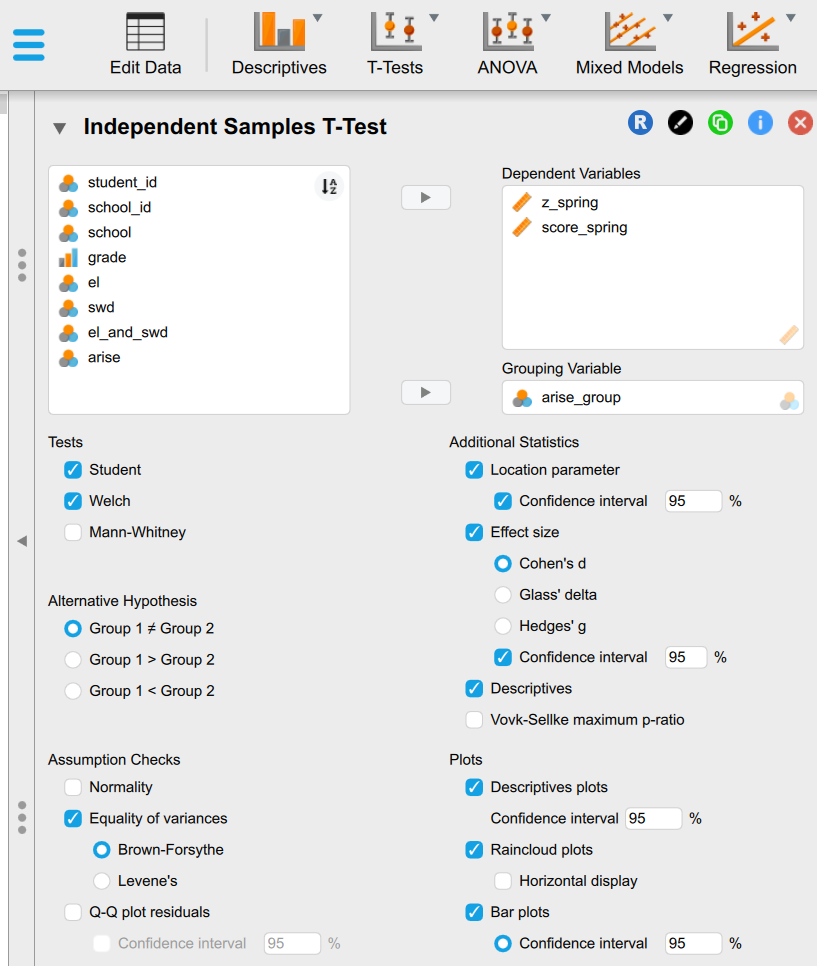
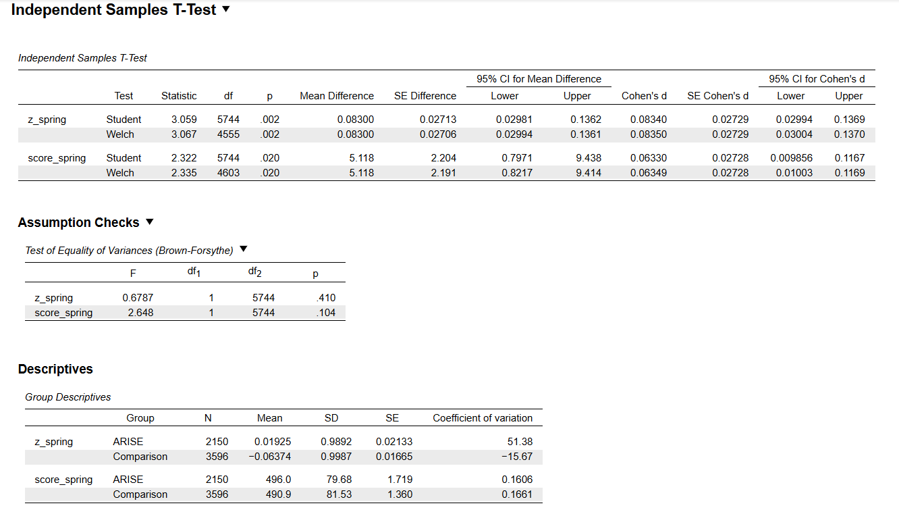

# Module 2: We have an untreated group, but only after the program

**Design:** Posttest-only with a comparison group · **File:** [m02_posttest_only.csv](data/m02_posttest_only.csv) · **JASP analysis:** Independent Samples T-Test

## The problem

Module 1 had no untreated group, so normal growth looked like a program effect. Now you have one: students who did not get the program, measured at the same time. But you have their scores only after the program started.

- **What is missing.** How ARISE students would have scored in spring without ARISE (their Y₀).
- **The trial you wish you had.** The same 13 schools, with a coin flip deciding which ones get ARISE.
- **The stand-in available.** The comparison group's spring scores. Both groups grew over the year, so normal growth cancels out.

The new problem however is that this design only looks at the end. It assumes the two groups would have scored the same without the program. If they started out different, that starting gap shows up as a fake "effect."

## Picture the design: filling in the missing world

Back to the six students. Posttest-only brings in the three comparison students, Dev, Eli and Fay, and looks only at spring scores. It fills each ARISE student's missing Y₀ with the comparison group's average spring score.

**The stand-in:** the comparison group's spring average, 470. "Them" stands in for "us without the program."

| Student | Stand-in for Y₀ (comparison spring average) | Spring score, observed (Y₁) | Posttest-only "effect" | True effect |
| --- | --- | --- | --- | --- |
| Ava | 470 | 486 | +16 | +4 |
| Ben | 470 | 504 | +34 | +6 |
| Cruz | 470 | 525 | +55 | +5 |
| **Average** | **470** | **505** | **+35** | **+5** |

*Posttest-only in the running example. Illustrative numbers, not ARISE data.*

**Reading the picture.** The orange line is the ARISE group and the blue line is the comparison group. Posttest-only looks only at the shaded spring column. It compares 505 with 470 and reports +35. The gray circle at 500 is the missing world, where ARISE students would have landed without the program. The 30 points between 500 and 470 have nothing to do with ARISE. They are the head start ARISE students already had in the fall (480 versus 450), carried into spring. Because posttest-only never sees the fall scores, it counts that head start as program effect. Notice what the comparison group did fix. Both groups grew over the year, so normal growth, the problem in Module 1, no longer inflates the estimate.

**What it can and cannot answer.** Posttest-only answers "Did ARISE students score higher than comparison students in spring?" It cannot answer whether ARISE caused that gap, because it cannot separate the program from differences that were there before the program began.

**Looking ahead.** Module 3 brings the fall scores back and uses them to compare students who started in the same place.

## What must be true to believe it

Posttest-only asks you to believe that the comparison group's spring scores show what ARISE students would have scored without ARISE. In symbols:

$$
E[Y_0 \mid D = 1] = E[Y_0 \mid D = 0]
$$

Read it as: without the program, the average spring score would have been the same in both groups. This is exchangeability in its plainest form (Part 1), and it is the same as saying that the selection-bias term in Part 1 is zero. When schools choose a program or are chosen for it, that is rarely true.

**How you could check it.** Only indirectly, by comparing the groups on things measured before the program, such as fall scores. This file has no pretest, so you cannot check it here. Module 3 brings the fall scores back.

**When the stand-in can be believable.** When something unrelated to the students decided who got the program, such as a coin flip (Module 10). Without random assignment you have to trust that the groups were alike, and this design gives you no way to check, because it has no pretest.

**How the What Works Clearinghouse would judge it.** Because ARISE schools were not randomly assigned, the WWC would treat this as a quasi-experimental design, which can earn at most its middle rating, Meets WWC Standards With Reservations. To get there, a study must show that the groups were similar before the program on a baseline measure. A difference of up to 0.05 SD is acceptable, a difference from 0.05 to 0.25 SD is acceptable only if the analysis adjusts for it, and a larger difference fails (*WWC Handbook, Version 5.0*, Chapter III, Step 4). With no pretest, this design cannot show baseline equivalence at all.

## The design and its model: the independent samples t-test

**The model, in symbols.** A paper using this design might write it as a regression with a single 0/1 predictor:

$$
Y_i = \beta_0 + \beta_1 D_i + \varepsilon_i
$$

| Symbol | What it means | Where it shows up in JASP |
| --- | --- | --- |
| Yᵢ | Student i's spring score (z\_spring) | The Dependent Variable |
| Dᵢ | 1 if student i is in an ARISE school, 0 if not | The Grouping Variable (arise\_group) |
| β₀ | The comparison group's average, because Dᵢ = 0 for them | The comparison group's mean in Group Descriptives |
| β₁ | How much higher the ARISE group's average is | Mean Difference |
| εᵢ | Everything else that makes student i's score differ from their group's average |  |

Plug in Dᵢ = 0 and the equation gives β₀, the comparison average. Plug in Dᵢ = 1 and it gives β₀ + β₁, the ARISE average. So β₁ is simply the difference between the two averages, the same number the t-test reports. Module 3 builds on exactly this equation.

**Which effect does it estimate?** The estimate is the difference in group averages, which Part 1 split into two pieces:

$$
\hat{\beta}_1 = \bar{Y}_{D=1} - \bar{Y}_{D=0}
\;\approx\; \underbrace{E[Y_1 - Y_0 \mid D=1]}_{\text{ATT}}
+ \underbrace{E[Y_0 \mid D=1] - E[Y_0 \mid D=0]}_{\text{selection bias}}
$$

It equals the ATT only when the selection-bias term is zero, which is the assumption above. In the running example, 35 = 5 + 30, and the 30 points are the ARISE students' head start.

The test compares the average outcome in two separate groups of people.

1. Compute the mean score in each group.
2. Take the difference.
3. Divide by the standard error of that difference, which depends on how spread out the scores are and how many people are in each group. The result is t.

"Independent" means the two groups contain different people, unlike Module 1.

**Effect size:** Cohen's d is the difference in means divided by the pooled standard deviation of the two groups. When the outcome is a z-score (as here), the mean difference and d are nearly the same number.

**Behind the scenes: what JASP computes.** With n₁ ARISE students and n₀ comparison students, Student's t-test pools the two groups' spreads into one standard deviation, sₚ, and uses it for both the SE and Cohen's d:

$$
\begin{gathered}
s_p = \sqrt{\frac{(n_1 - 1)s_1^2 + (n_0 - 1)s_0^2}{n_1 + n_0 - 2}}
\qquad\qquad \text{SE} = s_p\sqrt{\frac{1}{n_1} + \frac{1}{n_0}} \\[10pt]
t = \frac{\bar{Y}_{D=1} - \bar{Y}_{D=0}}{\text{SE}}
\qquad\qquad d = \frac{\bar{Y}_{D=1} - \bar{Y}_{D=0}}{s_p}
\end{gathered}
$$

The pooled SD, sₚ, is a weighted average of the two groups' spreads, so the bigger group counts more. Welch's version skips the pooling and uses √(s₁²/n₁ + s₀²/n₀) as the SE. You can check JASP by hand for z\_spring. The averages are 0.019 (ARISE) and −0.064 (comparison), a difference of 0.083. The pooled SD is about 0.995, so the SE is 0.995 × √(1/2,150 + 1/3,596) ≈ 0.027, and t is about 0.083 ÷ 0.027 ≈ 3.1. Because z-scores have an SD near 1, d (0.083) is almost the same as the difference.

**Why clustering shrinks your evidence.** These formulas treat all 5,746 students as independent. When students come in schools, the honest SE is larger by a factor called the design effect:

$$
\text{DEFF} = 1 + (m - 1)\rho \qquad\qquad \text{honest SE} \approx \text{SE} \times \sqrt{\text{DEFF}}
$$

Here m is the average number of students per school (about 442), and ρ (rho, the intraclass correlation) is the share of the variation in scores that lies between schools rather than within them. Even if ρ is only 0.01, the design effect is 1 + 441 × 0.01 ≈ 5.4. The honest SE is then about 2.3 times larger, and the t of 3.1 shrinks to about 1.3. That is why the Assumptions section warns that this p-value is too small.

## Example scenarios

**Scenario A: An after-school tutoring program.** In May, students who attended tutoring scored 8 points higher on the state test than students who did not. *Question answered:* Did tutored students score higher in May? *Not answered:* Were they already higher in September? Parents who sign their children up for tutoring may also read with them at home.

**Scenario B: A new math curriculum.** One middle school adopts a new curriculum and a nearby school does not. At year's end, the new-curriculum school has a higher pass rate. *Question answered:* Did the two schools differ at the end of the year? *Not answered:* Did they differ last year, before the curriculum?

## Your question in this module

*In spring 2025, did students in ARISE schools have higher i-Ready reading scores than students in the comparison schools?*

## Get to know the data

Same four questions as Module 1: what is a row, what is missing, what are typical values, and what shape is the data? Now there are two groups, so look at each one.

**Data dictionary.** The variables you will use in this module.

| Variable | Definition | Data type |
| --- | --- | --- |
| z\_spring | Spring 2025 reading score as a z-score: standard deviations above or below the 2022-23 average for the student's grade. This is the outcome. | Continuous (Scale) |
| score\_spring | Spring 2025 i-Ready reading scale score (about 200 to 750) | Continuous (Scale) |
| arise\_group | The group the student's school belongs to: "ARISE" or "Comparison" | Category, text (Nominal) |

1. Open **m02\_posttest\_only.csv**. Each row is one student.
2. Click **Descriptives**. Move **z\_spring** and **score\_spring** into **Variables** and **arise\_group** into **Split**.
3. Check that **Valid, Missing, Mean, Std. deviation, Minimum** and **Maximum** are ticked. Under **Plots**, tick **Distribution plots**.

**What to look for:** About 2,150 ARISE and 3,596 comparison students; the comparison group is bigger, which is fine. Compare the two groups' means, but also their **SDs**: if one group is much more spread out, that matters for choosing Student or Welch later. Compare the two distribution plots: do they have the same shape, just shifted?

## Step by step in JASP

**Where the variables go, and why.**

| Variable | JASP box | Role and why |
| --- | --- | --- |
| z\_spring | Dependent Variables | The outcome. It is what ARISE is meant to change, measured after the program began. The z-score keeps differences in grade mix from distorting the comparison. |
| score\_spring | Dependent Variables (optional) | The same outcome in raw scale points, to see how the grade mix affects a raw comparison |
| arise\_group | Grouping Variable | The treatment, the independent variable. It sorts students into the two groups being compared, so it must be Nominal with exactly two groups. |

1. Open **m02\_posttest\_only.csv**.
2. Check that **z\_spring** and **score\_spring** are **Scale** and **arise\_group** is **Nominal**.
3. Click **T-Tests**, then **Independent Samples T-Test**.
4. Move **z\_spring** into **Dependent Variables**. (Add **score\_spring** too, to compare.)
5. Move **arise\_group** into **Grouping Variable**.
6. Under **Tests**, keep **Student** and also tick **Welch**.
7. Under **Additional Statistics**, tick **Location parameter** and its **Confidence interval**, **Effect size** and its **Confidence interval**, and **Descriptives**.
8. Under **Assumption Checks**, tick **Equality of variances**. Leave **Normality** unticked: the Shapiro-Wilk test only works with up to 5,000 students, and this file has more, so JASP stops with an error. You do not need it here. With samples this large, the t-test is not affected by non-normal data (see Module 1).
9. Under **Plots**, tick **Descriptives plots**.

Figure 6.** **Independent Samples T-Test input panel with z\_spring and arise\_group

## Checkpoints

- **N = 2,150** in the ARISE group and **N = 3,596** in the Comparison group.
- **df = 5,744** for the Student test (total N minus 2).

## Reading the output

Figure 7. Independent Samples T-Test output

**Group Descriptives table.** The mean and SD of the outcome in each group. Compare the two means first.

**Independent Samples T-Test table.** One row per outcome, one line for Student and one for Welch.

| Column | What it tells you |
| --- | --- |
| t, df, p | The test of whether the group difference could be chance |
| Mean Difference | First group's mean minus the second's. **Your estimate.** JASP's group order decides the sign, so a negative number may just mean Comparison minus ARISE. Check against the Descriptives table. |
| 95% CI | Plausible range for the true difference |
| Cohen's d | Effect size in SD units |

**Student vs. Welch.** Student's t-test assumes the two groups have similar spread; Welch's does not. If they give similar answers, it doesn't matter which you report. If Levene's test (in the Assumption Checks table) is significant, prefer Welch.

**z\_spring vs. score\_spring.** Compare the two rows. The z-score version accounts for grade, so it is the fairer comparison if the two groups have a different mix of grades.

**Reading the plot.** The Descriptives plot shows one dot per group: the dot is the group's mean, and the bars above and below it are the 95% confidence interval. The vertical gap between the two dots is the mean difference from the table. Two cautions. First, check the vertical axis: JASP zooms in on the range of the data, so a small difference can look large. Second, overlapping bars do not automatically mean the difference is not significant; use the p-value and CI in the table for that. The plot is for seeing the direction and rough size of the difference.

## Explaining it to stakeholders

Your estimate is the spring gap between ARISE and comparison students in SD units. Translate it into i-Ready points, share of a year's growth or percentiles with the tables in Part 2 (Translating z-score results into real-world terms). Do not use the score\_spring version for this, because raw points mix the grades.

**A sample sentence.** "In spring 2025, students in ARISE schools scored about \_\_\_ i-Ready points (\_\_\_ SD) higher than students in comparison schools."

**What to add.** Most listeners hear "higher" as "caused by the program." This design cannot separate ARISE from differences between the schools that were there before the program started, so say so plainly: "This comparison alone can't tell us whether ARISE caused the gap."

## Assumptions

- Two separate groups, with no student in both.
- **Independent observations.** Strongly violated here: students are clustered in 13 schools, and ARISE was given to whole schools. The p-value treats you as having 5,746 independent pieces of information about ARISE, when really you have 4 ARISE schools and 9 comparison schools. *Treat this p-value as too small.* To give you an idea of how much this matters, if even 1% of the variation in scores lies between schools, the honest standard error is more than twice as large, and a p-value of .002 becomes roughly .18. Clustering should match the level where the program was assigned. ARISE went to whole schools, so the school, not the classroom, is the right cluster. The t-test cannot fix this; the honest fix is a **multilevel model** (a linear mixed model with school as a random effect), which Module 6 walks through. Even then, with only 4 ARISE schools, expect a wide confidence interval.
- **Roughly normal outcomes or large groups.** Fine at this sample size.
- **Similar variances** (Student only). Check Levene's test, or use Welch.

## Threats to internal validity

- **Selection.** The main threat. ARISE schools chose to join. Were their students already stronger readers? This design cannot tell you, because it only looks at spring.
- **Diffusion through early preparation.** The comparison schools knew they would start ARISE the next year (Part 2). Any early start makes the two groups more alike and pushes the estimate toward zero.
- **History (differential).** Something else may have happened in ARISE schools but not comparison schools in 2024-25, such as a new principal.
- **Clustering**, which affects how confident you can be in the result rather than the estimate itself.

## Bring to your instructor

1. Report the mean difference in z\_spring, its 95% CI, p-value and Cohen's d. Where does it fall on Kraft's benchmarks?
2. How does this compare with Module 1's estimate? Why is it so much smaller?
3. What one piece of information would most help you decide whether this difference was caused by ARISE?
4. You have 5,746 students but only 13 schools. Which number better describes how much evidence you have about a school-level program? Why?
5. **Back to the two worlds.** In the running example, what did posttest-only put in place of Cruz's missing Y₀? Write his stand-in, his posttest-only "effect" and his true effect, and explain in your own words why the two effects differ.
6. Suppose ARISE had no effect at all, so every student's Y₁ equals their Y₀. What would posttest-only report for the three ARISE students in the running example? Where does that number come from?
7. In the running example, pre-post and posttest-only each counted something as program effect that was not. What did each one count, and why did adding a comparison group fix one problem but not the other?
8. Under what conditions would a comparison group's spring average be a believable stand-in for what ARISE students would have scored without the program? Do you think those conditions held for ARISE? Why or why not?

## Learn more

- *The Effect*, **Chapter 6, Causal Diagrams,** and **Chapter 8, Causal Paths and Closing Back Doors:** how a third factor, such as which schools volunteer, can create a difference between groups that the program did not cause.
- *Causal Inference: The Mixtape* (Cunningham), Chapter 4, Potential Outcomes Causal Model: the same split of a simple comparison into the effect and selection bias.
- *Mastering 'Metrics* (Angrist and Pischke), Chapter 1, Randomized Trials: the opening sections show how comparing people who chose differently mixes the effect with selection bias.
- *Experimental and Quasi-Experimental Designs* (Shadish, Cook and Campbell), Chapter 4: the posttest-only design with nonequivalent groups.
- *WWC Handbook, Version 5.0*, Chapter III, Step 4, Baseline equivalence standard: how the WWC decides whether two groups started out similar enough.
- **Chapter 10, Treatment Effects:** what exactly a comparison of program and non-program groups estimates.

