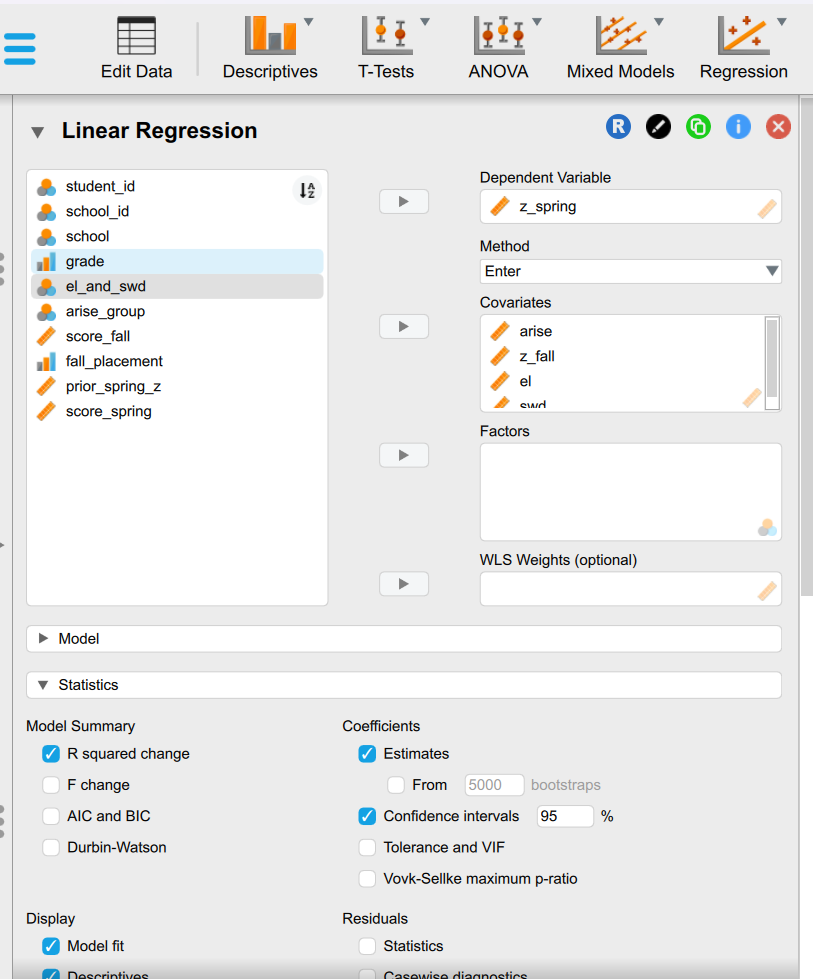
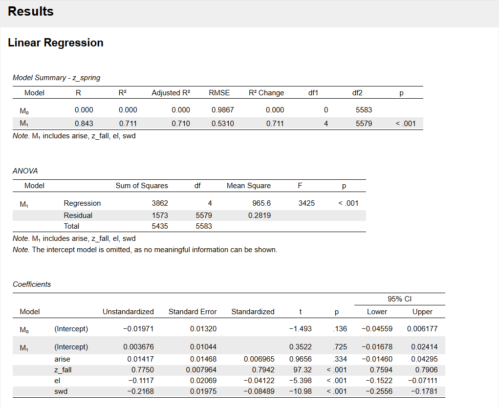

# Module 3: The groups differ, and we measured how

**Design:** Regression-adjusted comparison · **File:** [m03_regression_adjusted.csv](data/m03_regression_adjusted.csv) · **JASP analysis:** Linear Regression

## The problem

You have an untreated group, and you know where students started: their fall scores and some background. The groups differ on those things, so a simple comparison of spring scores is not fair.

- **What is missing.** How ARISE students would have scored in spring without ARISE (their Y₀).
- **The trial you wish you had.** A coin flip among schools, which would make the groups alike on everything, measured or not.
- **The stand-in available.** Comparison students who started in the same place on what you measured, compared through a regression model.

Module 2's weakness was that the groups might have started out different. If we know where each student **started** (their fall score) and some background (English learner status, disability status), we can compare ARISE and comparison students who started in the same place. Regression does this "apples to apples" comparison for us. It is called **controlling for**, **adjusting for**, or **holding constant** those variables.

The catch is that a regression can only adjust for what you measured. If ARISE schools differ in something not in the data (teacher quality, principal leadership), regression cannot fix it.

## Picture the design: filling in the missing world

Back to the six students. Regression uses the comparison students, Dev, Eli and Fay, to learn how spring scores depend on fall scores when there is no ARISE. It fits a line through their scores and then reads that line at each ARISE student's fall score. The point on the line is the stand-in for that student's missing Y₀.

**The stand-in:** what a comparison student who started at the same fall score would be expected to score in spring.

| Student | Fall score | Stand-in for Y₀ (comparison line) | Spring score, observed (Y₁) | Regression "effect" | True effect |
| --- | --- | --- | --- | --- | --- |
| Ava | 460 | 479.8 | 486 | +6.3 | +4 |
| Ben | 480 | 499.3 | 504 | +4.8 | +6 |
| Cruz | 500 | 518.8 | 525 | +6.3 | +5 |
| **Average** | **480** | **499.3** | **505** | **+5.8** | **+5** |

*Regression in the running example. Illustrative numbers, not ARISE data.*

**Reading the picture.** Each dot is a student. The purple dashed line is fitted through the blue comparison students, and it shows how spring scores rise with fall scores when there is no program. For each ARISE student, regression reads the line at that student's fall score and uses that point as the stand-in. The vertical gap between the orange dot and the line is that student's estimated effect. The gray circles are the true Y₀, and they sit very close to the line. That is why this stand-in works so much better than Module 2's. Ava is no longer compared with the comparison group's average. She is compared with what a comparison student who started at 460 would be expected to score. The head start disappears, and the estimate, about +6, lands close to the true +5. The small miss comes from fitting a line to only three students.

**What it can and cannot answer.** Regression answers "How did ARISE students do compared with comparison students who started in the same place?" It cannot rule out differences between the groups that were never measured.

**Looking ahead.** Module 4 drops the line and compares each ARISE student directly with a comparison student who matches exactly.

## What must be true to believe it

Regression asks you to believe that, once students are compared at the same fall score, English learner status and disability status, the comparison students show what ARISE students would have scored without ARISE. In symbols, with X standing for those measured characteristics:

$$
E[Y_0 \mid D = 1, X] = E[Y_0 \mid D = 0, X]
$$

Read it as: among students with the same X, the average spring score without the program would have been the same in both groups. This is conditional exchangeability (Part 1), exchangeability that holds only after accounting for X. It is often called no unmeasured confounding. Regression adds two more requirements. The straight-line model has to describe the relationship well for both groups, and there must be comparison students with X values like the ARISE students' (positivity).

**How you could check it.** You can check part of it. The SMD check shows how different the groups were on what you measured, and the residual plots show whether a straight line fits. You cannot check the most important part, that nothing unmeasured differs between the groups, because by definition it is not in the data.

**When the stand-in can be believable.** When the variables you measured explain why students ended up in the program. For example, if schools joined ARISE only because of low fall scores, adjusting for fall scores would cover the difference. It is harder to believe when something you did not measure, such as a motivated principal or experienced teachers, drew schools into ARISE.

**How the What Works Clearinghouse would judge it.** The WWC treats a regression-adjusted comparison of nonrandom groups as a quasi-experimental design, which can earn at most Meets WWC Standards With Reservations. The groups must meet the baseline equivalence standard on a pretest. A difference between 0.05 and 0.25 SD is acceptable only when the analysis adjusts for that pretest, which is what this regression does (*WWC Handbook, Version 5.0*, Chapter III, Step 4).

## The design and its model: how regression works

**One predictor.** Picture a scatter plot of fall scores (horizontal) and spring scores (vertical). Regression draws the **straight line that best fits the points**, the line that makes the vertical distances from points to the line as small as possible overall. The line is described by two numbers:

$$
\text{predicted spring} = b_0 + b_1 \times \text{fall}
$$

- **b0, the intercept:** the predicted spring score when fall = 0.
- **b1, the slope (coefficient):** how much predicted spring changes when fall goes up by 1. If b1 = 0.8, a student 1 SD higher in the fall is predicted to be 0.8 SD higher in the spring.

**A yes/no predictor.** If the predictor is arise (1 = ARISE, 0 = comparison), the coefficient is simply the difference in average outcome between the two groups, the same number the t-test in Module 2 gave you.

**Several predictors.** Put arise **and** z\_fall **and** el **and** swd in the same model. Now the coefficient on arise means the difference between ARISE and comparison students who had the same fall score, EL status and SWD status. Each coefficient is the effect of that variable with the others held constant.

$$
\text{predicted z\_spring} = b_0 + b_1 \times \text{arise} + b_2 \times \text{z\_fall} + b_3 \times \text{el} + b_4 \times \text{swd}
$$

**R-squared (R²)** is the share of the variation in the outcome the model explains, from 0 to 1. A high R² means good prediction; it does not mean the arise coefficient is causal.

**A worked example.** Suppose a regression of teacher salary on a "has a master's degree" indicator gives a coefficient of 6,000, meaning teachers with a master's earn $6,000 more on average. Add years of experience to the model and the master's coefficient drops to 2,500. Why? Teachers with master's degrees also tend to have more experience. Once you compare teachers with the same experience, the master's gap is smaller. Watch for exactly this kind of change in the arise coefficient.

**The model, in symbols.** A research article would write the Run 2 model like this:

$$
Y_i = \beta_0 + \beta_1 D_i + \beta_2\,\text{Fall}_i + \beta_3\,\text{EL}_i + \beta_4\,\text{SWD}_i + \varepsilon_i
$$

| Symbol | What it means | Where it shows up in JASP |
| --- | --- | --- |
| Yᵢ | Student i's spring z-score | Dependent Variable (z\_spring) |
| Dᵢ | 1 if student i is in an ARISE school, 0 if not | arise, in Covariates |
| Fallᵢ, ELᵢ, SWDᵢ | The control variables, together called X | z\_fall, el and swd, in Covariates |
| β₀ | The predicted score for a comparison student with every control equal to 0 | (Intercept) row |
| β₁ | The difference between ARISE and comparison students with the same values of X | arise row, Unstandardized column |
| β₂ to β₄ | How the predicted score changes with each control, holding the others fixed | z\_fall, el and swd rows |
| εᵢ | Everything about student i's score that the model does not explain | The residual plots |

Articles write β for the true coefficient and β̂ or b for the estimate from the data. JASP reports the estimate in its Unstandardized column, and earlier in this module it is written as b.

**Which effect does it estimate?** Regression compares students with the same X, so the selection-bias term from Part 1 is now computed among students with the same X:

$$
\hat{\beta}_1 \;\approx\; \underbrace{E[Y_1 - Y_0 \mid D=1]}_{\text{ATT}}
\;+\; \underbrace{E[Y_0 \mid D=1, X] - E[Y_0 \mid D=0, X]}_{\text{selection bias left after adjusting for } X}
$$

If conditional exchangeability holds, the last term is zero and β̂₁ estimates the effect of ARISE. One caution: if the effect differs from student to student, β̂₁ is a weighted average of those effects that need not equal the ATT exactly, because regression gives more weight to kinds of students who are well represented in both groups (*Mastering 'Metrics*, Chapter 2). In the running example, the comparison line gave about +5.8 against a true +5, a small miss that came from fitting a line to three students rather than from selection bias.

**Behind the scenes: what JASP computes.** Regression chooses its coefficients by least squares, and R² compares the model's misses with the total spread in the outcome:

$$
\begin{gathered}
\text{Least squares chooses } b_0, \dots, b_4 \text{ to make } \sum_{i=1}^{n}\bigl(Y_i - \hat{Y}_i\bigr)^2 \text{ as small as possible} \\[10pt]
R^2 = 1 - \frac{\sum (Y_i - \hat{Y}_i)^2}{\sum (Y_i - \bar{Y})^2}
\end{gathered}
$$

Ŷᵢ is the model's predicted score for student i, so Yᵢ − Ŷᵢ is the residual, the model's miss. Least squares squares every miss, adds them up and finds the coefficients that make that total as small as possible. R² is 1 minus the share of the spread the model misses. For each coefficient, JASP then computes a standard error and t = b ÷ SE, read exactly as in Part 1.

## Example scenarios

**Scenario A: Summer reading camp.** Campers score higher in fall than non-campers, but campers also had higher spring scores before camp. Regression of fall scores on camp attendance, controlling for prior spring score, asks: *Among students with the same spring score, did campers score higher in the fall?*

**Scenario B: Small class sizes.** Students in small classes score higher, but small classes are more common in wealthier schools. Controlling for school poverty asks: *Among schools with the same poverty level, do students in smaller classes score higher?* It cannot account for anything you didn't measure, such as parent involvement.

## Your question in this module

*Among students with the same fall score, EL status and disability status, did ARISE students score higher in spring 2025 than comparison students?*

## Get to know the data

**Data dictionary.** The variables you will use in this module.

| Variable | Definition | Data type |
| --- | --- | --- |
| z\_spring | Spring 2025 reading z-score (see Module 2). This is the outcome. | Continuous (Scale) |
| arise | 1 = the student attends an ARISE school, 0 = a comparison school. It is the number version of arise\_group. | Binary 0/1 (Scale) |
| arise\_group | "ARISE" or "Comparison" | Category, text (Nominal) |
| z\_fall | Fall 2024 reading z-score, measured at the start of the ARISE year | Continuous (Scale) |
| el | 1 = English learner, 0 = not an English learner | Binary 0/1 (Scale) |
| swd | 1 = student with a disability (receives special education services), 0 = not | Binary 0/1 (Scale) |

1. Open **m03\_regression\_adjusted.csv**. Each row is one student.
2. Click **Descriptives**. Move **z\_fall, el, swd** and **z\_spring** into **Variables** and **arise\_group** into **Split**.
3. Under **Plots**, tick **Distribution plots**.

**What to look for:** This file has 5,584 students, fewer than Module 2's 5,746, because students without a fall score are left out. **el** and **swd** are coded 1 = yes, 0 = no, so their **mean is the share** of students in that category (a mean of 0.25 means 25%). Now the key question: *Did the two groups start in the same place?* If ARISE students had higher fall scores, or fewer English learners, a raw spring difference would be partly about who was in each group. That is exactly what this module's regression adjusts for.

**Measuring the starting gap: the standardized mean difference (SMD).** To judge whether two groups started in the same place, researchers use the **SMD**: the difference between the two group means, divided by the standard deviation. It is in SD units, so you can compare it across variables, and unlike a p-value it does not grow with sample size. With 5,000 students, a trivial gap can be "significant," but its SMD stays small.

To get it in JASP, click **T-Tests**, then **Independent Samples T-Test**. Put **z\_fall, el** and **swd** in **Dependent Variables** and **arise\_group** in **Grouping Variable**, and tick **Effect size**. The **Cohen's d** column is the SMD for each variable. Ignore the p-values here.

| SMD (ignore the sign) | What it means |
| --- | --- |
| 0.05 or less | The groups are equivalent on this variable |
| 0.05 to 0.25 | A real gap; the analysis must adjust for this variable |
| More than 0.25 | Too different to compare credibly, even with adjustment |

These cutoffs come from the **What Works Clearinghouse (WWC)**, which reviews education research. Matching studies often use a simpler rule: an SMD below 0.1 means good balance. (For yes/no variables like el and swd, the WWC uses a slightly different formula, but Cohen's d is close enough for this course.) You will use SMDs again in Modules 4, 5 and 10 to check whether matching or random assignment produced groups that started in the same place.

## Step by step in JASP

**Where the variables go, and why.**

| Variable | JASP box | Role and why |
| --- | --- | --- |
| z\_spring | Dependent Variable | The outcome, as in Module 2 |
| arise | Covariates | The treatment, the independent variable of interest. JASP's regression puts every numeric predictor in Covariates, including the treatment. Because arise is coded 0/1 and set to Scale, its coefficient is the difference between ARISE and comparison students. |
| z\_fall, el, swd | Covariates | Control variables. They were measured before ARISE could change them, and they are related to spring scores. Adjusting for them compares students who started in the same place. |

In the SMD check under Get to know the data, z\_fall, el and swd go in Dependent Variables instead, and arise\_group goes in Grouping Variable. There the question is whether the groups differ on each characteristic, so the characteristic is what is being compared.

**Run 1: no adjustment**

1. Open **m03\_regression\_adjusted.csv**.
2. Set **z\_spring, arise, z\_fall, el, swd** all to **Scale**.
3. Click **Regression**, then **Linear Regression** (under Classical).
4. Move **z\_spring** into **Dependent Variable** and **arise** into **Covariates**.
5. Open **Statistics** and tick **Estimates**, **Confidence intervals**, **Model fit** and **Descriptives**.
6. Note the arise coefficient. It should equal the z\_spring mean difference you would get from a t-test on this file.

**Run 2: adjusted**

7. Add **z\_fall, el** and **swd** to the **Covariates** box (keep arise).
8. Open **Plots** and tick **Residuals vs. predicted** and **Q-Q plot standardized residuals**.
9. Optional: under **Statistics**, tick **Collinearity diagnostics**.

Figure 7. Linear Regression input panel with z\_spring as dependent and four covariates

## Checkpoints

- **N = 5,584** students (check the Descriptives table, or the ANOVA table: Total df = 5,583).
- In Run 2, the ANOVA table's **Regression df = 4** (four predictors).

## Reading the output

Figure 8. Model Summary, ANOVA and Coefficients tables

JASP shows two models: **M₀** (the "null" model with no predictors) and **M₁** (your model). Read the **M₁** rows.

**Model Summary.** R² for M₁: how much of the spread in spring scores the model explains. Expect it to jump between Run 1 and Run 2, because fall scores predict spring scores very well.

**ANOVA table.** Tests whether the model as a whole predicts better than nothing. With a fall score in the model, this will almost always be significant; it says nothing about ARISE.

**Coefficients table.** The heart of the output.

| Column | What it tells you |
| --- | --- |
| Unstandardized | The coefficient (b). For arise, the adjusted ARISE vs. comparison difference in z\_spring. **Your estimate.** |
| Standard Error | Its precision |
| Standardized | The coefficient if all variables were in SD units. For a 0/1 variable like arise, use Unstandardized instead |
| t, p | Test of whether this coefficient is different from 0 |
| 95% CI | Plausible range for the coefficient |

Because z\_spring is already in SD units, the arise coefficient **is** an effect size in SD. Compare it with Kraft's benchmarks.

**How to read the arise row: a five-step scan.** Don't chase every number. Read the row of the variable you care about in this order, then write one sentence.

| Step | Where to look | What it tells you | Run 2 example (arise) |
| --- | --- | --- | --- |
| 1. Sign | Is the Unstandardized value positive or negative? | The direction: are ARISE students higher or lower? | **Positive.** ARISE students scored slightly higher. |
| 2. b | Unstandardized | The size, in the outcome's units, holding the other variables constant. Here the outcome is a z-score, so b is in SD units. | **0.014.** About one-hundredth of an SD higher than similar comparison students. |
| 3. p and CI | p, and the 95% CI Lower and Upper | Could this be chance? If the CI includes 0, you cannot rule out "no difference." | **p = .334; CI −0.015 to 0.043.** The CI includes 0, so this is not statistically significant. |
| 4. β | Standardized | Compares predictors with each other on one scale. Use it to see which matter most, not to report arise's effect. | **0.007,** tiny next to z\_fall (0.794), swd (−0.085) and el (−0.041). Where students started matters far more. |
| 5. R² | Model Summary, M₁ row | How much of the spread in spring scores the whole model explains. | 0.711. The model explains about 71% of the spread in spring scores, up from 0.2% in Run 1, almost entirely because of z\_fall. |

**One sentence:** After controlling for fall scores, English learner status and disability status, ARISE students scored about 0.01 SD higher than comparison students, a difference too small to distinguish from chance (b = 0.014, 95% CI \[−0.015, 0.043\], p = .334).

Use the same scan on any regression row in later modules: sign, b, p and CI, β, R², then one sentence.

**Compare Run 1 and Run 2.** What happened to the arise coefficient? A big drop means the raw difference in Module 2 was mostly about where students started, not ARISE. For example, in Run 1 (arise alone, no adjustment) the ARISE difference was 0.079 SD (p = .004). After adjusting for fall scores, English learner status and disability status, it fell to 0.014 SD, which is not statistically significant. About 80% of the raw gap reflected where students started, not ARISE. **The lesson:** a difference can be "significant" simply because the groups were different to begin with. Always ask whether you are comparing students who started in the same place.

**Reading the plot.** A **residual** is a student's actual spring score minus the score the model predicted, so it is the model's miss for that student. In the **residuals vs. predicted** plot, each dot is one student, where the horizontal axis is the predicted score and the vertical axis is the miss. Dots above the zero line scored higher than predicted; dots below scored lower. In the **Q-Q plot**, each dot compares a residual's actual position with where it would fall if the residuals were perfectly bell-shaped. If they are, the dots follow the diagonal line. Dots bending away at the ends mean more extreme misses than a bell curve would have.

**Residual plots.** In the residuals vs. predicted plot, you want a shapeless cloud around zero. In the Q-Q plot, points close to the diagonal line. Mild departures are fine with this many students.

## Explaining it to stakeholders

Translate the arise coefficient from Run 2 into i-Ready points, share of a year's growth or percentiles with the tables in Part 2 (Translating z-score results into real-world terms).

**A sample sentence.** "Compared with students who started the year at the same reading level, with the same English learner and disability status, students in ARISE schools scored about \_\_\_ i-Ready points (\_\_\_ SD) higher in spring."

**What to add.** The comparison accounts only for what was measured. Name what was not: "Differences between the schools that we couldn't measure, such as teacher experience or leadership, could still explain part of this gap."

## Assumptions

Statistical assumptions:

- **Linearity.** Each predictor's relationship with the outcome is roughly a straight line.
- **Independent observations.** Again violated by school clustering, so treat the p-value as too small.
- **Constant spread of residuals** across predicted values.
- **Roughly normal residuals.** Matters little at this sample size.

The causal assumption, which matters most:

- **No unmeasured confounders.** After controlling for z\_fall, el and swd, nothing else that affects spring scores differs between ARISE and comparison students. This cannot be tested with the data.
- **Controls measured before the program.** A control affected by the program can hide part of its effect.

## Threats to internal validity

- **Selection on unmeasured variables.** The biggest threat. Regression adjusts only for what is in the model.
- **Missing fall scores.** The 162 students in Module 2's file who have no fall score are left out here. If they differ from other students, and especially if more are missing in one group, the result may not describe all students.
- **A post-program "baseline."** If ARISE raised fall scores, adjusting for them removes part of the ARISE effect.
- **History.** Still not addressed.
- **Clustering.** Affects confidence, not the estimate.

## Bring to your instructor

1. Report the arise coefficient, CI and p-value from both runs. How much did it change?
2. Look at the z\_fall coefficient. What does it say about how strongly fall predicts spring?
3. Name a variable **not** in this data that could differ between ARISE and comparison schools and affect reading.
4. Do you trust Run 2 more than Module 2? Why, and how much?
5. **Back to the two worlds.** In the running example, what did regression put in place of Ava's missing Y₀? Compare it with her true Y₀ of 482, and explain why this stand-in is so much closer than the one posttest-only used in Module 2.
6. Suppose ARISE had no effect at all, so every student's Y₁ equals their Y₀. Roughly what would regression report in the running example? Why would the answer be close to zero but not exactly zero?
7. Suppose ARISE schools also had more experienced teachers, and that this added 3 points to every ARISE student's spring score. Teacher experience is not in the data. What would regression report in the running example, and why can't adjusting for fall scores fix this?
8. In your own words, what does controlling for fall scores do to the stand-in? Sketch the Picture the design figure for your Run 2 results, with the comparison line and where the ARISE students fall relative to it.

## Learn more

- *The Effect*, **Chapter 4, Describing Relationships:** line-fitting and what "controlling for" a variable does.
- *The Effect*, **Chapter 13, Regression:** reading regression tables, controls, and the assumptions of regression.
- *Mastering 'Metrics* (Angrist and Pischke), Chapter 2, Regression: regression as an automatic way of comparing like with like, and how adding a control can shrink a gap.
- *Causal Inference: The Mixtape* (Cunningham), Chapter 2, Probability and Regression Review: the mechanics of least squares and what "holding constant" means.
- *What If* (Hernán and Robins), Chapter 15, section 15.1, Outcome regression: using a model of the outcome to adjust for measured confounders.
- *Methods Matter* (Murnane and Willett), Chapter 12: the limits of adjusting for measured differences with nonexperimental education data.

