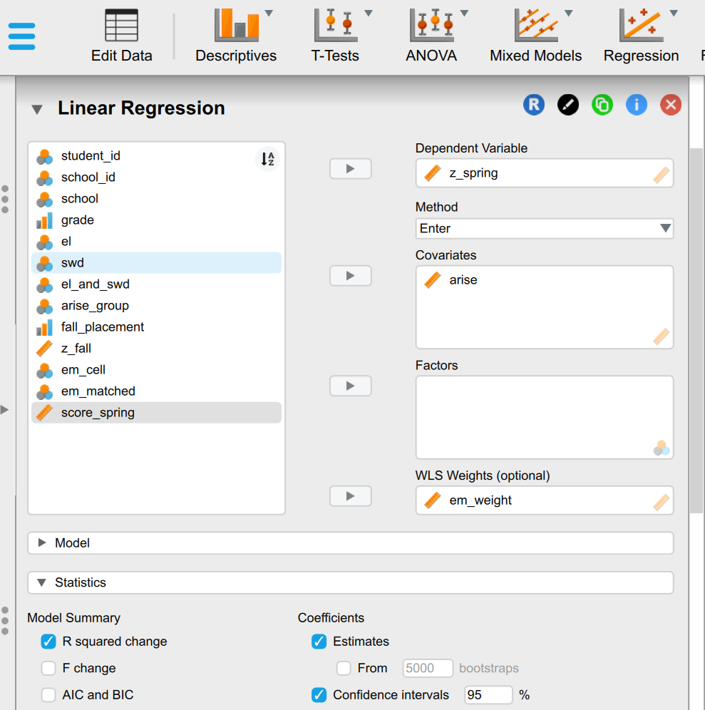
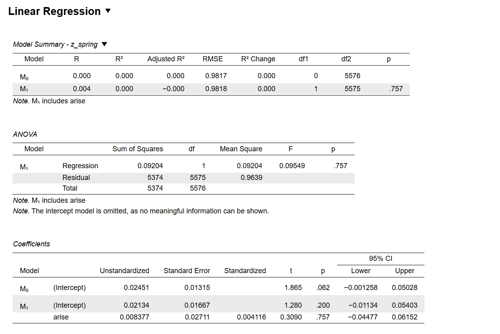

# Module 4: The groups differ on a few things we can match exactly

**Design:** Exact matching · **File:** m04\_exact\_matching.csv · **JASP analysis:** Linear Regression with weights (after a filter)

## The problem

You have an untreated group, and the groups differ on a handful of measured characteristics: grade, English learner status, disability status and fall placement. Each has only a few possible values, so you can look for comparison students who match an ARISE student exactly.

- **What is missing.** How ARISE students would have scored in spring without ARISE (their Y₀).
- **The trial you wish you had.** A coin flip among schools, which would make the groups alike on everything, measured or not.
- **The stand-in available.** Comparison students in exactly the same cell, reweighted so that their mix of cells matches the ARISE group's.

Regression adjusts for differences by fitting a line. Matching takes a more direct route. For every ARISE student, find comparison students who look exactly the same on the things you measured, and compare only those look-alikes.

Here, "exactly the same" means the same **grade**, **EL status**, **disability status** and **fall placement** (at grade level, 1, 2, or 3+ grade levels below). Each unique combination is a cell, such as "2nd grade, EL, no disability, 1 grade level below." ARISE and comparison students are compared within cells only.

Two things happen along the way:

- **Students with no match are dropped.** If a cell has ARISE students but no comparison students (or the reverse), nobody in it can be compared, so the cell is left out. This keeps you from comparing students who are not alike.
- **Comparison students are reweighted.** If a cell holds 30 ARISE students and only 10 comparison students, each of those comparison students counts more, so the comparison group ends up with the same mix of cells as the ARISE group.

The result answers: *How did ARISE students do compared with comparison students just like them? *This is called the **average treatment effect on the treated (ATT)**.

## Picture the design: filling in the missing world

Exact matching needs more comparison students to choose from, so add three to the running example. Gia started at 460 and scored 481 in spring, Hal started at 480 and scored 499, and Ivy started at 505 and scored 523. To keep the picture simple, students are matched on fall score only. In the module, the cells also use grade, EL status and disability status.

**The stand-in:** the spring score of a comparison student with exactly the same fall score, an identical twin on what we measured.

| ARISE student | Fall score | Matched comparison student | Stand-in for Y₀ (twin's spring score) | Spring score, observed (Y₁) | Matched "effect" | True effect |
| --- | --- | --- | --- | --- | --- | --- |
| Ava | 460 | Gia (460) | 481 | 486 | +5 | +4 |
| Ben | 480 | Hal (480) | 499 | 504 | +5 | +6 |
| Cruz | 500 | none | none | 525 | dropped | +5 |
| **Average (matched students)** | **470** |  | **490** | **495** | **+5** | **+5** |

*Exact matching in the running example. Illustrative numbers, not ARISE data.*

**Reading the picture.** The two rows place students by fall score, and the purple lines join twins. Ava and Ben each have a comparison student with exactly the same fall score, so the twin's spring score stands in for their missing Y₀. Gia's 481 is very close to Ava's true Y₀ of 482, and Hal's 499 is very close to Ben's 498. The estimate for the matched students is +5, the same as their true effect. Cruz has no one at 500, so he is dropped, and the comparison students without a twin (Dev, Eli, Fay and Ivy) are not used. The answer now describes Ava and Ben only. This is the average treatment effect on the treated (ATT) for the matched students, not for every ARISE student.

**What it can and cannot answer.** Exact matching answers "How did matched ARISE students do compared with comparison students exactly like them?" It cannot speak for students who were dropped, such as Cruz, and it cannot rule out differences that were not measured.

**Looking ahead.** With only one matching variable, twins are easy to find. With many variables, most cells go empty. Module 5 solves this by matching on a single number.

## What must be true to believe it

Exact matching asks you to believe that, within each cell, the comparison students show what ARISE students would have scored without ARISE. It also needs both groups to be present in every cell you use. In symbols:

$$
\begin{gathered}
E[Y_0 \mid D = 1, \text{cell}] = E[Y_0 \mid D = 0, \text{cell}] \\[6pt]
0 < P(D = 1 \mid \text{cell}) < 1
\end{gathered}
$$

The first line is conditional exchangeability within cells, the same assumption as Module 3 but without a straight-line model. The second line is positivity: in every cell you use, the chance of being in ARISE is above 0 and below 1, so both groups are present. Cells that break positivity are the ones that get dropped.

**How you could check it.** You can check positivity directly, because the em\_matched count shows how many students had no match. You can also check balance after weighting, which the regression with z\_fall as the outcome does. As in Module 3, you cannot check whether something unmeasured differs within cells.

**When the stand-in can be believable.** When the matching variables capture the reasons students ended up in ARISE, and there are enough comparison students in each cell that few ARISE students are dropped.

**How the What Works Clearinghouse would judge it.** A matched comparison of nonrandom groups is a quasi-experimental design, so the most it can earn is Meets WWC Standards With Reservations. The WWC checks baseline equivalence in the matched sample that is actually analyzed, not in the full sample (*WWC Handbook, Version 5.0*, Chapter III, Step 4).

## The design and its model: weighted regression

The matching has already been done for you. Three columns hold the results:

| Column | Meaning |
| --- | --- |
| em\_cell | The student's cell, e.g., G2\_EL1\_SWD0\_P-1 (grade 2, EL, no disability, 1 level below) |
| em\_matched | 1 if the student's cell has both ARISE and comparison students; 0 if not |
| em\_weight | How much the student counts. ARISE students = 1. Comparison students are weighted up or down so their cell mix matches ARISE |

**How the cells and weights were built.** Three steps produced these columns:

1. **Label every student with a cell.** Each student's grade, EL status, disability status and fall placement are combined into one label (em\_cell).
2. **Count each group in each cell.** If a cell has no ARISE students or no comparison students, everyone in it gets em\_matched = 0 and is left out.
3. **Weight the comparison students.** In each remaining cell, each comparison student's weight is the number of ARISE students divided by the number of comparison students. ARISE students always get a weight of 1.

A small example with three cells:

| Cell | ARISE students | Comparison students | Comparison weight | em\_matched |
| --- | --- | --- | --- | --- |
| Grade 2, EL, no disability, 1 level below | 30 | 10 | 30 ÷ 10 = 3 | 1 |
| Grade 4, not EL, no disability, at grade level | 10 | 40 | 10 ÷ 40 = 0.25 | 1 |
| Grade 5, EL, disability, 3+ levels below | 2 | 0 | none | 0 |

After weighting, the 10 comparison students in the first cell count as 30, and the 40 in the second cell count as 10. The comparison group now has the same 3-to-1 mix of these two cells as the ARISE group. The third cell is dropped because those 2 ARISE students have no one to be compared with. If the weights in your file are not exactly these simple ratios, they were also multiplied by one overall number so they add up to a sensible total; that does not change the estimate.

**Why this gives the ATT.** The weighted difference in means works out to the same thing as computing the ARISE-minus-comparison difference inside each cell, then averaging those differences, with each cell counting as much as it has ARISE students (here, the first cell counts three times as much as the second). Because the average follows the ARISE students' mix, the answer is about ARISE students, or the effect on the treated. Strictly, it is about the matched ARISE students, since students in dropped cells are not included.

You then run a regression of z\_spring on arise, **using em\_weight as a weight**. A weighted regression is like an ordinary one, except that a student with weight 2 counts as if they were two students. With only arise in the model, the coefficient is the weighted difference in means: ARISE students vs. their reweighted look-alikes.

**The model, in symbols.** The weights come from a simple rule. Here Nᵀc and Nᶜc are the numbers of ARISE (treated) and comparison students in cell c:

$$
w_i = 1 \text{ for ARISE students} \qquad\qquad w_i = \frac{N^{T}_{c}}{N^{C}_{c}} \text{ for comparison students in cell } c
$$

The model is the Module 2 equation, fitted with those weights:

$$
Y_i = \beta_0 + \beta_1 D_i + \varepsilon_i, \quad \text{fitted by making } \sum_{i} w_i \bigl(Y_i - \hat{Y}_i\bigr)^2 \text{ as small as possible}
$$

| Symbol | What it means | Where it shows up in JASP |
| --- | --- | --- |
| wᵢ | How much student i counts | em\_weight, in WLS Weights |
| Dᵢ | 1 for ARISE, 0 for comparison | arise, in Covariates |
| β₁ | The weighted difference between ARISE students and their matched comparison students | arise row, Unstandardized column |
| c | A cell: one combination of grade, EL status, disability status and fall placement | em\_cell |

**Which effect does it estimate?** The weighted regression gives the same number as this average of within-cell differences:

$$
\widehat{\text{ATT}} = \sum_{c} \frac{N^{T}_{c}}{N^{T}} \Bigl(\bar{Y}^{T}_{c} - \bar{Y}^{C}_{c}\Bigr)
$$

Read it as: in each cell, take the ARISE average minus the comparison average, then average those differences, giving each cell a weight equal to its share of all ARISE students (Nᵀc ÷ Nᵀ). Because the weights follow the ARISE students, the result is the ATT for matched ARISE students. If exchangeability holds within cells, each difference is that cell's effect and nothing else. In the running example the two matched cells give 486 − 481 = 5 and 504 − 499 = 5, each with half the weight, so the estimate is ½ × 5 + ½ × 5 = +5.

**Behind the scenes: what JASP computes.** Weighted least squares works like ordinary least squares, except that each squared miss is multiplied by the student's weight before the misses are added up. A student with a weight of 3 pulls on the fitted line as if they were three students. The SE comes from those weighted misses. Because a few comparison students can carry large weights, the SE is usually larger than in an unweighted regression of the same size, which is one reason the matched CI is wider than Module 3's.

## Example scenarios

**Scenario A: Dual enrollment.** Do students who take a college class in high school graduate at higher rates? Match each dual-enrollment student to non-participants with the same GPA band, grade and high school. Question answered: *Among students with the same GPA band, grade and school, did dual-enrollment students graduate at higher rates?*

**Scenario B: A teacher residency program.** Compare student test results of residency-trained teachers with other teachers who teach the same subject, at the same school level, with the same years of experience. Question answered: *Did residency teachers' students outperform those of similar teachers?* Not answered: *Were residency teachers more motivated to begin with?*

## Your question in this module

*Compared with comparison-school students in the same grade, with the same EL status, disability status and fall placement, did ARISE students score higher in spring 2025?*

## Get to know the data

**Data dictionary.** The variables you will use in this module.

| Variable | Definition | Data type |
| --- | --- | --- |
| z\_spring | Spring 2025 reading z-score. This is the outcome. | Continuous (Scale) |
| z\_fall | Fall 2024 reading z-score | Continuous (Scale) |
| arise | 1 = ARISE school, 0 = comparison school | Binary 0/1 (Scale) |
| arise\_group | "ARISE" or "Comparison" | Category, text (Nominal) |
| em\_cell | The student's matching cell, written as grade, EL status, disability status and fall placement. For example, G2\_EL1\_SWD0\_P-1 means grade 2, English learner, no disability, one grade level below. P0 means at grade level, and P-3 means three or more levels below. | Category, text (Nominal) |
| em\_matched | 1 = the student's cell has both ARISE and comparison students, so the student is kept. 0 = the cell has no one to compare with, so the student is dropped (7 students). | Binary 0/1 (Nominal; used as a filter) |
| em\_weight | How much each student counts after matching. ARISE students count 1. Comparison students are weighted up or down so that their mix of cells matches the ARISE group's. Unmatched students get 0. | Weight (Scale) |

1. Open **m04\_exact\_matching.csv**. Each row is one student.
2. Click **Descriptives**. Move **z\_fall** and **z\_spring** into **Variables** and **arise\_group** into **Split**.
3. Under **Plots**, tick **Distribution plots**.

**What to look for:** As in Module 3, compare the groups' fall scores: this is the gap matching is meant to close. Look at the minimum and maximum too. Matching only works where both groups have students with similar fall scores; if ARISE has students far above or below anyone in the comparison group, those students may find no match.

## Step by step in JASP

**Where the variables go, and why.**

| Variable | JASP box | Role and why |
| --- | --- | --- |
| em\_matched | Variables (Descriptives), then the filter | A sample variable. It decides which students are analyzed, so it is used to count and then filter rows, not as a predictor. |
| z\_fall | Dependent Variable (balance check) | A characteristic measured before ARISE. In the balance check, the question is whether being in ARISE predicts the fall score, so z\_fall is the thing being compared. After matching, the answer should be no. |
| z\_spring | Dependent Variable (effect) | The outcome |
| arise | Covariates | The treatment, coded 0/1, so its coefficient is the ARISE-minus-comparison difference |
| em\_weight | WLS Weights | Not a predictor. It tells JASP how much each student counts, so the comparison group mirrors the ARISE group's mix of cells. |

**Look at the cells first**

1. Open **m04\_exact\_matching.csv**.
2. Set **em\_cell, em\_matched** and **arise\_group** to **Nominal**; set **z\_spring, z\_fall, arise** and **em\_weight** to **Scale**.
3. Click **Descriptives**. Move **em\_matched** into **Variables**, then under **Tables**, tick **Frequency tables** to see how many students have no match. (Not Frequency plots, which draws a bar chart; the table gives exact counts.)

**Apply the filter**

4. Filter the data to keep only matched students. In the spreadsheet, click the **em\_matched** column header (in some versions, double-click it). In the panel that opens, **untick 0** in the **Filter** column, leaving 1 ticked. The 7 unmatched rows turn grey, and every analysis now ignores them. Click the **^** in the top-right corner to close the panel. (Part 2 has a picture of this panel.)

**Check balance (did matching make the groups alike?)**

5. Click **Regression**, then **Linear Regression**. Put **z\_fall** in **Dependent Variable**, **arise** in **Covariates**, and **em\_weight** in **WLS Weights**. Under **Statistics**, in the **Coefficients** column, tick **Estimates** (usually already ticked) and **Confidence intervals**.
6. The arise coefficient is now the weighted difference in **fall** scores. After good matching it should be very close to 0. (Remove the weight to see the unmatched difference.)

**Balance before and after matching.** This check is an SMD (see Module 3's Get to know the data). Because z\_fall is already in SD units, the arise coefficient is close to the fall-score SMD. Run step 5 twice, without and with the weight:

|  | Fall-score gap (approximate SMD) |
| --- | --- |
| Before matching (no weight) | about 0.077 |
| After matching (em\_weight) | about −0.006 |

Matching shrank the fall-score gap from above the WWC's 0.05 line to nearly zero. You do not need to check grade, EL status, disability status or fall placement: they define the cells, so after weighting the groups match on them exactly. Fall score is balanced only approximately, because placement sorts students into broad bands, which is why it is the one to check.

**Estimate the effect**

7. Open a new Linear Regression. Put **z\_spring** in **Dependent Variable**, **arise** in **Covariates**, and **em\_weight** in **WLS Weights**.
8. Under **Statistics**, tick **Estimates, Confidence intervals, Model fit** and **Descriptives**.

Figure 9: Linear Regression panel with em\_weight in the WLS Weights box

## Checkpoints

- The Frequency table shows **7 students** with em\_matched = 0 and **5,577** with em\_matched = 1.
- After the filter, the regression N is **5,577** (2,109 ARISE and 3,468 comparison).
- In the balance check (step 6), the weighted arise coefficient for z\_fall is within **0.01 of zero**.

## Reading the output

Figure 10: weighted regression Coefficients table

The tables are the same as in Module 3. In the **Coefficients** table, M₁ row **arise**:

- **Unstandardized** = the ARISE minus matched-comparison difference in z\_spring. **Your estimate**, already in SD units.
- **p** and **95% CI** = the usual tests.

**Worked example: the five-step scan (Module 3) on the arise row.**

1. **Sign: positive.** Matched ARISE students scored slightly higher.
2. **b = 0.008.** Less than one-hundredth of an SD, effectively zero.
3. **p = .757; 95% CI −0.045 to 0.062.** The CI includes 0, so the difference is not statistically significant.
4. **β:** skip it. arise is the only predictor, so there is nothing to compare it with.
5. **R²:** 0.000. arise alone explains essentially none of the spread in spring scores. That is expected: this model is not meant to predict spring scores; the matching does the work.

**One sentence:** Compared with comparison students in the same grade, EL status, disability status and fall placement, ARISE students scored about 0.01 SD higher, a difference too small to distinguish from chance (b = 0.008, 95% CI \[−0.045, 0.062\], p = .757).

Notice that this CI is ***wider** *than Module 3's (−0.015 to 0.043). Matching makes the groups alike, but this model does not use fall scores to explain the spread in spring scores, and the weights make some comparison students count a lot. Both add uncertainty. The two methods agree on the answer, close to zero, but regression is more precise here.

The JASP output may note that a weight was used; that is expected.

Compare this estimate with Module 2 (no adjustment) and Module 3 (regression). Did matching and regression agree?

## Explaining it to stakeholders

Translate the matched estimate into i-Ready points, share of a year's growth or percentiles with the tables in Part 2 (Translating z-score results into real-world terms).

**A sample sentence.** "Compared with comparison-school students in the same grade, with the same English learner status, disability status and starting reading level, students in ARISE schools scored about \_\_\_ i-Ready points (\_\_\_ SD) higher in spring."

**What to add.** Say who the result describes, because matching dropped students who had no match: "This applies to ARISE students who had a close match in the comparison schools." As with regression, differences that were not measured could still explain part of the gap.

## Assumptions

- **No unmeasured confounders.** Within each cell, ARISE and comparison students would have scored the same without ARISE. As with regression, this cannot be tested.
- **Overlap (common support).** Each ARISE student has comparison students in the same cell. Dropped students show where this fails.
- **Cells are fine enough.** "1 grade level below" lumps together students with quite different scores. Leftover differences within cells are not removed.
- **Independent observations.** Still violated by school clustering; the p-value is too small.

## Threats to internal validity

- **Selection on unmeasured variables.** Matching on four variables cannot match on teacher quality or school leadership.
- **Coarse matching.** Matching on fall placement (4 categories) is rougher than matching on the exact fall score.
- **Too many variables.** Matching on more variables creates more cells, and more empty ones. With many variables, exact matching drops most of the sample. Module 5 addresses this.
- **The fall "baseline" was measured after ARISE began** (see Module 3).

## Bring to your instructor

1. Report the matched estimate, CI and p-value. Compare it with Modules 2 and 3.
2. What did the balance check show before and after weighting?
3. Who was dropped, and does dropping them change who the result applies to?
4. Why might adding a fifth matching variable (say, school attendance) be hard with exact matching?
5. **Back to the two worlds.** In the running example, who stood in for Ava and for Ben? Explain why their spring scores are good stand-ins for Ava's and Ben's missing Y₀.
6. Suppose ARISE had no effect at all, so every student's Y₁ equals their Y₀. What would exact matching report for Ava and Ben in the running example?
7. Cruz was dropped. Who does the +5 describe? If students like Cruz benefited more, or less, than other students, how could the matched estimate mislead someone who wants the effect for all ARISE students?
8. Gia and Ava match exactly on fall score. Name something they might still differ on that would make Gia a poor stand-in for Ava. Can exact matching protect against that? Why or why not?

## Learn more

- *The Effect*, **Chapter 14, Matching:** exact and approximate matching, weighting, balance checks and common support.
- *The Effect*, **Chapter 10, Treatment Effects:** what the "effect on the treated" means and how it differs from an average effect for everyone.
- *Causal Inference: The Mixtape* (Cunningham), Chapter 5, Matching and Subclassification: subclassification and exact matching, and why matching on many variables runs out of matches.
- *What If* (Hernán and Robins), Chapter 4, sections 4.4 and 4.5: stratification and matching as forms of adjustment.
- *Methods Matter* (Murnane and Willett), Chapter 12: stratifying and matching on observed characteristics with education data.
- *WWC Handbook, Version 5.0*, Chapter III, Step 4, Baseline equivalence standard: how the WWC judges whether a matched sample started out similar.

