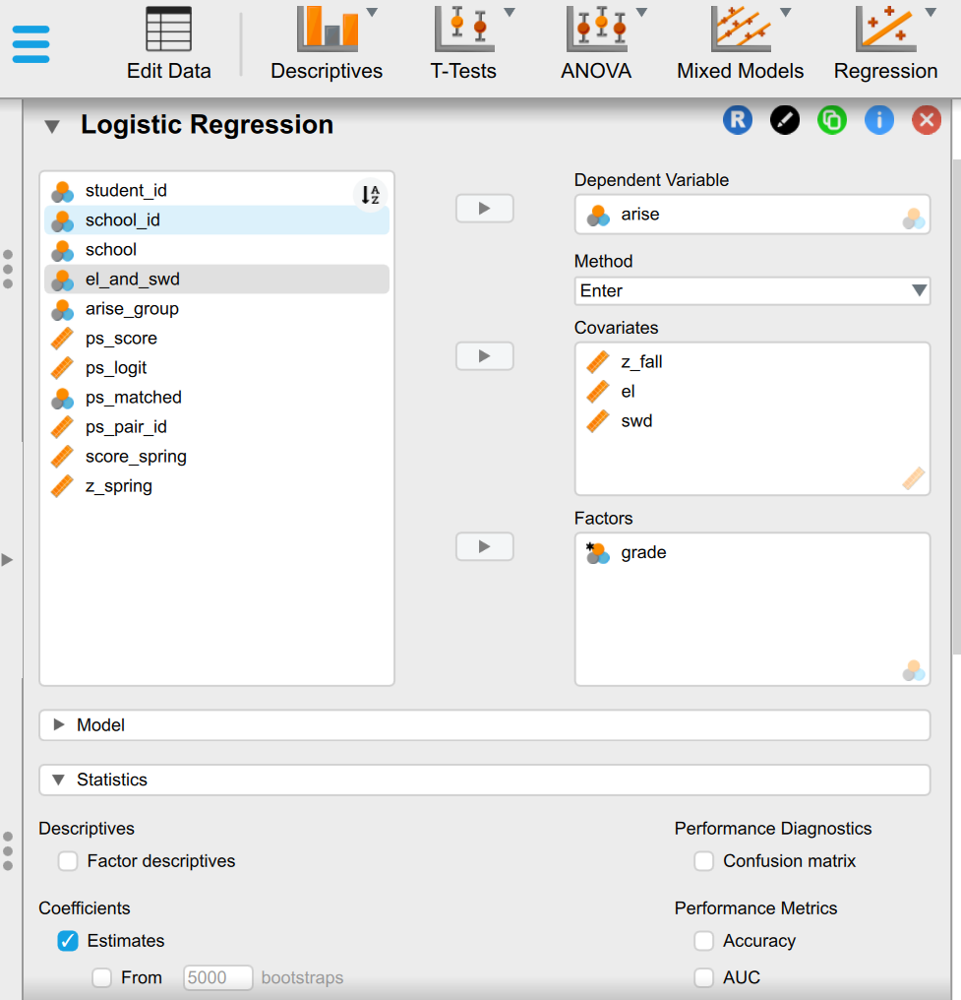
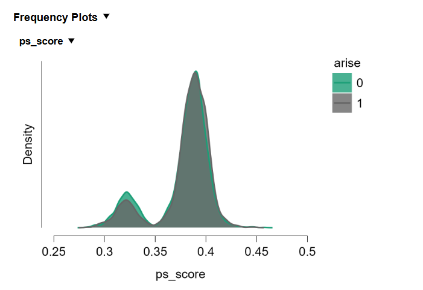
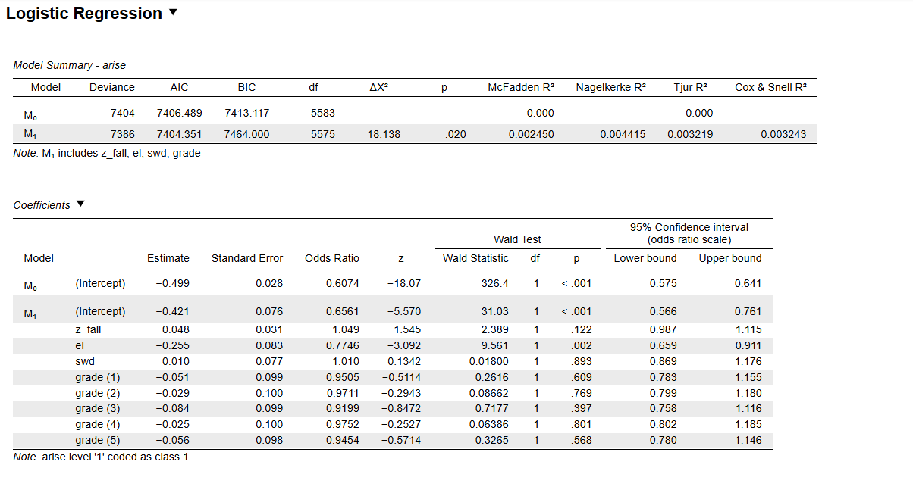

# Module 5: The groups differ on too many things to match exactly

**Design:** Propensity score matching · **File:** m05\_propensity\_matching.csv · **JASP analyses:** Logistic Regression, Descriptives, Independent Samples T-Test

## The problem

The groups differ on many measured characteristics at once, including fall scores that take hundreds of different values. Exact matching on all of them would leave most cells empty.

- **What is missing.** How ARISE students would have scored in spring without ARISE (their Y₀).
- **The trial you wish you had.** A coin flip among schools, which would make the groups alike on everything, measured or not.
- **The stand-in available.** Comparison students who had about the same chance of being in an ARISE school, given what you measured.

Module 4 showed exact matching's limit; that is, the more variables you match on, the more cells end up empty. **Propensity score matching** solves this by squeezing all the matching variables into one number. Essentially, each student's **propensity score**, or the predicted probability that they are in the program group, given their characteristics.

Two students with the same propensity score had the same chance of being in an ARISE school based on what we measured, even if they differ on individual characteristics. So we pair each ARISE student with the comparison student whose propensity score is closest, then compare the pairs.

The process has four steps:

1. **Predict** each student's chance of being in the program group (logistic regression).
2. **Check overlap:** Do the two groups have similar ranges of propensity scores?
3. **Match** each program student to the closest comparison student and **check balance**.
4. **Compare** outcomes in the matched sample.

Step 3 has been done for you. You will do steps 1, 2 and 4, and the balance check.

**Why it was done for you.** JASP does not have a point-and-click tool for pairing students up, so the matching was done ahead of time in other software. The result is saved in the **ps\_matched** column: 1 if the student was matched, 0 if not.

**How it works, briefly.** The method is *one-to-one nearest-neighbor matching without replacement, with a caliper of 0.2 SD of the log-odds of the propensity score*. In plain terms:

- **One-to-one nearest neighbor:** each ARISE student is paired with the single comparison student whose propensity score is closest to theirs.
- **Without replacement:** once a comparison student is used, they cannot be paired with anyone else.
- **Caliper:** a pair only counts if the two scores are close enough. If an ARISE student's nearest comparison student is too far away, that ARISE student is left unmatched and dropped. This keeps poor matches out.
- **Log-odds and 0.2 SD:** the scores are converted to log-odds first, which spreads out scores bunched near 0 or 1, and "close enough" is set at 0.2 of a standard deviation on that scale. This is a common rule of thumb in published research.

Comparison students who were never picked as anyone's nearest neighbor are also left out. So the matched sample is the ARISE students who found a close partner, plus their partners. As in Module 4, the answer is about those matched ARISE students (the ATT).

## Picture the design: filling in the missing world

Keep the nine students from Module 4. Suppose a logistic regression gave each one a propensity score, the predicted chance of being in an ARISE school given their characteristics. The ARISE students' scores are Ava .48, Ben .57 and Cruz .68. The comparison students' scores are Dev .20, Eli .30, Fay .40, Gia .46, Hal .55 and Ivy .66. These scores are made up for the example.

**The stand-in:** the spring score of the comparison student whose propensity score is closest.

| ARISE student | Propensity score | Matched comparison student | Stand-in for Y₀ (partner's spring score) | Spring score, observed (Y₁) | PSM "effect" | True effect |
| --- | --- | --- | --- | --- | --- | --- |
| Ava | .48 | Gia (.46) | 481 | 486 | +5 | +4 |
| Ben | .57 | Hal (.55) | 499 | 504 | +5 | +6 |
| Cruz | .68 | Ivy (.66) | 523 | 525 | +2 | +5 |
| **Average** |  |  | **501** | **505** | **+4** | **+5** |

*Propensity score matching in the running example. Illustrative numbers, not ARISE data.*

**Reading the picture.** The axis is no longer a test score. It is each student's chance of being in ARISE. The purple lines join each ARISE student to the comparison student with the closest chance. Cruz, who had no twin in Module 4, now gets a partner, Ivy. But Ivy is not identical to Cruz. She started at 505, not 500, and her spring score of 523 is 3 points above Cruz's true Y₀ of 520. That makes Cruz's estimated effect +2 instead of +5, and pulls the average down to +4. This is the trade-off in propensity score matching. You keep more students, but you accept partners who are close rather than exact. Dev, Eli and Fay have low scores where there are no ARISE students, so they are left out. The shaded area marks the overlap, where both groups have students.

**What it can and cannot answer.** Propensity score matching answers "How did matched ARISE students do compared with comparison students who had a similar chance of being in ARISE?" It balances only what went into the propensity score, so it cannot fix differences that were never measured.

**Looking ahead.** Modules 2 to 5 all depend on what we measured. Module 6 uses change over time to handle differences we did not measure.

## What must be true to believe it

Propensity score matching asks you to believe that students who had the same chance of being in ARISE, based on what you measured, are interchangeable. In symbols, where e(X) is the propensity score:

$$
\begin{gathered}
E[Y_0 \mid D = 1, e(X)] = E[Y_0 \mid D = 0, e(X)] \\[6pt]
0 < e(X) < 1, \qquad e(X) = P(D = 1 \mid X)
\end{gathered}
$$

The first line is conditional exchangeability, now among students with the same propensity score. Rosenbaum and Rubin (1983) showed that if exchangeability holds among students with the same X, it also holds among students with the same e(X). That is why a single number can stand in for many characteristics. The second line is positivity: every student must have some chance of being in either group. A third requirement is that the logistic regression describes well enough how the characteristics relate to being in ARISE.

**How you could check it.** You can check positivity with the overlap plots of ps\_score, and balance with the SMDs after matching. As in Modules 3 and 4, you cannot check whether something unmeasured differs between the matched groups.

**When the stand-in can be believable.** When the measured characteristics explain why students ended up in ARISE, the two groups' propensity scores overlap, and the balance check shows the matched groups look alike on each characteristic.

**How the What Works Clearinghouse would judge it.** As in Module 4, this is a quasi-experimental design that can earn at most Meets WWC Standards With Reservations, and baseline equivalence is judged in the matched sample. A characteristic whose SMD falls between 0.05 and 0.25 after matching, as disability status does here, has to be adjusted for in the analysis (*WWC Handbook, Version 5.0*, Chapter III, Step 4).

## The design and its model: logistic regression and matching

Ordinary regression predicts a number, like a test score. **Logistic regression predicts the probability of a yes/no outcome**, like "in an ARISE school (1) or not (0)." Probabilities must stay between 0 and 1, so logistic regression works on the **log-odds** scale and converts back to a probability.

- **Odds** can be confusing at first because they sound like probability but are not the same thing. A simple way to think about them: **probability compares yes to everyone; odds compare yes to no.** Picture 4 students, 1 in an ARISE school and 3 not. The probability of ARISE is 1 out of 4 (0.25). The odds are 1 yes to 3 no (1 ÷ 3 = 0.33). In general, odds = probability ÷ (1 − probability). Even chances (50/50) are odds of 1 to 1, or 1.0. The **log-odds** simply takes the log of the odds, so even chances become 0, more likely than not is positive, and less likely is negative.
- **Why convert to log-odds?** Regression draws a straight line, and a straight line keeps going up or down forever. A probability can't: it is stuck between 0 and 1. Odds are only half fixed: they can grow without limit but can never drop below 0. Log-odds have **no limits in either direction**, so the straight line can go anywhere, and any value converts back to a sensible probability between 0 and 1. A bonus: log-odds are balanced. Odds of 3 to 1 for and 3 to 1 against become +1.1 and −1.1, the same distance from 0.
- Each logistic **coefficient** is the change in log-odds for a one-unit change in the predictor. Positive means more likely to be in ARISE; negative means less likely.
- The **odds ratio** (the exponentiated coefficient) is easier to read. An odds ratio of 1.2 means 20% higher odds per unit; 0.8 means 20% lower; 1.0 means no relationship.

**The model, in symbols.** Step 1 fits a logistic regression of being in ARISE on the characteristics:

$$
\log\!\left(\frac{p_i}{1 - p_i}\right) = \alpha_0 + \alpha_1\,\text{Fall}_i + \alpha_2\,\text{EL}_i + \alpha_3\,\text{SWD}_i + \text{(grade terms)}
$$

| Symbol | What it means | Where it shows up in JASP |
| --- | --- | --- |
| pᵢ | Student i's probability of being in an ARISE school | Saved in the file as ps\_score |
| log(pᵢ ÷ (1 − pᵢ)) | The log-odds of being in ARISE |  |
| α₀ to α₃ | How the log-odds change with each characteristic. Alpha (α) is used so these are not confused with the outcome model's β. | Coefficients table, Estimate column |
| Grade terms | One coefficient for each grade, compared with kindergarten | The grade rows |

Turning the log-odds back into a probability gives the propensity score, and raising e to a coefficient gives its odds ratio:

$$
\hat{e}(X_i) = \hat{p}_i = \frac{1}{1 + e^{-(\hat{\alpha}_0 + \hat{\alpha}_1\,\text{Fall}_i + \cdots)}} \qquad\qquad \text{odds ratio} = e^{\hat{\alpha}}
$$

Step 3 pairs students whose scores are close on the log-odds (logit) scale. A pair counts only if it falls inside the caliper:

$$
\bigl|\,\text{logit}(\hat{e}_i) - \text{logit}(\hat{e}_j)\,\bigr| \;\le\; 0.2 \times SD\bigl(\text{logit}(\hat{e})\bigr)
$$

**Which effect does it estimate?** Step 4 compares each matched ARISE student with their partner, j(i), and averages the differences:

$$
\widehat{\text{ATT}} = \frac{1}{N^{T}_{m}} \sum_{i \,\in\, \text{matched ARISE}} \Bigl(Y_i - Y_{j(i)}\Bigr)
$$

Here Nᵀm is the number of matched ARISE students. Each partner's spring score stands in for that ARISE student's missing Y₀, so the average is the ATT for matched ARISE students, provided conditional exchangeability holds given the propensity score. With one-to-one matching, this average equals the mean difference in the t-test on the matched sample. In the running example, (5 + 5 + 2) ÷ 3 = +4.

**Behind the scenes: what JASP computes.** Logistic regression cannot use least squares, because its outcome is 0 or 1. JASP instead uses maximum likelihood: it searches for the coefficients that make the observed pattern of ARISE and comparison students most likely. Each coefficient's SE comes out of that search, and JASP's Wald test asks whether the coefficient is far from zero relative to its SE, much like a t statistic.

The predicted probability for each student is their propensity score (stored in **ps\_score**).

## Example scenarios

**Scenario A: An after-school STEM club.** Club members differ from non-members in grades, attendance, prior test scores, gender and family income. Exact matching on all five would leave almost no matches. A propensity score combines them into one number. Question answered: *Did club members do better than non-members who were equally likely to join, based on what we know?*

**Scenario B: A mentoring program for chronically absent students.** Students were referred by counselors, who considered prior absences, grade, behavior incidents and grades. Matching on the propensity of being referred asks: *Did mentored students attend more than similar students who were not referred?* Not answered: *What the counselor saw that is not in the data, such as a family crisis.*

## Your question in this module

*Compared with comparison-school students who had the same predicted chance of being in an ARISE school, did ARISE students score higher in spring 2025?*

## Get to know the data

**Data dictionary.** The variables you will use in this module.

| Variable | Definition | Data type |
| --- | --- | --- |
| z\_spring | Spring 2025 reading z-score. This is the outcome. | Continuous (Scale) |
| arise | 1 = ARISE school, 0 = comparison school. In step 1 it is the outcome of the propensity model. | Binary 0/1 (Nominal in this module) |
| arise\_group | "ARISE" or "Comparison" | Category, text (Nominal) |
| z\_fall | Fall 2024 reading z-score | Continuous (Scale) |
| el | 1 = English learner, 0 = not | Binary 0/1 (Scale) |
| swd | 1 = student with a disability, 0 = not | Binary 0/1 (Scale) |
| grade | Grade level (0 = kindergarten, 1 to 5) | Category, number code (Nominal) |
| ps\_score | The propensity score: the student's predicted probability (0 to 1) of being in an ARISE school, from a logistic regression on z\_fall, el, swd and grade. In this file it runs from about 0.28 to 0.46. | Continuous probability (Scale) |
| ps\_matched | 1 = the student is in the matched sample (every ARISE student, plus the comparison student paired with each). 0 = a comparison student never picked as a partner (1,364 students). | Binary 0/1 (Nominal; used as a filter) |

1. Open **m05\_propensity\_matching.csv**. Each row is one student.
2. Click **Descriptives**. Move **z\_fall, el, swd** and **z\_spring** into **Variables** and **arise\_group** into **Split**.
3. Under **Tables**, tick **Frequency tables**, then move **grade** into **Variables** as well, to see how many students in each grade are in each group.

**What to look for:** Which characteristics differ between the groups? Fall scores, the share of English learners (mean of **el**), the share of students with disabilities (mean of **swd**), and the mix of grades. Every difference you spot here is something the propensity score has to account for. If the groups look very similar already, expect the propensity scores to be bunched close together.

## Step by step in JASP

**Where the variables go, and why.**

| Variable | JASP box | Role and why |
| --- | --- | --- |
| arise | Dependent Variable (Logistic Regression) | In step 1 the question changes to "What predicts being in an ARISE school?", so being in ARISE becomes the outcome. Logistic regression needs a dependent variable with two categories, so arise is set to Nominal. |
| z\_fall, el, swd | Covariates (Logistic Regression) | Numeric predictors of being in ARISE. These are the characteristics the matching will balance. |
| grade | Factors | A categorical predictor. As a factor, each grade gets its own coefficient compared with kindergarten, instead of one straight-line effect of the grade number. |
| ps\_score | Variables, with arise\_group in Split | Compares the two groups' propensity scores to check overlap |
| ps\_matched | Filter | A sample variable that keeps only matched students |
| z\_spring | Dependent Variables (t-test) | The outcome |
| arise\_group | Grouping Variable | The treatment, defining the two groups compared in the matched sample |

**Setup**

1. Open **m05\_propensity\_matching.csv**.
2. Set **arise** and **ps\_matched** to **Nominal**, **grade** to **Nominal**, and **arise\_group** to **Nominal**. Set **z\_fall, el, swd, ps\_score, z\_spring** to **Scale**.

**Step 1: The propensity model**

3. Click **Regression**, then **Logistic Regression**.
4. Move **arise** into **Dependent Variable**. Move **z\_fall, el** and **swd** into **Covariates** and **grade** into **Factors**.
5. Under **Statistics**, tick **Estimates, Odds ratios** and **Confidence intervals**.

Figure 11: Logistic Regression input panel

**Step 2: Overlap**

6. Click **Descriptives**. Move **ps\_score** into **Variables** and **arise\_group** into **Split**.
7. Tick **Minimum** and **Maximum** under Statistics and Dispersion. Under **Basic Plots**, tick **Distribution plots** and under **Customizable Plots** tick **Boxplots**.
8. For one plot with both groups overlapping, open a **second Descriptives** (no filter on). Move **ps\_score** into **Variables** and leave **Split** empty. Tick **Frequency plots**, select **arise** in the list and click the arrow to move it into **Separate frequencies**. Under **Type for scale variables**, choose **Density**; under **How to combine separate frequencies**, choose **Identity**. Where the two curves cover the same range, the groups overlap. (If anything is in Split, you will get separate plots instead.)

Figure 12: Propensity Score Matching for Arise and Comparison Groups

**Step 3: Balance check before and after matching**

9. **Before matching:** with no filter on, run an **Independent Samples T-Test** with **z\_fall, el** and **swd** as **Dependent Variables**, **arise\_group** as **Grouping Variable**, and **Effect size** ticked. Write down Cohen's d for each; this is the SMD before matching (see Module 3's Get to know the data).
10. Filter to **ps\_matched = 1** (untick 0).
11. Run an **Independent Samples T-Test** with **z\_fall, el** and **swd** as **Dependent Variables**, **arise\_group** as **Grouping Variable**, and **Effect size** and **Descriptives** ticked. Cohen's d for each should be **close to 0** (a common rule: below 0.1 in absolute value). Compare each with its before-matching value from step 9: good matching shrinks every SMD toward 0.

**Step 4: The effect**

12. With the filter still on, run an **Independent Samples T-Test** with **z\_spring** as the Dependent Variable and **arise\_group** as the Grouping Variable. Tick **Location parameter** with its CI, **Effect size** with its CI, and **Descriptives**.

## Checkpoints

- Logistic regression: **N = 5,584**.
- Overlap: ps\_score runs from about **0.28 to 0.46** in both groups.
- After the filter: **2,110 ARISE** and **2,110 comparison** students (1,364 comparison students were not matched).
- Balance check: the matched groups' mean z\_fall differs by about **0.01** or less.

## Reading the output

Figure 13: Logistic Regression Coefficients table

**Logistic Regression: Model Summary.** Compares your model (M₁) with a model that has no predictors (M₀). The **chi-square (χ²) test** and its p-value ask whether the predictors improve prediction at all. **McFadden's R²** (and similar) shows how much; values near 0 mean the characteristics barely predict which group a student is in.

**Logistic Regression: Coefficients.** One row per predictor (grade appears as several rows, each compared with kindergarten). Look at the **Odds Ratio** and **p** columns:* Which characteristics make a student more or less likely to be in an ARISE school?*

**Reading the plots.** In the **distribution plot**, the horizontal axis is the propensity score (0 to 1) and the height of each bar is how many students have a score in that range. The smooth curve traces the same shape. In the **box plots**, the thick line is the median, the box holds the middle half of students, and the whiskers reach out to the rest; dots beyond the whiskers are unusual scores. Compare the two groups side by side because you want their shapes and boxes to cover the same range.

**Descriptives and plots of ps\_score.** *Do the two groups' distributions sit on top of each other (good overlap)?* *Are there ARISE students with scores no comparison student has (poor overlap)?* Also notice how narrow the range is. If all propensity scores are close together, students' characteristics hardly explain which school they attend.

**Balance t-tests.** You are hoping for **no** difference here. Look at Cohen's d, not the p-value: balance is about the size of the difference. Cohen's d here is the SMD (Module 3). Put the before and after values side by side, one row per variable: good matching moves every SMD toward 0.

**Worked example: SMDs before and after matching.**

| Variable | SMD before | SMD after | Verdict (WWC) |
| --- | --- | --- | --- |
| z\_fall | 0.076 | −0.010 | Gap closed: was above 0.05, now well under |
| el | −0.105 | −0.003 | Gap closed: was above 0.1, now essentially 0 |
| swd | −0.020 | 0.058 | **Got worse:** was under 0.05, now just over |

Matching fixed the two biggest gaps, fall scores and EL status. But the disability gap grew, from 0.02 to 0.06. This happens because a propensity score balances the characteristics as a group, not each one perfectly, and pairing students up can push a small gap the other way. An SMD of 0.058 is still under the looser 0.1 rule, but it is just over the WWC's 0.05 line, which means the analysis should adjust for swd. One way is in Step 4, run a Linear Regression on the matched sample with z\_spring as the outcome and both arise and swd as covariates, and compare the arise coefficient with the t-test's mean difference. Notice the p-value for swd after matching: p = .058, "not significant," yet its SMD says the gap is big enough to adjust for. That is why balance is judged by SMDs, not p-values.

**The effect t-test.** Read it as in Module 2: the mean difference in z\_spring (your estimate, in SD), its CI, p-value and Cohen's d.

## Explaining it to stakeholders

Translate the matched t-test estimate into i-Ready points, share of a year's growth or percentiles with the tables in Part 2 (Translating z-score results into real-world terms). Avoid the term "propensity score" with most audiences. Describe what it did instead.

**A sample sentence.** "We paired each ARISE student with a comparison-school student who was similar in starting reading level, English learner status, disability status and grade. The ARISE students scored about \_\_\_ i-Ready points (\_\_\_ SD) higher in spring than their partners."

**What to add.** The pairs are similar only on what was measured: "If ARISE schools differ in ways we couldn't measure, such as how motivated their staff were to try something new, that could explain part of the gap."

## Assumptions

- **No unmeasured confounders.** Exactly as in Modules 3 and 4. A propensity score only balances the variables that went into it.
- **Overlap.** Every ARISE student has comparison students with similar propensity scores.
- **A reasonable propensity model.** The logistic regression includes the variables that drive selection into the program.
- **Independent observations.** Still violated by clustering.

## Threats to internal validity

- **Selection on unmeasured variables.** The key threat. Here, who got ARISE was decided by schools, not by student characteristics. No student-level matching can fix a school-level choice.
- **Poor overlap.** Students without good matches are dropped, which changes who the result describes.
- **Model choices.** Different propensity models or matching rules can give different answers. Researchers should report how sensitive the result is.

## Bring to your instructor

1. Which characteristics predicted being in an ARISE school? How well did the model predict overall?
2. What does the narrow range of propensity scores (about 0.28 to 0.46) tell you about why schools ended up in ARISE?
3. Did matching balance z\_fall, el and swd? Report the Cohen's d values.
4. Report the matched estimate, CI and p-value. Compare it with Modules 2 to 4. Why might PSM and regression agree here?
5. **Back to the two worlds.** In the running example, propensity score matching paired Cruz with Ivy. Write Cruz's stand-in, his PSM "effect" and his true effect. Why is Ivy a less accurate stand-in for Cruz than Gia was for Ava?
6. Suppose ARISE had no effect at all, so every student's Y₁ equals their Y₀. What would propensity score matching report in the running example? Why is it not exactly zero?
7. Dev, Eli and Fay were never used. Using their propensity scores, explain why they had no partner and what this says about overlap.
8. Two students with the same propensity score can still differ on individual characteristics. Why is that acceptable when the goal is an average effect? What must the balance check show for the matched comparison group to be a believable stand-in?

## Learn more

- *The Effect*, **Chapter 14, Matching:** propensity scores, choosing matches, calipers, balance tables and common support.
- *Causal Inference: The Mixtape* (Cunningham), Chapter 5, Matching and Subclassification: propensity score methods, common support and balance.
- *What If* (Hernán and Robins), Chapter 15, sections 15.2 to 15.4: propensity scores, and stratifying and matching on them.
- *Methods Matter* (Murnane and Willett), Chapter 12: propensity scores in education research, and what they cannot fix.
- *WWC Handbook, Version 5.0*, Chapter III, Step 4, Baseline equivalence standard: the 0.05 and 0.25 SD lines used in the balance check.

