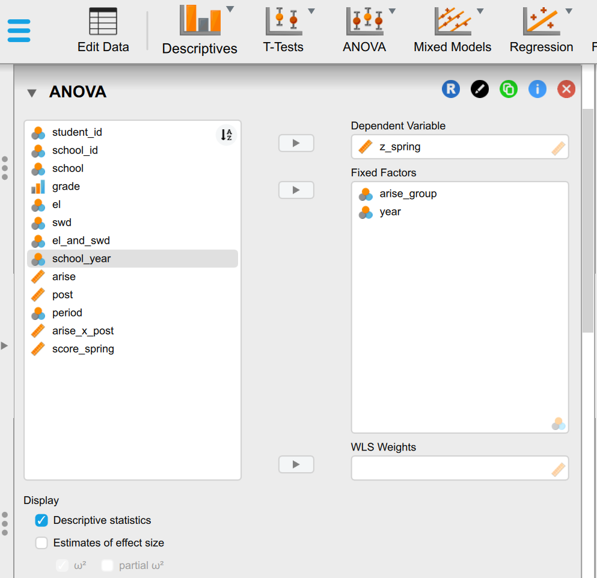
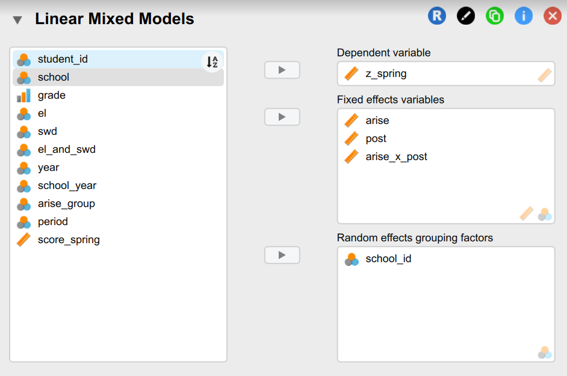
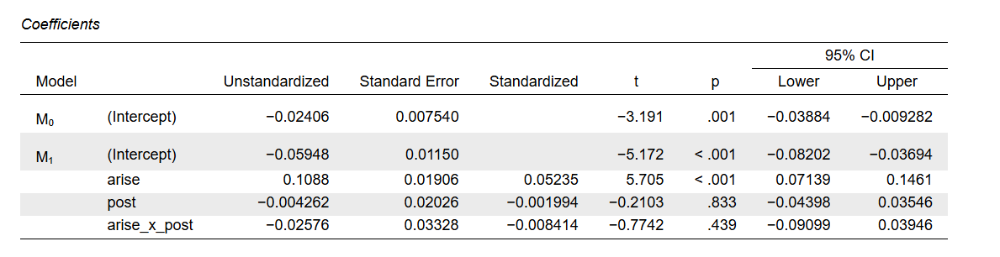

# Module 6: We have an untreated group, observed before and after

**Design:** Difference-in-differences (DiD) · **File:** [m06_diff_in_diff.csv](data/m06_diff_in_diff.csv) · **JASP analyses:** ANOVA (for the picture), Linear Regression, Linear Mixed Models

## The problem

You have an untreated group, and you observed both groups before and after the program started. The groups were not alike to begin with, and some of the ways they differ were never measured.

- **What is missing.** How ARISE students' scores would have changed from before to after without ARISE.
- **The trial you wish you had.** A coin flip among schools, which would make the groups alike on everything, measured or not.
- **The stand-in available.** The comparison group's change over the same period, added to the ARISE group's own starting point.

Modules 2 to 5 could only adjust for differences we **measured**. Difference-in-differences handles differences we **didn't** measure, as long as they stay the same over time.

The idea: compare how much each group **changed** from before the program to after.

1. **First difference:** How much did the ARISE group change from before (2022-24) to after (2024-25)?
2. **Second difference:** How much did the comparison group change over the same period?
3. **Difference-in-differences:** Subtract the second from the first.

If ARISE schools always scored 0.10 SD higher than comparison schools, that gap is in both the "before" and "after" numbers, so it cancels out. Anything that affected both groups in 2024-25 (a hard test, a district-wide change) also cancels out. What's left is the change **unique** to ARISE schools after they started ARISE.

|  | Before (2022-24) | After (2024-25) | Change |
| --- | --- | --- | --- |
| ARISE | A | B | B − A |
| Comparison | C | D | D − C |
|  |  | **DiD** | **(B − A) − (D − C)** |

**The key assumption is parallel trends.** Without ARISE, the two groups' scores would have moved in parallel (changed by the same amount). The comparison group's change stands in for what the ARISE group's change would have been.

## Picture the design: filling in the missing world

Difference-in-differences needs a year before the program. Imagine the same ARISE and comparison schools one year earlier, in spring 2023-24. ARISE schools' students averaged 494, and comparison schools' students averaged 464. In spring 2024-25, the ARISE year, the averages were 505 and 470, the six students' averages from Part 1.

**The stand-in:** the ARISE group's own score before the program, plus the change the comparison group made over the same year.

| Group | 2023-24 (before ARISE) | 2024-25 (ARISE year) | Change |
| --- | --- | --- | --- |
| ARISE, observed | 494 | 505 | +11 |
| Comparison, observed | 464 | 470 | +6 |
| ARISE without the program (stand-in) | 494 | 494 + 6 = 500 | +6 |
| **DiD estimate** |  |  | **11 − 6 = +5** |

*Difference-in-differences in the running example. Illustrative numbers, not ARISE data.*

**Reading the picture.** The blue line shows the comparison group rising 6 points over the year. DiD copies that 6-point rise onto the ARISE group's starting point (the purple dashed line) and lands at 500. That is the stand-in for the missing world, and here it matches the true Y₀ of 500 exactly. The 30-point gap between the groups (494 versus 464) does not matter, because DiD compares changes, not levels. The head start that fooled posttest-only in Module 2 cancels out, and so does normal growth. What remains is the 5 extra points ARISE students gained, which is the true effect.

**What it can and cannot answer.** DiD answers "How much more did ARISE schools' scores change than comparison schools' scores?" It handles differences between the groups that stay the same over time, even ones never measured. It cannot handle differences that change over time, such as ARISE schools also hiring a new reading coach the same year.

**Looking ahead.** Module 7 uses several years of the ARISE schools' own history instead of a comparison group.

## What must be true to believe it

DiD asks you to believe that, without ARISE, ARISE schools' scores would have changed by the same amount as comparison schools' scores. In symbols:

$$
E[Y_{0,\text{post}} - Y_{0,\text{pre}} \mid D = 1] = E[Y_{0,\text{post}} - Y_{0,\text{pre}} \mid D = 0]
$$

Read it as: in the world without the program, the average change from before to after is the same in both groups. This is parallel trends. It is an exchangeability assumption about changes rather than levels. The groups may start in different places, by any amount and for any reason, as long as they would have moved together. Consistency matters too: ARISE must mean the same thing across schools, and the comparison schools must not have started any part of it early (Part 2).

**How you could check it.** You cannot check the program year itself, but you can check the years before it. If the groups moved in parallel from 2022-23 to 2023-24 (Part C), parallel trends in 2024-25 is easier to believe. It remains an assumption, because something new could have happened to only one group in the program year.

**When the stand-in can be believable.** When the two groups moved in parallel in the years before the program (the check in Part C), and nothing else changed for only one group in the program year.

**How the What Works Clearinghouse would judge it.** The WWC reviews difference-in-differences studies as quasi-experimental designs, so the most they can earn is Meets WWC Standards With Reservations, and the groups must still meet the baseline equivalence standard on the pretest (*WWC Handbook, Version 5.0*, Chapter I, "Assignment to conditions," and Chapter III, Step 4).

## The design and its model: an interaction in regression

You can fill in the table above by hand from group means. Regression gives the same answer, plus a standard error and p-value. The model has three predictors, each 0/1:

$$
\text{z\_spring} = b_0 + b_1 \times \text{arise} + b_2 \times \text{post} + b_3 \times (\text{arise} \times \text{post})
$$

| Coefficient | Meaning | In the table |
| --- | --- | --- |
| b0 (Intercept) | Comparison group, before | C |
| b1 (arise) | How much higher ARISE was before the program | A − C |
| b2 (post) | How much the comparison group changed | D − C |
| b3 (arise\_x\_post) | **The extra change in the ARISE group: the DiD estimate** | (B − A) − (D − C) |

The last predictor, **arise × post**, is called an **interaction**. It equals 1 only for ARISE students after ARISE started. Its coefficient asks: *Was the ARISE-group change different from the comparison-group change?*

**Students nested in schools: the linear mixed model.** Because ARISE was given to whole schools, students in the same school are not independent (Part 1). A **linear mixed model** gives each school its own baseline level (a **random intercept**), so the model knows students come in school-sized groups. The DiD estimate is similar, but the standard error is more honest, usually larger.

**The model, in symbols.** Articles write the DiD model with subscripts for student (i), school (s) and time (t):

$$
Y_{ist} = \beta_0 + \beta_1\,\text{ARISE}_s + \beta_2\,\text{Post}_t + \beta_3\,(\text{ARISE}_s \times \text{Post}_t) + \varepsilon_{ist}
$$

| Symbol | What it means | Where it shows up in JASP |
| --- | --- | --- |
| Yᵢₛₜ | The spring z-score of student i in school s in year t | Dependent Variable (z\_spring) |
| ARISEₛ | 1 if school s is an ARISE school | arise |
| Postₜ | 1 for 2024-25, after ARISE started | post |
| ARISEₛ × Postₜ | 1 only for ARISE schools after ARISE started | arise\_x\_post |
| β₃ | The DiD estimate | arise\_x\_post row |

**Which effect does it estimate?** β₃ equals the difference-in-differences of the four group averages, and splitting it as in Part 1 shows what it contains:

$$
\begin{aligned}
\beta_3 &= \bigl(\bar{Y}_{A,\text{post}} - \bar{Y}_{A,\text{pre}}\bigr) - \bigl(\bar{Y}_{C,\text{post}} - \bar{Y}_{C,\text{pre}}\bigr) \\[4pt]
&= \underbrace{E[Y_1 - Y_0 \mid D=1]_{\text{post}}}_{\text{ATT}}
+ \underbrace{E[Y_{0,\text{post}} - Y_{0,\text{pre}} \mid D=1] - E[Y_{0,\text{post}} - Y_{0,\text{pre}} \mid D=0]}_{\text{difference in trends (zero if trends are parallel)}}
\end{aligned}
$$

The first piece is the ATT in the program year. The second is the difference between the two groups' changes in the world without the program. Parallel trends says that second piece is zero, and then β₃ is the ATT. In the running example, (505 − 494) − (470 − 464) = 11 − 6 = +5.

**The mixed model, in symbols.** Part D adds a random intercept, uₛ, for each school:

$$
\begin{gathered}
Y_{ist} = \beta_0 + \beta_1\,\text{ARISE}_s + \beta_2\,\text{Post}_t + \beta_3\,(\text{ARISE}_s \times \text{Post}_t) + u_s + \varepsilon_{ist} \\[6pt]
u_s \sim N(0, \tau^2) \qquad \varepsilon_{ist} \sim N(0, \sigma^2) \qquad \text{ICC} = \frac{\tau^2}{\tau^2 + \sigma^2}
\end{gathered}
$$

Each school's uₛ shifts its baseline up or down. The model does not report each school's shift as a separate number. It estimates how much the shifts vary between schools (τ², tau squared) and how much students vary within schools (σ², sigma squared). The intraclass correlation (ICC) is the share of all the variation that lies between schools. It is the ρ in Module 2's design-effect formula, and JASP's Variance/correlation estimates table gives you the pieces to compute it. That is how the mixed model knows its evidence about school-level differences comes from only 13 schools.

**Behind the scenes: what JASP computes.** The regression in Part B is fitted by least squares, as in Module 3. The mixed model is fitted by restricted maximum likelihood (REML), which estimates the βs, τ² and σ² together. Its t-tests use Satterthwaite degrees of freedom, which is why the arise row has about 11 df rather than thousands. The df reflect how many schools, not how many students, that comparison rests on.

## Example scenarios

**Scenario A: Later school start times.** District A moves high school start times from 7:30 to 8:30 in 2024; neighboring District B does not. Attendance rises 3 points in District A and 1 point in District B. *DiD = 3 − 1 = 2 points.* Question answered: *Did attendance rise more in the district that changed start times than in a similar district that didn't?* *Key assumption:* Without the change, both districts' attendance would have risen by the same amount.

**Scenario B: A cell phone ban.** One state bans phones in classrooms in 2024. Compare the change in discipline referrals in that state with the change in a neighboring state over the same years. *Threat:* If the first state also launched a new behavior program that year, DiD would credit it to the phone ban.

## Your question in this module

*From 2022-24 to 2024-25, did ARISE schools' spring reading scores improve more than the comparison schools' did?*

## Get to know the data

This file is shaped differently from Modules 1 to 5. **Each row is one student in one year**, so a student who was there all three years appears three times. This is called **long format**.

**Data dictionary.** The variables you will use in this module.

| Variable | Definition | Data type |
| --- | --- | --- |
| z\_spring | Spring reading z-score for that student in that year. This is the outcome. | Continuous (Scale) |
| arise | 1 = the student attends an ARISE school, 0 = a comparison school (in every year) | Binary 0/1 (Scale) |
| arise\_group | "ARISE" or "Comparison" | Category, text (Nominal) |
| year | The spring the score comes from: 2023 = 2022-23, 2024 = 2023-24, 2025 = 2024-25 | Category, number code (Nominal) |
| period | Before or after ARISE started: "1 Pre (2022-24)" for 2022-23 and 2023-24, and "2 Post (2024-25)" | Category, text (Nominal) |
| post | 1 = 2024-25, after ARISE started; 0 = the two earlier years. It is the number version of period. | Binary 0/1 (Scale) |
| arise\_x\_post | arise × post. It is 1 only for ARISE students in 2024-25 and 0 for everyone else. Its coefficient is the DiD estimate. | Binary 0/1 (Scale) |
| school\_id | Code for the student's school (S02 to S14) | ID code (Nominal) |

1. Open **m06\_diff\_in\_diff.csv** and set **year, arise\_group** and **school\_id** to **Nominal**.
2. Click **Descriptives**. Move **year** and **school\_id** into **Variables** and **arise\_group** into **Split**. Under **Tables**, tick **Frequency tables** and change **Maximum distinct values** from 10 to 20. (school\_id has 13 schools, so at the default of 10 JASP leaves it out.)
3. Start a second Descriptives with **z\_spring** in **Variables** and **year** in **Split**.

**What to look for:** About 17,645 rows in all. Roughly how many rows does each group have each year? The **school\_id** frequency tables (scroll down past the Descriptive Statistics table) list all 13 schools for each group, but most rows are 0: only 4 schools (S02 to S05) have ARISE students and 9 (S06 to S14) have comparison students; note how many students each one has, since a few large schools can dominate the result. Finally, how much do the yearly means of z\_spring move around before ARISE started? That is the background "noise" any ARISE effect has to stand out from.

## Step by step in JASP

**Where the variables go, and why.**

| Variable | JASP box | Role and why |
| --- | --- | --- |
| z\_spring | Dependent Variable (every part) | The outcome |
| arise\_group, period | Fixed Factors (ANOVA, Part A) | The treatment group and the time period, as categories. ANOVA computes a mean for each combination, which gives the four cells of the 2×2 table. |
| year | Fixed Factors (ANOVA, Part C) | Replaces period, so the two years before ARISE show up separately and you can check whether the groups moved in parallel |
| arise, post, arise\_x\_post | Covariates (regression, Part B); Fixed Effects Variables (mixed model, Part D) | The 0/1 versions of group and period, plus their product. arise is the gap between groups before ARISE, post is the comparison group's change, and arise\_x\_post is the extra change in ARISE schools, the DiD estimate. In the mixed model they are fixed effects because each is one number for all schools. |
| school\_id | Random Effects Grouping Factors (Part D) | The cluster. Students in the same school are not independent, so a random intercept gives each school its own baseline and makes the standard error honest. |

**Setup**

1. Open **m06\_diff\_in\_diff.csv**.
2. Set **arise\_group, period, year** and **school\_id** to **Nominal**. Set **z\_spring, arise, post** and **arise\_x\_post** to **Scale**.

**Part A: See it**

3. Click **ANOVA**, then **ANOVA**. Put **z\_spring** in **Dependent Variable** and **arise\_group** and **period** in **Fixed Factors**.
4. Under **Display**, tick **Descriptive statistics**.
5. Open **Descriptives Plots**. Put **period** on the **Horizontal Axis** and **arise\_group** in **Separate Lines**. Tick **Display error bars** (confidence intervals).
6. Use the Descriptive Statistics table to fill in the 2×2 table (A, B, C, D) and compute the DiD by hand.

Figure 14: ANOVA descriptives plot with two lines across Pre and Post

**Part B: Estimate it**

7. Click **Regression**, then **Linear Regression**. Put **z\_spring** in **Dependent Variable** and **arise, post** and **arise\_x\_post** in **Covariates**.
8. Under **Statistics**, tick **Estimates, Confidence intervals** and **Model fit**.

**Part C: Check parallel trends**

9. Go back to your ANOVA (or start a new one). Replace **period** with **year** in **Fixed Factors** and in the Descriptives Plot's **Horizontal Axis**. You now see three points per group: 2023 and 2024 (both before ARISE) and 2025 (after).

**Part D: Account for schools**

10. If **Mixed Models** is not in the menu bar, click **+** (top right) and tick **Mixed Models**.
11. Click **Mixed Models**, then **Linear Mixed Models** (Classical).
12. Put **z\_spring** in **Dependent Variable**, **arise, post** and **arise\_x\_post** in **Fixed Effects Variables**, and **school\_id** in **Random Effects Grouping Factors**.
13. Expand the **Model** section. Under **Fixed effects**, check that only **arise, post** and **arise\_x\_post** are listed. Under **Random effects**, JASP ticks every box by default; **untick arise, post and arise\_x\_post** and keep only **Intercept** ticked. This gives each school its own baseline (a random intercept) and nothing more. Then expand **Options** and check that **Test method** is set to **Satterthwaite** (the default; it is faster with large files than the other choices). Why untick the others? Each would let that variable's effect differ from school to school (a random slope). arise can't, since every school is all ARISE or all comparison, and the other slopes ask 13 schools to support a much more complicated model that often fails to run. A random intercept is enough to account for students being grouped in schools.
14. Still in **Options**, tick **Fixed effects estimates**. It is off by default, and without it you will not get the table with the **arise\_x\_post** row. Also tick **Variance/correlation estimates** to see how much scores vary between schools. Large files may take a minute to run.

Figure 15: Linear Mixed Models input panel with school\_id as random effects grouping factor

## Checkpoints

- Total **N = 17,645** student-years.
- ANOVA Descriptive Statistics N per cell: **ARISE Pre 4,331, ARISE Post 2,150, Comparison Pre 7,568, Comparison Post 3,596.**
- By year (Part C): ARISE **2,053 / 2,278 / 2,150**; Comparison **3,757 / 3,811 / 3,596** for 2023 / 2024 / 2025.
- Mixed model: **13 levels** of school\_id.
- Your hand-calculated DiD (Part A) should equal the **arise\_x\_post** coefficient (Part B) exactly.

## Reading the output

Figure 16: Part B Linear Regression, Coefficients table with arise\_x\_post highlighted

**Which output is which?** You ran three analyses, and each has a different job:

| Analysis | Part | Table to read | Its job |
| --- | --- | --- | --- |
| ANOVA | A and C | The descriptives **plot** only | Draw the picture. Ignore its F-tests. |
| Linear Regression | B | **Coefficients**, M₁ rows | The DiD (**arise\_x\_post** row), ignoring schools: a check |
| Linear Mixed Model | D | **Fixed effects estimates** | The DiD accounting for schools: the one to report |

**Reading the plot.** The horizontal axis is time (Pre and Post, or the three years in Part C). Each line is one group, each dot is that group's mean at that time, and the bars are 95% confidence intervals. A helpful trick: from the ARISE Pre dot, imagine a line with the same slope as the comparison line. That is where ARISE would have ended up if it had changed like the comparison group. The vertical gap between that imagined point and the actual ARISE Post dot is the difference-in-differences.

**ANOVA descriptives plot.** Two lines, one per group. **Parallel lines = no DiD effect.** If the ARISE line rises more steeply (or falls less) from Pre to Post, that's a positive DiD. Ignore the ANOVA F-tests here; the plot and the two models are what you need.

**Regression Coefficients table (M₁).** Use the coefficient table above to name each row. **arise\_x\_post** is your DiD estimate, in SD units, with its CI and p-value.

**Worked example: the Part B regression.**

| Row | b | What it means |
| --- | --- | --- |
| (Intercept) | −0.059 | Comparison schools' average z\_spring before ARISE |
| arise | 0.109 | How far ahead ARISE schools already were **before** the program. A starting gap, not an effect. |
| post | −0.004 | How much comparison schools changed from before to after: essentially nothing |
| arise\_x\_post | −0.026 | **The DiD:** ARISE schools changed 0.026 SD *less* than comparison schools |

The five-step scan on arise\_x\_post: (1) negative; (2) b = −0.026 SD, very small; (3) p = .439, 95% CI −0.091 to 0.039, which includes 0; (4) skip β; (5) R² will be small, since this model is not built to predict scores.

**One sentence:** ARISE schools' spring scores changed about the same as comparison schools' over the same period (DiD = −0.026 SD, 95% CI \[−0.091, 0.039\], p = .439).

**Watch out:** the arise row is significant (p < .001), and it is tempting to read it as an ARISE effect. It is not. It is the gap that existed before ARISE began, which is exactly what DiD subtracts out.

**Parallel trends plot (Part C).** Look at 2023 to 2024, **before** ARISE. Did the two lines move in parallel? If the ARISE line was already rising or falling relative to the comparison line before 2025, the parallel-trends assumption is in doubt.

**Linear mixed model (Part D).** Find the **Fixed effects estimates** table. It has the same four rows as the regression and is read the same way. Ignore the Note under it about sum contrasts: all three predictors are 0/1 numbers, so it does not apply. JASP does not print a CI here; a quick estimate is the estimate ± 2 × SE.

| Row | Regression (Part B) | Mixed model (Part D) |
| --- | --- | --- |
| arise (starting gap) | 0.109, SE 0.019, p < .001 | 0.079, SE 0.151, df 11, p = .613 |
| arise\_x\_post (DiD) | −0.026, SE 0.033, p = .439 | −0.003, SE 0.032, p = .935 |

Two things changed, and both are lessons:

- **The arise row's SE grew about eightfold.** The regression treats 17,645 rows as independent pieces of information about how ARISE schools differ from comparison schools. The mixed model knows there are only 13 schools, and its **df of about 11** says so. A gap that looked highly significant is indistinguishable from zero once schools are counted honestly.
- **The DiD row's SE barely changed, but the estimate moved toward zero.** arise\_x\_post is a change *within* each school, before vs. after, so grouping by school does little to its uncertainty. Because the mixed model gives every school its own baseline, it compares each school with itself, which likely explains why the estimate moved: differences in which schools and students were tested each year matter less.

**One sentence:** Accounting for students being grouped in schools, ARISE schools' spring scores changed about the same as comparison schools' (DiD = −0.003 SD, SE 0.032, p = .935; roughly 95% CI −0.07 to 0.06).

**Regression or mixed model: why run both, and which to report?**

- **What the regression tells you.** The plain DiD is one simple model, easy to read, the same before-and-after comparison as the plot. Its weakness is that it treats every student as independent, so its SEs and p-values are too small for anything that differs *between* schools.
- **What the mixed model adds.** It knows students come in school-sized groups. That gives honest uncertainty for school-level comparisons (the arise row), a DiD that compares each school with itself, and, in the **Variance/correlation estimates** table, how much schools differ from one another.
- **Why run both.** As a check. If two reasonable models agree on the DiD, your conclusion does not hinge on one modeling choice; here both say "about zero." The side-by-side also shows how much clustering changes your confidence, which one model alone would hide.
- **Which to report.** The **mixed model**. ARISE was given to whole schools, so the school is the unit that matters, and the mixed model is the one that accounts for it. Report its DiD and mention the regression as a check.
- **One caution.** A random intercept accounts for schools differing in their overall level, not for one school having an unusually good or bad year. With only 4 ARISE schools, even the mixed model's SE may be too small, so treat any DiD from this design as fragile.

## Explaining it to stakeholders

The DiD estimate (arise\_x\_post) is how much more ARISE schools' scores changed than comparison schools' scores. Translate it into i-Ready points, share of a year's growth or percentiles with the tables in Part 2 (Translating z-score results into real-world terms). Describe it as a change in the gap, not as a score.

**A sample sentence.** "From the two years before ARISE to its first year, scores in ARISE schools rose about \_\_\_ i-Ready points (\_\_\_ SD) more than scores in comparison schools." If your estimate is negative, say "fell behind comparison schools by about \_\_\_ points" instead.

**What to add.** State the key assumption in plain words: "This assumes that, without ARISE, scores in both sets of schools would have changed by the same amount." Mention what your Part C check showed about whether that is believable.

## Assumptions

- **Parallel trends.** Without ARISE, both groups would have changed by the same amount. This can't be proven, but pre-program years (Part C) give evidence for or against it.
- **No anticipation.** ARISE schools did not change what they did before ARISE officially began.
- **Stable groups.** The kinds of students in each group did not change sharply over time.
- **No spillover.** The comparison schools did not get part of ARISE.
- **Accounting for clustering.** Handled by the mixed model, not by the ordinary regression.

## Threats to internal validity

- **Different trends (selection × maturation).** If ARISE schools were already on a different path, DiD mistakes that path for the program effect.
- **Regression to the mean / a pre-program dip.** Schools often adopt a program because scores just fell. Scores tend to bounce back on their own, which DiD would credit to the program. Check whether ARISE schools dipped right before 2024-25.
- **Differential history.** Something else changed only in ARISE schools in 2024-25.
- **Composition change.** Different students in the "after" year (e.g., a boundary change).
- **Early start in comparison schools.** If the comparison schools began preparing for ARISE during 2024-25 (Part 2), part of their change that year comes from ARISE itself. DiD subtracts that change, so it would understate the effect.

## Bring to your instructor

1. Fill in the 2×2 table and report the DiD from your hand calculation and from the regression (with CI and p-value).
2. Compare the regression and mixed-model standard errors and p-values. What explains the difference?
3. Describe the 2023 to 2024 pattern from Part C. Does parallel trends look believable? Which way could a violation bias the result?
4. How does this estimate compare with Modules 2 to 5, and why might it differ?
5. **Back to the two worlds.** In the running example, DiD filled in the ARISE group's missing spring average with 494 + 6 = 500. Explain where each number comes from, and why the 30-point gap between ARISE and comparison schools does not bias the estimate.
6. Suppose that, in the year ARISE started, ARISE schools also got new principals who added 3 points to their students' scores, and comparison schools did not. What would DiD report in the running example, and which assumption failed?
7. Suppose instead that ARISE schools had been gaining 2 points a year more than comparison schools even before ARISE, and that this would have continued. Would DiD's stand-in of 500 be too high or too low? Would DiD overstate or understate the effect?
8. Sketch the Picture the design figure for your ARISE results, with both groups' lines and the dashed line that copies the comparison group's change. Use your Part C results to say whether that dashed line is believable.

## Learn more

- *The Effect*, **Chapter 18, Difference-in-Differences:** the logic, parallel trends, testing pre-trends and placebo checks.
- *The Effect*, **Chapter 16, Fixed Effects:** comparing groups with themselves over time, and why grouping in the data matters.
- *Causal Inference: The Mixtape* (Cunningham), Chapter 9, Difference-in-Differences: the two-by-two comparison, parallel trends and checks using earlier years.
- *Mastering 'Metrics* (Angrist and Pischke), Chapter 5, Differences-in-Differences: the logic of the design and its regression version.
- *Methods Matter* (Murnane and Willett), Chapter 8: difference-in-differences as a natural-experiment design in education, and Chapter 7: why students grouped in schools change the analysis.
- *Experimental and Quasi-Experimental Designs* (Shadish, Cook and Campbell), Chapter 5: the untreated control group design with a pretest and posttest, and the threats it still faces.

