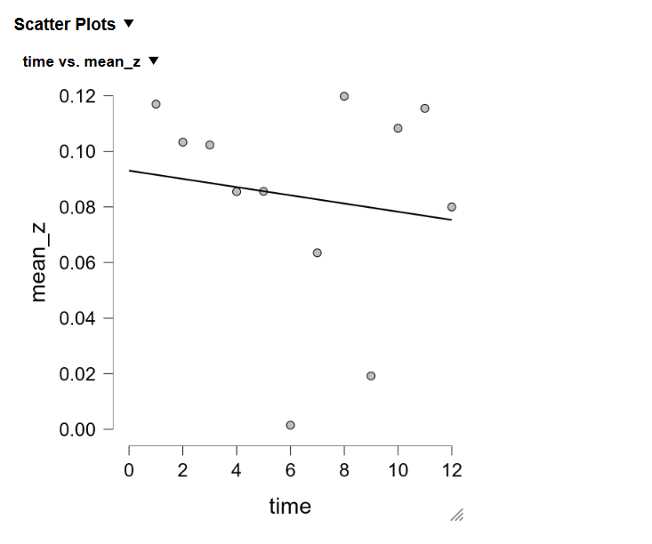
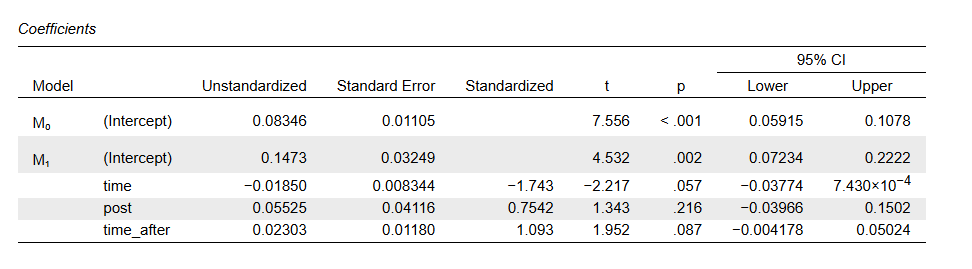
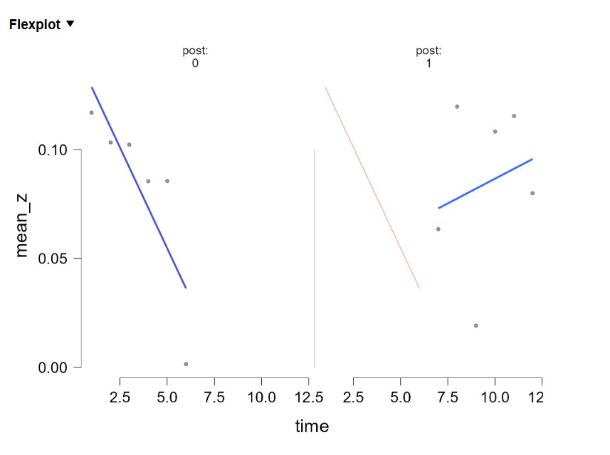

# Module 7: The program starts at a known time, and we have a long history

**Design:** Interrupted time series (ITS) · **File:** [m07_interrupted_time_series.csv](data/m07_interrupted_time_series.csv) · **JASP analyses:** Correlation (for the scatter plot), Linear Regression

## The problem

You have only the program group, but you have many measurements of it from before the program started, not just one.

- **What is missing.** Where the ARISE schools' scores would have gone after window 7 without ARISE.
- **The trial you wish you had.** A coin flip among schools, which would give you an untreated group living through the same years.
- **The stand-in available.** The ARISE schools' own trend from before the program, projected forward.

Module 1 compared one "before" point with one "after" point, so it could not tell normal growth from a program effect. An interrupted time series uses many points before the program to learn the group's normal trend, then asks whether the program interrupted that trend.

The stand-in for "what would have happened" is the pre-program trend, extended forward. The program's effect shows up in two possible ways:

- **A level change (a jump):** right when the program starts, the outcome jumps up or down from where the trend predicted.
- **A slope change:** after the program starts, the outcome climbs (or falls) faster or slower than before.

In this module, each row is one **test window** (fall, winter or spring of a school year), and the outcome is the average score of all students in the four ARISE schools. There are 12 windows: 6 before ARISE (2022-23 and 2023-24) and 6 after (2024-25 and 2025-26). ARISE starts at window 7.

## Picture the design: filling in the missing world

Interrupted time series follows only the ARISE group, over several years. Imagine the ARISE schools' spring averages for the three years before the program were 486, 490 and 494, a steady rise of 4 points a year. In 2024-25, the ARISE year, they averaged 505. One more detail matters here. That same year, a district-wide change (say, a new reading curriculum in every school) added 2 points for everyone. So without ARISE, the ARISE group would have reached 500, not 498.

**The stand-in:** the pre-program trend, extended forward one more year.

| School year | ARISE schools, observed | Trend projected forward (stand-in) | Without ARISE (never seen) |
| --- | --- | --- | --- |
| 2021-22 | 486 | 486 | 486 |
| 2022-23 | 490 | 490 | 490 |
| 2023-24 | 494 | 494 | 494 |
| 2024-25 (ARISE year) | 505 | 498 | 500 |
| **ITS estimate** |  | **505 − 498 = +7** | **True effect +5** |

*Interrupted time series in the running example. Illustrative numbers, not ARISE data.*

**Reading the picture.** The orange line shows three years of steady growth before ARISE. ITS learns that trend, 4 points a year, and extends it to 498 (the purple square). That projection is the stand-in. ARISE students actually scored 505, so ITS reports +7. The gray circle shows that the missing world was 500. The trend could not know about the district-wide change that started the same year as ARISE, so ITS credits those 2 points to ARISE. Unlike pre-post, ITS does handle normal growth, because the trend already includes it. What it cannot handle is something new that arrives at the same moment as the program. This example uses one score per year to keep the picture simple. The module's data has three test windows per year and checks for both a jump and a change in slope.

**What it can and cannot answer.** ITS answers "Did ARISE schools' scores break from their own trend when ARISE started?" It cannot separate ARISE from anything else that started at the same time (history).

**Looking ahead.** Module 8 adds the comparison schools' time series, which can catch a change like the district-wide one that hit everyone.

## What must be true to believe it

ITS asks you to believe that, without ARISE, the ARISE schools' scores would have kept following their earlier trend. In symbols, the stand-in is the pre-program line, extended:

$$
Y_{0,t} = \beta_0 + \beta_1\,\text{time}_t + \varepsilon_t \quad \text{for every window, including those after the program starts}
$$

Read it as: in the world without the program, every window, including those after window 7, would sit on the same straight line apart from random noise. This is exchangeability between the past and the future. The earlier windows must tell you what the later ones would have looked like. It fails if the trend would have bent anyway, or if something else changed at window 7, such as a new curriculum (history), a new test (instrumentation) or a change in who was tested.

**How you could check it.** Partly. A long, steady pre-period makes a straight-line projection easier to believe, and you can look at whether the pre-program points really follow a line. You cannot check whether something else started at window 7. Module 8 adds a comparison series for that.

**When the stand-in can be believable.** When there are many steady points before the program, and you know of no other change that started at the same time, such as a new curriculum, a new test, or a change in which students were tested.

**How the What Works Clearinghouse would judge it.** The WWC has not developed standards for interrupted time series designs without a comparison group, so it does not review them, although it notes that such designs could provide credible evidence (*WWC Handbook, Version 5.0*, p. 16).

## The design and its model: segmented regression

Segmented regression fits one line before the program and lets it jump and bend at the start. It uses three predictors:

| Variable | What it is | Its coefficient means |
| --- | --- | --- |
| time | Window number, 1 to 12 | The trend before the program (change per window) |
| post | 0 before window 7, 1 from window 7 on | The **level change**: the jump at the start of ARISE |
| time\_after | 0 before window 7, then 0, 1, 2, … 5 | The **slope change**: how much the trend per window changed after ARISE |

$$
\text{mean\_z} = b_0 + b_1 \times \text{time} + b_2 \times \text{post} + b_3 \times \text{time\_after}
$$

The trend after the program is b1 + b3.

**Two outcomes, two questions.** You will run the segmented regression twice, on two versions of the outcome:

|  | Raw scale score (mean\_score) | z-score (mean\_z) |
| --- | --- | --- |
| What it measures | Points on the i-Ready scale: how much students know | Standing compared with typical students in the same grade and season. 0 = average. |
| Normal growth | Built in. Scores rise during every school year no matter what. | Removed. A student who grows at the typical pace keeps the same z. |
| The question it answers | Did scores rise faster, in points, after ARISE? | Did ARISE students gain ground on their peers after ARISE? |
| Strength | Easy to explain ("8 points") | Comparable across grades, seasons and other modules |

**Why run both?** As a check. The two outcomes handle normal growth and the seasons in different ways. If both tell the same story about the level and slope changes, your conclusion does not depend on which outcome you chose. If they disagree, one of them is probably picking up something other than ARISE, and you need to find out which.

**Why raw scores need season terms.** Raw scores follow a zig-zag every year: lowest in fall, higher in winter, highest in spring, then back down the next fall as students move up a grade. In this file, the average winter score is about 15 points above fall, and spring is about 29 points above fall. Segmented regression draws straight lines, so it cannot follow a zig-zag on its own. Worse, ARISE starts at window 7, which is a fall test, so scores drop right at the start of the program no matter what. Without help, the model blames that seasonal drop on ARISE.

The fix is two yes/no predictors: **winter** (1 for winter windows, 0 otherwise) and **spring** (1 for spring windows, 0 otherwise). Fall is the baseline. Their coefficients are the usual winter and spring bumps above fall, so time, post and time\_after measure only what is left after the normal seasonal pattern is set aside. The cost: with only 12 points, two extra predictors use up information and leave just 6 points' worth to estimate everything else.

**Why z-scores don't need them.** Each z-score is already compared with students in the same grade and season, so the seasonal rise is removed before the model ever sees it. That is why Part B has three predictors and Part C has five.

**Autocorrelation.** Points next to each other in time tend to be similar. Regression assumes they are independent, so with autocorrelated data, p-values look too small. The **Durbin-Watson** statistic checks this, where values near 2 are fine; values well below 2 suggest positive autocorrelation.

**The model, in symbols.** Articles write segmented regression with a subscript for the time window (t):

$$
Y_t = \beta_0 + \beta_1\,\text{time}_t + \beta_2\,\text{post}_t + \beta_3\,\text{time\_after}_t + \varepsilon_t
$$

| Symbol | What it means | Where it shows up in JASP |
| --- | --- | --- |
| Yₜ | The ARISE schools' average score in window t | Dependent Variable (mean\_z or mean\_score) |
| timeₜ | The window number, 1 to 12 | time |
| postₜ | 1 from window 7 on | post |
| time\_afterₜ | Windows since ARISE started | time\_after |
| β₁ | The trend per window before ARISE | time row |
| β₂ | The jump at window 7 (the level change) | post row |
| β₃ | The change in the trend after ARISE (the slope change) | time\_after row |

In Part C the model adds β₄ × winterₜ and β₅ × springₜ, so the other coefficients are measured after the usual seasonal pattern is set aside.

**Which effect does it estimate?** For any window after ARISE starts, subtract the projected trend (the stand-in) from what the model predicts with the program:

$$
\underbrace{\bigl(\beta_0 + \beta_1 t + \beta_2 + \beta_3 (t - 7)\bigr)}_{\text{with the program}} - \underbrace{\bigl(\beta_0 + \beta_1 t\bigr)}_{\text{trend projected forward}} = \beta_2 + \beta_3\,(t - 7) \qquad \text{for windows } t \ge 7
$$

So the estimated effect at window 7 is β₂, and it changes by β₃ with every window after that. If the assumption holds, that is the ATT for the ARISE schools in that window, measured on school averages. In the running example, the projected trend was 498 and ARISE students scored 505, so ITS reported +7. Two of those points came from the district-wide change, not from ARISE.

**Behind the scenes: what JASP computes.** The coefficients are fitted by least squares, as in Module 3, using only 12 data points. The Durbin-Watson statistic compares each residual with the one before it:

$$
DW = \frac{\sum_{t=2}^{T} (e_t - e_{t-1})^2}{\sum_{t=1}^{T} e_t^2} \;\approx\; 2\,(1 - r)
$$

Here eₜ is the residual in window t, and r is the correlation between neighboring residuals. If neighboring residuals are unrelated, r is near 0 and DW is near 2. If they move together, r is positive, DW falls toward 0, and the usual SEs are too small.

## Example scenarios

**Scenario A: A new suspension policy.** A district tracks suspensions every month for three years, then adopts restorative practices in January 2025. Question answered: *Did monthly suspensions drop below where the earlier trend predicted, either right away (level) or gradually (slope)?* *Threat:* The same month, the state changed how suspensions are reported.

**Scenario B: An attendance campaign.** A school records its weekly attendance rate for two years, then launches a family outreach campaign. Attendance usually dips in winter. Question answered: *After accounting for the usual seasonal pattern, did attendance rise above its expected path once the campaign started?*

## Your question in this module

*After ARISE began in fall 2024, did the four ARISE schools' average reading scores jump above, or climb faster than, their earlier trend?*

## Get to know the data

This file is tiny: 12 rows, and each row is one testing window, not a student. Each value is an average across all students tested in that window. With this little data, you can (and should) look at every row.

**Data dictionary.** The variables you will use in this module. Each row is a test window, so each value describes the four ARISE schools in that window.

| Variable | Definition | Data type |
| --- | --- | --- |
| time | Test window number in order, 1 to 12 (fall 2022-23 = 1, spring 2025-26 = 12) | Time index (Scale) |
| post | 1 = window 7 or later, after ARISE started; 0 = before | Binary 0/1 (Scale) |
| time\_after | Windows since ARISE started: 0 through window 7, then 1, 2, 3, 4 and 5 | Count (Scale) |
| winter | 1 = a winter window, 0 = otherwise | Binary 0/1 (Scale) |
| spring | 1 = a spring window, 0 = otherwise. Fall is the window with both winter and spring equal to 0. | Binary 0/1 (Scale) |
| mean\_z | Average reading z-score of all students tested in the ARISE schools in that window. This is the outcome. | Continuous (Scale) |
| mean\_score | Average i-Ready scale score of the same students | Continuous (Scale) |

1. Open **m07\_interrupted\_time\_series.csv** and read through all 12 rows in the data view.
2. Click **Descriptives** and move **mean\_score** and **mean\_z** into **Variables**.

**What to look for:** Find where **post** switches from 0 to 1 (window 7). Read down the **mean\_score** column. Raw scores rise from fall to winter to spring every year, then drop back the next fall. That sawtooth is normal growth within a year, and it is why Part C adds winter and spring to the model. Compare it with **mean\_z**, which adjusts for grade and time of year and should look much flatter. Because each value is an average, you cannot see how much individual students varied.

## Step by step in JASP

**Where the variables go, and why.**

| Variable | JASP box | Role and why |
| --- | --- | --- |
| mean\_z | Dependent Variable; Flexplot dependent variable | The outcome, the schools' average score in each window |
| time | Covariates; Flexplot independent variable | The trend before ARISE. Its coefficient is the change per window. |
| post | Covariates; Flexplot Panels | The level change. Its coefficient is the jump at window 7. In Flexplot it splits the plot into before and after panels. |
| time\_after | Covariates | The slope change. Its coefficient is how much faster or slower scores move after ARISE starts. |
| mean\_score | Dependent Variable (Part C) | The same outcome in raw points, which rise within each school year |
| winter, spring | Covariates (Part C only) | Season indicators that absorb the within-year rise in raw scores. Fall is the reference season and is left out, because the three season indicators always add to 1, so one would be redundant. |

**Setup**

1. Open **m07\_interrupted\_time\_series.csv**. It has only 12 rows; look at them.
2. Set **time, post, time\_after, winter, spring, mean\_z** and **mean\_score** to **Scale**.

**Part A: See it**

3. Click **Regression**, then **Correlation**. Move **time** and **mean\_z** into **Variables**.
4. Under **Plots**, tick **Scatter plots**. Ignore the correlation table; you want the picture.
5. Find window 7 (the first fall with ARISE). Do the points after it look different from the points before?
6. Now draw the two segments. If **Visual Modeling** is not in the menu bar, click **+** (top right) and tick it. Click **Visual Modeling**, then **Flexplot**. Put **mean\_z** as the dependent variable, **time** as the independent variable, and **post** in the panel box. Under **Options**, change **Fitted line (scatterplots)** from **Loess** to **Regression**, and keep **Ghost lines** ticked. You get two panels: before ARISE (post = 0) and after (post = 1), each with its own straight line. The faint line in the second panel is the "before" line, repeated for comparison.

Figure 17: scatter plot of mean\_z by time with a hand-drawn line at window 7

**Part B: Segmented regression on z-scores**

7. Click **Regression**, then **Linear Regression**. Put **mean\_z** in **Dependent Variable** and **time, post** and **time\_after** in **Covariates**.
8. Under **Statistics**, tick **Estimates** and **Confidence intervals** (Coefficients column), **Model fit** (Display), and **Durbin-Watson** (Model Summary, the left column near the top).

**Part C: Segmented regression on raw scores**

9. Open a new Linear Regression. Put **mean\_score** in **Dependent Variable** and **time, post, time\_after, winter** and **spring** in **Covariates**. Tick the same options.

## Checkpoints

- The data have 12 rows; **post** first equals 1 at wave 7 (fall 2024-25).
- Part B: the ANOVA table shows Regression df = 3 and Residual df = 8.
- Part C: Regression df = 5 and Residual df = 6.
- In Part C, the **winter** and **spring** coefficients should be clearly positive (scores rise through the year).

## Reading the output

Figure 18: Part B segmented regression on z-scores (mean\_z), Coefficients table

In the **Coefficients** table (M₁ rows):

| Row | Ask yourself |
| --- | --- |
| time | What was the trend per window before ARISE? Rising, falling, flat? |
| post | Did scores jump at the start of ARISE? (In SD units for Part B) |
| time\_after | Did the trend per window change after ARISE? |

For each, read the estimate, its 95% CI and p. With only 12 points, CIs will be wide; a large estimate can still be uncertain.

**Durbin-Watson** (in the Model Summary table): near 2 is fine. Well below 2 means the p-values are probably too small.

**Compare Parts B and C.** Do the z-score and raw-score models tell the same story about the level and slope changes? If not, think about why the choice of outcome could matter.

**Worked example: comparing Parts B and C.**

| Row | Part B: z-scores (SD) | Part C: raw scores (points) | Same story? |
| --- | --- | --- | --- |
| time (trend before ARISE) | −0.019, p = .057 | −2.7, p = .013 | Yes: scores were slipping before ARISE |
| post (jump at window 7) | +0.055, p = .216 | +1.3, p = .749 | Yes: a small jump, not distinguishable from 0 |
| time\_after (change in trend) | +0.023, p = .087 | +4.8, p = .003 | Same direction; only the raw-score model is significant |
| R² | 0.395 | 0.972 |  |

Both models say the same thing about direction. Namely, scores were drifting down before ARISE, there was no clear jump when it started, and the trend turned upward afterward (in Part C, from −2.7 to about +2.2 points per window). They disagree only on whether the turnaround is "significant," and with 12 points, one model crossing p = .05 and the other not is a thin difference. Read this as a hint of a change in trend, not proof.

**Why the outcome matters: a warning.** If you run Part C *without* winter and spring, the post estimate becomes about −19 points, the opposite sign. Window 7 is a fall test, and raw scores drop every fall no matter what. Without the season terms, the model blames that seasonal drop on ARISE. z-scores compare each window with its own norm, so they remove most of the season automatically. With raw scores, you must model the season yourself, or you can get the answer backwards.

**Remember the threats.** Even a real change in trend at window 7 could come from anything else that changed that year (history). Module 8 adds a comparison group to check exactly this.

**Reading the plot.** In the Part A scatter plot, each dot is one testing window (12 in all), with time on the horizontal axis and the average z-score on the vertical axis. JASP draws one straight line through all 12 dots. Ignore that line, because it assumes nothing changed at window 7. Instead, picture two separate lines. One line through windows 1 to 6 and one through windows 7 to 12. A jump between the end of the first line and the start of the second is a level change (post). A steeper or flatter second line is a slope change (time\_after). If you plot raw scores instead of z-scores, expect a sawtooth pattern, because scores rise from fall to spring every year and reset the next fall.

Figure 18. scatter plot of mean\_z by time with two lines drawn at post 0 and post 1

**Reading the Flexplot.** The two straight lines are exactly what the Part B regression estimates. You can also work them out from the coefficients: before ARISE, predicted mean\_z = 0.147 − 0.0185 × time, which runs from about 0.13 at window 1 to 0.04 at window 6. After ARISE, add post (+0.055) and time\_after (+0.023 per window after window 7), which runs from about 0.07 at window 7 to 0.10 at window 12.

- **What would have happened:** imagine the "before" line continuing past window 6. It would reach about 0.02 at window 7. The gap between that point and the start of the "after" line (0.07) is the **level change**; the after line rising instead of falling is the **slope change**.
- **Watch the single points.** The steep "before" line is driven mostly by window 6, which sits near 0; windows 1 to 5 decline only gently. Likewise, window 9 pulls the "after" line down. Both are spring windows, so the z-scores may not remove the seasonal pattern completely. With only 12 points, one or two unusual windows can create or erase a trend. Always look at the points, not just the lines.

## Explaining it to stakeholders

Each row in this file is a school average, but mean\_z is still in student-level SD units, so the post and time\_after coefficients translate with the tables in Part 2 (Translating z-score results into real-world terms). Report the jump and the change in trend separately. A change in trend adds up over time: after a number of windows, the total change is the jump plus that many times the slope change.

**A sample sentence.** "When ARISE started, the four ARISE schools' average reading score was about \_\_\_ i-Ready points (\_\_\_ SD) above where its earlier trend predicted, and it grew about \_\_\_ points faster per testing window after that." If an estimate is near 0 or negative, say so plainly.

**What to add.** This design follows only the ARISE schools, over 12 test windows: "Anything else that changed in fall 2024, such as a new curriculum or test, could produce the same pattern."

## Assumptions

- **The pre-program trend would have continued** in a straight line without the program. With only 6 pre-program points, that's a big leap.
- **Nothing else changed at the same time** (see History, below).
- **Independent errors** (no autocorrelation). Check Durbin-Watson.
- **Enough data points.** Methodologists often recommend many more than 12, with at least 8 or so on each side.
- **Stable measurement and population.** Same test and similar students across all windows.

## Threats to internal validity

- **History.** The biggest threat for ITS. Anything else that started in fall 2024 (a new curriculum, new staff, a change in test administration) looks exactly like a program effect.
- **Instrumentation.** A change in the test or how it is scored at the same time.
- **Seasonality.** Handled here by z-scores or season indicators; ignoring it would create fake jumps.
- **Regression to the mean.** If scores happened to be unusually low just before the program started, they would tend to rise anyway. Look at the last pre-program window.
- **Changing student mix.** Average scores move if different students enroll.

## Bring to your instructor

1. Describe the pre-ARISE trend, the level change and the slope change, with estimates, CIs and p-values (Part B).
2. What did Durbin-Watson show? How does that affect your trust in the p-values?
3. Did Parts B and C agree? Which would you report, and why?
4. Name one event that, if it happened in fall 2024, would make an ITS result misleading.
5. ITS has no comparison group. What would adding one let you rule out? (This leads into Module 8.)
6. **Back to the two worlds.** In the running example, ITS reported +7 when the true effect was +5. What did ITS use as the stand-in for the missing world? Where did the extra 2 points come from, and why can't ITS detect them?
7. Suppose ARISE had no effect at all, but the district-wide change still happened. What would ITS report in the running example?
8. Suppose the ARISE schools' scores before the program had bounced around (486, 495, 488) instead of rising steadily. How would that change your trust in the projected trend as a stand-in?
9. Sketch the Picture the design figure for your ARISE results from Part A, with the pre-ARISE trend, the trend projected forward, and where ARISE scores actually landed. Which part of the gap could be explained by something other than ARISE?

## Read an exemplar

Humphreys, D. K., Gasparrini, A., & Wiebe, D. J. (2017). Evaluating the impact of Florida's "stand your ground" self-defense law on homicide and suicide by firearm: An interrupted time series study. *JAMA Internal Medicine, 177*(1), 44–50. [Journal (DOI)](https://doi.org/10.1001/jamainternmed.2016.6811)

**Why this study.** Florida's 2005 "stand your ground" law took effect on a known date. The authors model monthly homicide rates from 1999 to 2014 with segmented regression, adjusting for seasons, and ask whether the rates jumped or changed trend when the law began. Florida's own pre-2005 trend is the stand-in, as in Module 7. After the law, homicide rose by about 24% and firearm homicide by about 32%. The authors also check comparison states and suicide, an outcome the law should not affect, which previews Module 8.

**As you read, ask:**

- *Which coefficient in their model corresponds to post, and which to time_after?*
- *Why do they adjust for season, and how does that compare with the winter and spring variables in Module 7?*
- *What do the comparison states and the suicide outcome rule out that the Florida series alone could not?*

## Learn more

- *The Effect*, Chapter 17, Event Studies: using the period before an event to predict what would have happened, and measuring the deviation from that prediction. ITS applies the same logic.
- *Experimental and Quasi-Experimental Designs* (Shadish, Cook and Campbell), Chapter 6, Interrupted Time-Series Designs: the simple time series and the threats that matter most for it.
- *WWC Handbook, Version 5.0*, Chapter I, "Assignment to conditions" (p. 16): why the WWC does not yet review time series designs without a comparison group.

