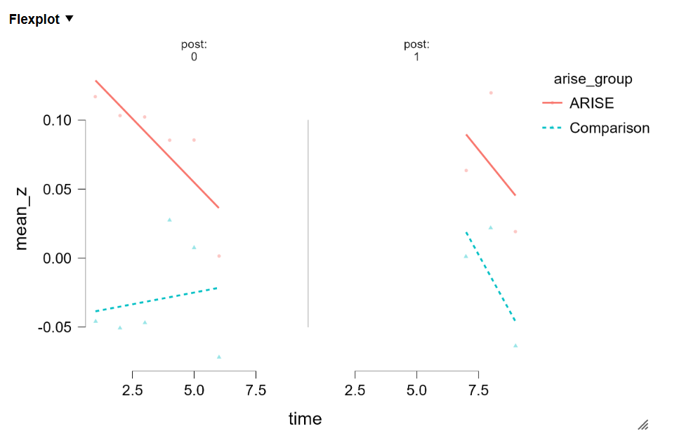
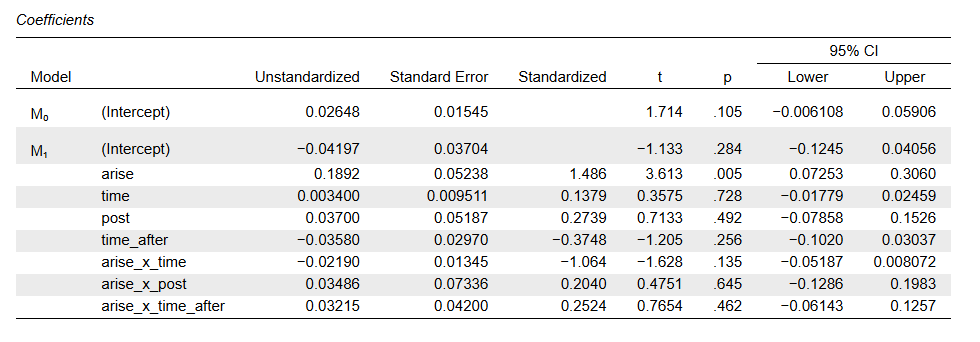

# Module 8: The program starts at a known time, and an untreated group shares the same history

**Design:** Comparative interrupted time series (CITS) · **File:** [m08_comparative_its.csv](data/m08_comparative_its.csv) · **JASP analyses:** Flexplot (Visual Modeling), Linear Regression

## The problem

You have a long history for the program group, but a trend alone cannot tell you whether something else changed at the same moment the program started.

- **What is missing.** Where the ARISE schools' scores would have gone after window 7 without ARISE, including any district-wide change that hit everyone that year.
- **The trial you wish you had.** A coin flip among schools, so that the untreated schools would live through exactly the same events.
- **The stand-in available.** The ARISE schools' own trend projected forward, adjusted by how far an untreated comparison group moved off its trend at the same time.

Module 7's biggest weakness was history: anything else that happened when ARISE started could look like an ARISE effect. A comparative interrupted time series adds a comparison group's time series over the same windows. If something district-wide happened in fall 2024, it should show up in both series. Only a change that appears in the ARISE series and not the comparison series is credited to ARISE.

CITS combines the logic of ITS (Module 7) and difference-in-differences (Module 6). It compares the jump and the change in trend between the two groups.

The file covers windows 1 to 9 only. The comparison schools started ARISE at window 10 (fall 2025-26), so after that they no longer serve as a comparison. That leaves 6 windows before ARISE and only 3 after.

## Picture the design: filling in the missing world

Add the comparison schools' history to Module 7's example. Their spring averages for the three years before ARISE were 456, 460 and 464, the same 4-point climb as the ARISE schools. In 2024-25 they averaged 470. They had no ARISE, but they did get the district-wide change.

**The stand-in:** the ARISE group's own trend projected forward, plus however far the comparison group moved off its own trend that year (498 + 2 = 500).

| Group | Trend projected to 2024-25 | Observed 2024-25 | Above its trend |
| --- | --- | --- | --- |
| ARISE | 498 | 505 | +7 |
| Comparison | 468 | 470 | +2 |
| **CITS estimate** |  |  | **7 − 2 = +5** |

*Comparative interrupted time series in the running example. Illustrative numbers, not ARISE data.*

**Reading the picture.** Both groups were climbing 4 points a year before ARISE. In 2024-25 the ARISE schools beat their trend by 7 points. The comparison schools, which had no ARISE, beat theirs by 2 points. Those 2 points cannot be ARISE, so they must be the district-wide change that fooled ITS in Module 7. CITS subtracts them and is left with +5, the true effect. Put another way, the missing world for the ARISE group is its own trend (498) plus whatever pushed everyone off trend that year (+2), which gives 500.

**What it can and cannot answer.** CITS answers "Did ARISE schools break from their trend more than comparison schools did?" It cannot rule out an event that affected only the ARISE schools at the same moment the program started.

**Looking ahead.** Module 9 takes a different approach and uses the rule that decided who was offered the program.

## What must be true to believe it

CITS asks you to believe that, without ARISE, the ARISE schools would have moved off their trend by the same amount as the comparison schools did. In symbols:

$$
\bigl(Y_{0,\text{ARISE},t} - \text{ARISE trend}_t\bigr) = \bigl(Y_{\text{comp},t} - \text{comparison trend}_t\bigr) \quad \text{for windows } t \ge 7
$$

Read it as: whatever pushed the comparison schools above or below their own trend after window 7 would have pushed the ARISE schools by the same amount. This is a parallel-deviations version of the parallel trends condition from Module 6. The groups may start at different levels and climb at different rates, but anything else that happened when ARISE started must have affected both groups equally. It fails if an event hit only the ARISE schools at that moment, such as a new principal or a separate grant.

**How you could check it.** Partly. You can compare the two groups' trends before window 7 (the arise\_x\_time row), and a long, similar pre-period makes the stand-in easier to believe. You cannot check what would have happened after window 7, and you cannot rule out an event that touched only the ARISE schools.

**When the stand-in can be believable.** When the two groups had similar trends before the program, the comparison schools went through the same district events, and nothing happened at that time to the ARISE schools alone.

**How the What Works Clearinghouse would judge it.** The WWC reviews comparative interrupted time series designs as quasi-experimental designs (*WWC Handbook, Version 5.0*, p. 15). The best rating is Meets WWC Standards With Reservations, and the groups must show baseline equivalence on the outcome before the program.

## The design and its model: segmented regression with a comparison group

The model has the three ITS predictors from Module 7, plus a group indicator and three interactions:

| Predictor | Its coefficient means |
| --- | --- |
| time | Comparison group's trend before window 7 |
| post | Comparison group's level change at window 7 (anything that hit everyone, e.g., history) |
| time\_after | Comparison group's slope change after window 7 |
| arise | How far ARISE schools were from comparison schools at the start (level gap) |
| arise\_x\_time | How different ARISE schools' **pre-program trend** was |
| **arise\_x\_post** | **Extra jump in ARISE schools at window 7, beyond the comparison group's jump: the level effect** |
| **arise\_x\_time\_after** | **Extra change in trend in ARISE schools, beyond the comparison group's: the slope effect** |

The two bold rows are the ARISE effects. The comparison group's own changes (post, time\_after) show what would have happened anyway, and the model subtracts them.

**The model, in symbols.** Articles write the CITS model with a subscript for the group (g) and the window (t):

$$
\begin{aligned}
Y_{gt} = \;&\beta_0 + \beta_1\,\text{time}_t + \beta_2\,\text{post}_t + \beta_3\,\text{time\_after}_t \\
&+ \beta_4\,\text{ARISE}_g + \beta_5\,(\text{ARISE}_g \times \text{time}_t) + \beta_6\,(\text{ARISE}_g \times \text{post}_t) + \beta_7\,(\text{ARISE}_g \times \text{time\_after}_t) + \varepsilon_{gt}
\end{aligned}
$$

| Symbol | What it means | Where it shows up in JASP |
| --- | --- | --- |
| Y\_gt | Group g's average score in window t | Dependent Variable |
| ARISE\_g | 1 for the ARISE schools, 0 for the comparison schools | arise |
| β₁, β₂, β₃ | The comparison group's trend, jump and slope change | time, post and time\_after rows |
| β₄ | The starting gap between the groups | arise row |
| β₅ | How much the ARISE trend differed before the program | arise\_x\_time row |
| β₆ | The extra jump in the ARISE group at window 7 (the level effect) | arise\_x\_post row |
| β₇ | The extra change in the ARISE trend after window 7 (the slope effect) | arise\_x\_time\_after row |

It helps to write out the line the model draws for each group. Set ARISE\_g to 0 for the comparison schools and to 1 for the ARISE schools:

$$
\begin{aligned}
\text{Comparison:}\quad & \beta_0 + \beta_1\,\text{time} + \beta_2\,\text{post} + \beta_3\,\text{time\_after} \\
\text{ARISE:}\quad & (\beta_0 + \beta_4) + (\beta_1 + \beta_5)\,\text{time} + (\beta_2 + \beta_6)\,\text{post} + (\beta_3 + \beta_7)\,\text{time\_after}
\end{aligned}
$$

**Which effect does it estimate?** After window 7, the comparison schools moved off their trend by β₂ + β₃(t − 7), and the ARISE schools moved off theirs by (β₂ + β₆) + (β₃ + β₇)(t − 7). The assumption says the ARISE schools would have moved by the comparison amount without the program, so subtract it:

$$
\text{ARISE effect at window } t \ge 7 \;=\; \beta_6 + \beta_7\,(t - 7)
$$

If the assumption holds, this is the ATT for the ARISE schools in window t, measured on school averages. In the running example, the ARISE schools were 7 points above their trend and the comparison schools were 2 points above theirs, so CITS reports 7 − 2 = +5, the true effect.

**Behind the scenes: what JASP computes.** One least squares regression is fitted to both groups' series at once, exactly as in Module 3. Because each interaction is the product of two columns, its coefficient measures how much the ARISE line differs from the comparison line in that one feature. With only 9 windows per group, the SEs are large, and the Durbin-Watson check from Module 7 still applies.

## Example scenarios

**Scenario A: A suspension policy, with a neighbor.** District A adopts restorative practices in January 2025 and a neighboring District B does not. Both districts' monthly suspension counts are tracked for three years. Question answered: *Did District A's suspensions drop (or their trend bend) more than District B's at the same time?* *Rules out:* A statewide reporting change that affected both districts.

**Scenario B: A math program in some grades.** A school adopts a new math program in grades 3 to 5 but not grades 6 to 8. Both grade bands' quarterly benchmark averages are tracked for three years. Question answered: *Did grades 3 to 5 depart from their trend more than grades 6 to 8 did? Key assumption:* The two grade bands would otherwise have followed similar patterns.

## Your question in this module

*When ARISE started in fall 2024, did ARISE schools' average reading scores jump, or change trend, more than the comparison schools' scores did?*

## Get to know the data

Like Module 7, each row is one testing window, but now there are two series: 18 rows, 9 windows for each group.

**Data dictionary.** The variables you will use in this module. Each row is one group in one test window.

| Variable | Definition | Data type |
| --- | --- | --- |
| mean\_z | Average reading z-score for that group in that window. This is the outcome. | Continuous (Scale) |
| arise | 1 = a row from the ARISE schools' series, 0 = the comparison schools' series | Binary 0/1 (Scale) |
| arise\_group | "ARISE" or "Comparison" | Category, text (Nominal) |
| time | Test window number, 1 to 9 | Time index (Scale) |
| post | 1 = window 7 or later, 0 = before | Binary 0/1 (Scale) |
| time\_after | Windows since ARISE started: 0 through window 7, then 1 and 2 | Count (Scale) |
| arise\_x\_time | arise × time. It equals time for ARISE rows and 0 for comparison rows. | Time index (Scale) |
| arise\_x\_post | arise × post. It is 1 only for ARISE rows from window 7 on. | Binary 0/1 (Scale) |
| arise\_x\_time\_after | arise × time\_after. It equals time\_after for ARISE rows and 0 for comparison rows. | Count (Scale) |

1. Open **m08\_comparative\_its.csv** and read through all 18 rows in the data view.
2. Make sure no filter is on (the data view should show all 18 rows, none greyed out). Click **Descriptives**. Move **mean\_z** into **Variables** and **arise\_group** into **Split**.

**What to look for:** Confirm there are 9 rows per group. Before window 7, were the two groups at a similar level? Were they moving in the same direction? A comparison group that was already on a very different path is a weaker stand-in for what would have happened to ARISE.

## Step by step in JASP

**Where the variables go, and why.**

| Variable | JASP box | Role and why |
| --- | --- | --- |
| mean\_z | Dependent Variable; Flexplot dependent variable | The outcome |
| time, post, time\_after | Covariates | Because arise is 0 for the comparison group, these describe the comparison group's trend, jump and slope change. That is the change both groups would share, such as a district-wide event. |
| arise | Covariates | The gap between the groups' levels before ARISE |
| arise\_x\_time | Covariates | The difference between the groups' trends before ARISE |
| arise\_x\_post | Covariates | How much more the ARISE schools jumped at window 7. This is the level effect. |
| arise\_x\_time\_after | Covariates | How much more the ARISE schools' slope changed. This is the slope effect. |
| time, arise\_group, post | Flexplot independent variables and Panels | time goes on the horizontal axis, arise\_group gets its own colored line, and post splits the plot into before and after panels |

**Setup**

1. Open **m08\_comparative\_its.csv** (18 rows: 9 windows × 2 groups). Look at the rows.
2. Set **arise\_group** to **Nominal** and all other analysis variables (**mean\_z, arise, time, post, time\_after, arise\_x\_time, arise\_x\_post, arise\_x\_time\_after**) to **Scale**.

**Part A: See it**

3. Make sure no filter is on. If **Visual Modeling** is not in the menu bar, click **+** (top right) and tick it. Click **Visual Modeling**, then **Flexplot**. Put **mean\_z** as the dependent variable. Put **time** and then **arise\_group** as the independent variables, in that order (the first goes on the horizontal axis; the second gets its own colored line). Put **post** in the panel box. Under **Options**, change **Fitted line** to **Regression** and **untick Ghost lines**. You get two panels, before and after ARISE, each with an ARISE line and a comparison line on the **same vertical axis**.
4. Before running any model, write down what you see: Did the two lines move in parallel before ARISE? After window 7, did the ARISE line move relative to the comparison line?

Figure 19. Flexplot of mean\_z by time for ARISE and Comparison, in panels before and after ARISE

**Part B: The CITS model**

5. Make sure no filter is on.
6. Click **Regression**, then **Linear Regression**. Put **mean\_z** in **Dependent Variable** and all seven predictors in **Covariates**: **arise, time, post, time\_after, arise\_x\_time, arise\_x\_post, arise\_x\_time\_after**.
7. Under **Statistics**, tick **Estimates, Confidence intervals, Model fit** and **Durbin-Watson**.

## Checkpoints

- **18 rows**: 9 ARISE and 9 Comparison, windows 1 to 9.
- **post** = 1 for windows **7, 8, 9**.
- The ANOVA table shows **Regression df = 7** and **Residual df = 10**.

## Reading the output

Figure 20. CITS Coefficients table with arise\_x\_post and arise\_x\_time\_after highlighted

Use the predictor table above to read each row of the **Coefficients** table. Focus on:

1. **arise\_x\_post** (level effect): estimate, CI, p.
2. **arise\_x\_time\_after** (slope effect): estimate, CI, p.
3. **arise\_x\_time** (difference in pre-trends): if ARISE schools were already on a different path before window 7, that's a warning sign, as in Module 6.
4. **post** and **time\_after**: did the comparison group itself change at window 7? If so, an ITS without a comparison (Module 7) would have credited that change to ARISE.

With only 18 data points and 3 post-program windows per group, expect wide confidence intervals. Focus on the size and direction of estimates, not just p-values.

**Worked example: the CITS model on mean\_z.** To decide whether ARISE did better, focus on the rows that start with **arise\_x**: each is the difference between how ARISE changed and how the comparison group changed.

| Row | Estimate (SD) | p | 95% CI | What it means |
| --- | --- | --- | --- | --- |
| arise\_x\_post (level effect) | +0.035 | .645 | −0.129 to 0.198 | ARISE jumped slightly more than comparison at window 7 |
| arise\_x\_time\_after (slope effect) | +0.032 per window | .462 | −0.061 to 0.126 | ARISE's trend improved slightly more after window 7 |
| arise\_x\_time (pre-trend gap) | −0.022 per window | .135 | −0.052 to 0.008 | ARISE was already falling relative to comparison before ARISE |

Both effect estimates are small and positive, but their CIs include 0 and run from meaningful harm to meaningful benefit: **no evidence that ARISE students did better.**

**Don't skip the pre-trend row.** arise\_x\_time is negative, matching the plot. It is not significant, but with 6 pre-program points per group the test has little power, so "not significant" does not mean "parallel." If ARISE schools really were on a downward path, the small positive estimates after window 7 could partly be ARISE drifting back toward normal rather than a program effect.

**The other rows describe, they don't answer.** **arise** (0.19, p = .005) is the starting gap: ARISE schools scored above comparison schools throughout. **time, post** and **time\_after** describe the comparison group's own trend, jump and slope change.

**Compare with Module 7.** ITS alone gave a level change of +0.055 and a slope change of +0.023. After subtracting the comparison group's changes, CITS gives +0.035 and +0.032: a similar story, with a little less level change once the district-wide pattern is removed.

**One sentence:** Compared with the comparison schools, ARISE schools showed no clear change in level (+0.035 SD, 95% CI \[−0.13, 0.20\]) or trend (+0.032 SD per window, 95% CI \[−0.06, 0.13\]) after the program began, and they were already losing ground before it started.

**If you used raw scores by mistake:** the comparison group's post row will be large and negative (about −29 points). That is the fall drop at window 7, the same seasonal pattern as in Module 7. The arise\_x rows are mostly protected, because both groups go through the same seasons and the season cancels when you subtract one group's change from the other's. That is a built-in benefit of having a comparison group.

**Reading the plot.** Each dot is one testing window; each line is a straight-line fit for one group. The left panel is before ARISE (windows 1 to 6) and the right panel is after (windows 7 to 9). Both groups share one vertical axis, so you can compare them directly. Ask three questions:

- **Before ARISE, were the lines parallel?** This is the key assumption: the comparison group should show what ARISE schools would have done. Here they were **not**: the ARISE line falls steeply while the comparison line rises slightly. Much of the ARISE drop comes from one point, window 6.
- **After ARISE, did the ARISE line move relative to the comparison line?** Compare the gap between the lines at the end of the left panel with the gap at the start of the right panel (a level change), and whether the lines spread apart or come together (a slope change). Here both lines fall at a similar rate, with ARISE staying above.
- **Do both groups share the same ups and downs?** Both drop at windows 6 and 9, which are spring tests. A dip in both groups is something district-wide, not ARISE. Catching that is exactly what the comparison group is for.

With only 3 points after ARISE in each group, every post-program line rests on very little data.

## Explaining it to stakeholders

Translate the arise\_x\_post and arise\_x\_time\_after coefficients with the tables in Part 2 (Translating z-score results into real-world terms). They are the extra jump and the extra change in trend in ARISE schools, beyond what happened in comparison schools.

**A sample sentence.** "When ARISE started, ARISE schools' average reading score moved about \_\_\_ i-Ready points (\_\_\_ SD) more than comparison schools' scores, compared with where each group's earlier trend was heading."

**What to add.** Name the strength and the limit: "Using comparison schools rules out district-wide events that affected everyone. It can't rule out something that happened only in ARISE schools at the same time."

## Assumptions

- **The comparison series shows what would have happened.** Without ARISE, the ARISE series would have departed from its trend in the same way the comparison series did.
- **Similar enough groups.** Ideally similar levels and trends before the program (check arise and arise\_x\_time).
- **No spillover.** The comparison schools did not adopt parts of ARISE early.
- **Independent errors and enough points.** As in Module 7, these are both shaky here.

## Threats to internal validity

- **Differential history.** Something that affected only ARISE schools in fall 2024. The comparison series cannot rule this out.
- **Different pre-trends.** If the groups were already diverging, the model's straight lines may not capture it well with only 6 pre-program points.
- **Too few post-program points.** Three windows can't reveal a slow-building effect.
- **Regression to the mean.** Still a concern if ARISE schools joined after a bad year.
- **Early start in comparison schools.** If the comparison schools began preparing for ARISE during 2024-25 (Part 2), their change at window 7 partly reflects ARISE. CITS subtracts that change, so it would understate the effect.

## Bring to your instructor

1. Report the level effect (arise\_x\_post) and slope effect (arise\_x\_time\_after) with CIs and p-values.
2. Did the comparison schools change at window 7 (post, time\_after)? What does that mean for your Module 7 result?
3. Did the groups have similar pre-trends (arise\_x\_time)?
4. Compare this result with the DiD in Module 6. Why might they agree or differ?
5. **Back to the two worlds.** In the running example, explain how CITS turned ITS's +7 into +5. What job did the comparison group do?
6. Suppose the district-wide change had added 4 points in ARISE schools but only 2 points in comparison schools. What would CITS report in the running example, and which assumption failed?
7. Describe the stand-in for each of DiD (Module 6), ITS (Module 7) and CITS in one sentence each. How is CITS like DiD, and how is it like ITS?
8. In your results, did the comparison schools move off their own trend at window 7? What does that tell you about whether history affected your Module 7 estimate?

## Learn more

- *The Effect*, **Chapter 17, Event Studies,** and **Chapter 18, Difference-in-Differences:** combining a before-and-after comparison with an untreated group, and checking for differences in prior trends.
- *Experimental and Quasi-Experimental Designs* (Shadish, Cook and Campbell), Chapter 6, Interrupted Time-Series Designs: adding a no-treatment control series and why it answers the history threat.
- *Causal Inference: The Mixtape*, Chapter 9, Difference-in-Differences: the parallel trends idea that CITS extends to whole trends.
- *WWC Handbook, Version 5.0*, Chapter I, "Assignment to conditions" (p. 15): comparative interrupted time series reviewed as quasi-experimental designs.

