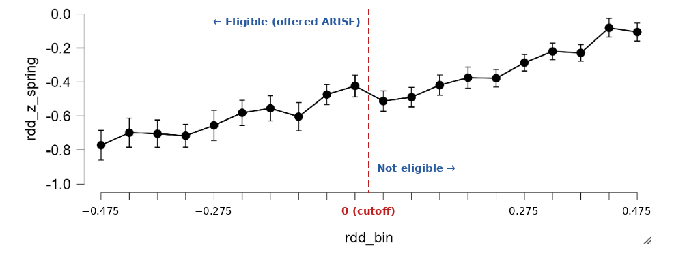
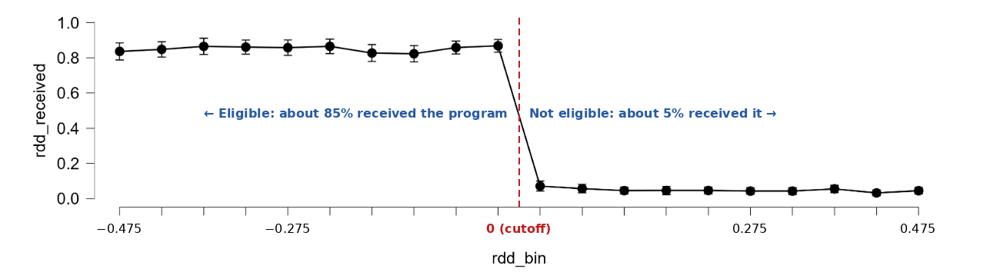
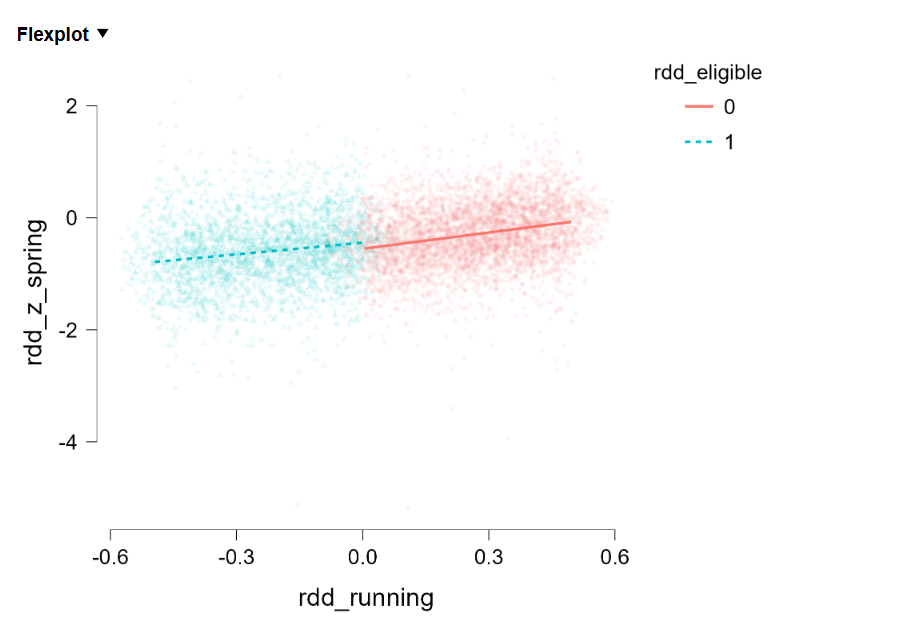
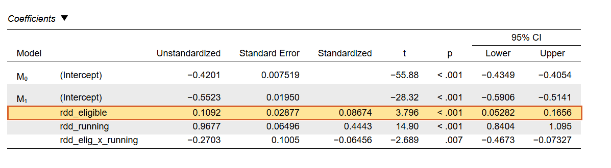
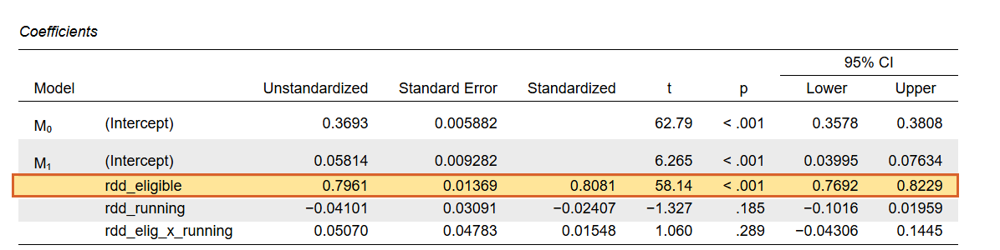

# Module 9: Assignment follows a cutoff score

**Design:** Regression discontinuity design (RDD) · **File:** [m09_regression_discontinuity.csv](data/m09_regression_discontinuity.csv) · **JASP analyses:** ANOVA (for the binned plot), Descriptives, Linear Regression

**This module uses a simulated program.** ARISE was not assigned by a cutoff score, so your instructor created a made-up reading intervention and added its effect to real students' scores. Your instructor knows the true effect and will share it when you meet, so you can see how close your estimate came.

## The problem

The program was not given at random, but it was given by a rule you know: students below a cutoff score were offered it.

- **What is missing.** What students just below the cutoff would have scored in spring if they had not been offered the program.
- **The trial you wish you had.** A coin flip among students with fall scores near the cutoff.
- **The stand-in available.** Students just above the cutoff, who are nearly identical but were not offered the program.

Many programs are given to people below (or above) a cutoff on a score. That is, students below a reading benchmark get intervention and students with a GPA above 3.0 get a scholarship. A **regression discontinuity design** compares people just below the cutoff with people just above it.

Why does that work? A student who scored 1 point below the cutoff and one who scored 1 point above are nearly identical. They have the same skills, same background, separated only by a little luck on test day. But one got the program and one didn't. If outcomes jump right at the cutoff, the program is the best explanation, because nothing else changes suddenly at that exact score.

The stand-in for "what would have happened" is the students just on the other side of the line.

**The story.** Each fall, every student whose fall reading z-score fell below **−0.63** (roughly the bottom 25%) was offered a reading intervention. Not everyone offered took part (about 85% did), and a few students above the cutoff got in anyway (about 5%). The outcome is the spring z-score. Four school years are combined to give enough students near the cutoff.

## Picture the design: filling in the missing world

Like this module's data, this example uses a made-up program. Imagine the program had been offered to every one of the six students who scored below 465 in the fall. That puts Dev (430), Eli (450) and Ava (460) in the program, so we see their Y₁. Fay (470), Ben (480) and Cruz (500) are not offered, so we see their Y₀. Everyone offered takes part, which keeps the picture simple. The module's data is fuzzy, because not everyone offered took part.

**The stand-in:** the students just on the other side of the cutoff. A line through the not-offered students, extended to the cutoff, stands in for what students right at the cutoff would score without the program.

| Student | Fall score | Offered the program? | Spring score, observed | Which world we see |
| --- | --- | --- | --- | --- |
| Dev | 430 | Yes | 456 | Y₁ |
| Eli | 450 | Yes | 474 | Y₁ |
| Ava | 460 | Yes | 486 | Y₁ |
| Fay | 470 | No | 490 | Y₀ |
| Ben | 480 | No | 498 | Y₀ |
| Cruz | 500 | No | 520 | Y₀ |

At the cutoff of 465, the offered students' line reaches about 490 and the not-offered students' line reaches about 484. The jump, about +6, is the RDD estimate. The true effects for the students nearest the cutoff are +4 (Ava) and +5 (Eli).

*Regression discontinuity in the running example, as if the program had been offered to everyone scoring below 465. Illustrative numbers, not ARISE data.*

**Reading the picture.** Each side of the cutoff gets its own line. The orange line runs through the students who were offered the program, and the blue line runs through those who were not. RDD extends the blue line just to the cutoff (the purple dashed line) and uses it as the stand-in for what students at the cutoff would have scored without the program. The gap between the two lines at 465 is the estimate. The gray circles are the offered students' never-seen Y₀, and they sit close to the purple line, which is why this stand-in works. Ava at 460 and Fay at 470 started only 10 points apart, so Fay is a reasonable stand-in for Ava. With only six students the lines are rough, so the estimate of about +6 is a little off. Real studies use many students close to the cutoff.

**What it can and cannot answer.** RDD answers "What was the program's effect for students near the cutoff?" It cannot say much about students far from the cutoff, such as Dev at 430.

**Looking ahead.** Module 10 lets a coin flip decide who gets the program.

## What must be true to believe it

RDD asks you to believe that nothing except the offer changes at the cutoff. In symbols, with R the running variable and the cutoff at 0:

$$
E[Y_0 \mid R = r] \text{ and } E[Y_1 \mid R = r] \text{ change smoothly as } r \text{ passes through the cutoff } (r = 0)
$$

Read it as continuity. If you could see Y₀ for every student and plot its average against the fall score, the line would pass straight through the cutoff with no jump. Students at −0.01 and +0.01 would have the same average Y₀. This is exchangeability, but only at the cutoff: right there, which side a student lands on is as good as random. It fails if students, families or teachers can push a score to one side, or if something else, such as a second program, uses the same cutoff.

A fuzzy RDD, like the one in this module, needs two more conditions to turn the jump into the effect of receiving the program. Being offered the program must change scores only by changing who takes part (the exclusion restriction), and no student may be less likely to take part because they were offered it (monotonicity).

**How you could check it.** Partly, and better than in most designs. Part B looks for a pile-up of students just below the cutoff (sorting) and for jumps in characteristics such as el and swd that the program could not change. Part E looks for a jump in a score the program could not have touched. Passing these checks does not prove continuity, but failing them is a strong warning.

**When the stand-in can be believable.** When a fixed rule set the cutoff, students could not control which side they landed on, and the balance and density checks show nothing unusual at the cutoff.

**How the What Works Clearinghouse would judge it.** The WWC reviews RDDs under their own standards (*WWC Handbook, Version 5.0*, Chapter IV). A study can earn Meets WWC Standards Without Reservations if it passes four standards: the running variable cannot be manipulated, attrition is low, the relationship between the running variable and the outcome is modeled well (including a bandwidth check), and, for a fuzzy RDD, extra criteria on the first stage and on how the effect of receiving the program is estimated.

## The design and its model: regression discontinuity

The **running variable** is the score that decides eligibility, re-centered so the cutoff is at **0**. Here, **rdd\_running** = fall z-score + 0.63. Negative = eligible.

**Fitting two lines.** Within a window around the cutoff (the **bandwidth**), fit one line for students below the cutoff and one for students above. The **gap between the lines at 0** is the effect. The regression uses three predictors:

$$
\text{rdd\_z\_spring} = b_0 + b_1 \times \text{eligible} + b_2 \times \text{running} + b_3 \times (\text{eligible} \times \text{running})
$$

- **b1 (rdd\_eligible):** the jump at the cutoff. **This is the RDD estimate.**
- **b2 (rdd\_running):** the slope of the line above the cutoff.
- **b3 (rdd\_elig\_x\_running):** how much the slope differs below the cutoff (so the two lines can tilt differently).

**Sharp vs. fuzzy.** If everyone below the cutoff got the program and no one above did, the design is **sharp**, and b1 is the program's effect. Here, take-up was imperfect, so the design is **fuzzy**:

- The jump in the outcome at the cutoff is the effect of being offered the program (the **intent-to-treat effect**, ITT).
- The jump in participation at the cutoff is the first stage. It determines how much more likely eligible students were to actually get the program.
- **Effect of receiving the program = ITT ÷ first stage.** For example, if being offered a program raised scores by 0.06 and raised participation by 0.60 (60 percentage points), receiving it raised scores by 0.06 ÷ 0.60 = 0.10. This applies to students near the cutoff who took the program because they were offered it.

**Bandwidth.** A narrow window compares students who are most alike, but includes fewer of them (less precise). A wide window has more students, but those far from the cutoff are less comparable and a straight line may fit poorly. Good practice is to check that the answer holds up across several bandwidths. **Triangular weights** give students closest to the cutoff the most weight.

**The model, in symbols.** Articles write the RDD model with R for the running variable and h for the bandwidth:

$$
Y_i = \beta_0 + \beta_1\,\text{Elig}_i + \beta_2 R_i + \beta_3\,(\text{Elig}_i \times R_i) + \varepsilon_i, \qquad \text{for students with } |R_i| \le h
$$

| Symbol | What it means | Where it shows up in JASP |
| --- | --- | --- |
| Yᵢ | Student i's spring score | Dependent Variable (rdd\_z\_spring) |
| Rᵢ | The running variable: the fall score minus the cutoff | rdd\_running |
| Eligᵢ | 1 if Rᵢ is below 0, so the student was offered the program | rdd\_eligible |
| h | The bandwidth: how far from the cutoff a student can be and still be included | rdd\_bw050 filter (h = 0.5) |
| β₁ | The jump at the cutoff (the ITT at the cutoff) | rdd\_eligible row |
| β₂ | The slope above the cutoff | rdd\_running row |
| β₃ | How much the slope differs below the cutoff | rdd\_elig\_x\_running row |
| Dᵢ | 1 if the student actually took part | rdd\_received |
| γ₁ | The jump in participation at the cutoff (the first stage) | rdd\_eligible row in Part D |

**Which effect does it estimate?** At R = 0, the interaction and slope terms are zero, so the eligible line reaches β₀ + β₁ and the not-eligible line reaches β₀. The gap is β₁:

$$
\beta_1 = \underbrace{\lim_{r \uparrow 0} E[Y \mid R = r]}_{\text{just below the cutoff}} - \underbrace{\lim_{r \downarrow 0} E[Y \mid R = r]}_{\text{just above the cutoff}} = \text{ITT at the cutoff}
$$

By the continuity assumption, the line from above the cutoff is the stand-in for the eligible students' Y₀ right at the cutoff, so β₁ is the effect of being offered the program for students at the cutoff. In the running example, the program line reached about 490 at 465 and the stand-in line reached about 484, so RDD reported about +6. The true effects for the two students nearest the cutoff were +4 and +5. Neither number tells you anything about Dev at 430.

In a fuzzy RDD, not every eligible student took part. Part D fits the same model with participation as the outcome. This is the first stage:

$$
D_i = \gamma_0 + \gamma_1\,\text{Elig}_i + \gamma_2 R_i + \gamma_3\,(\text{Elig}_i \times R_i) + \nu_i
$$

Dividing the jump in scores by the jump in participation gives the LATE:

$$
\text{LATE} = \frac{\beta_1}{\gamma_1} = \frac{\text{jump in the outcome at the cutoff}}{\text{jump in participation at the cutoff}}
$$

The LATE is the effect of receiving the program for compliers at the cutoff: students near 0 who took part because they were offered it and would not have taken part otherwise. It is not the ATE for everyone, and it is not the ATT for every participant. If γ₁ were 1 (a sharp design), the LATE and the ITT would be the same.

**Behind the scenes: what JASP computes.** JASP fits each model by least squares, using only the students the filter keeps. With rdd\_tri\_w050 in WLS Weights, it fits weighted least squares instead, giving each student a triangular weight:

$$
w_i = 1 - \frac{|R_i|}{h} \qquad \text{for } |R_i| \le h
$$

A student at the cutoff gets weight 1, a student halfway to the edge of the bandwidth gets 0.5, and a student at the edge gets 0. JASP does not compute the LATE or its SE for you. Dividing β₁ by γ₁ by hand gives the right estimate, but a proper SE needs two-stage least squares, which statistical software such as R or Stata provides.

## Example scenarios

**Scenario A: Required summer school.** Students scoring below 300 on the spring state test must attend summer school. Compare next fall's scores for students scoring 290 to 299 with those scoring 300 to 309. Question answered: *For students right around 300, did summer school raise fall scores?* Not answered: *Would it help students scoring 200?*

**Scenario B: A merit scholarship.** Students with a GPA of 3.0 or higher get a scholarship. Compare college enrollment for students just above and just below 3.0. *Threat:* If teachers nudge borderline students' grades up to 3.0, students just above the cutoff are no longer comparable to those just below.

## Your question in this module

*For students near the cutoff, did being offered the intervention raise spring reading scores, and by how much did actually receiving it raise them?*

## Get to know the data

**Data dictionary.** The variables you will use in this module. Each row is one student in one year.

| Variable | Definition | Data type |
| --- | --- | --- |
| rdd\_running | The running variable: the student's fall z-score measured as a distance from the cutoff (z\_fall + 0.63). 0 is the cutoff, and a negative value means below it. | Continuous (Scale) |
| rdd\_eligible | 1 = below the cutoff (rdd\_running below 0), so the student was offered the intervention; 0 = at or above the cutoff | Binary 0/1 (Nominal for plots and Split, Scale for regressions) |
| rdd\_received | 1 = the student actually took part, 0 = did not. About 85% of eligible students and 5% of ineligible students took part. | Binary 0/1 (Scale) |
| rdd\_elig\_x\_running | rdd\_eligible × rdd\_running. It lets the line have a different slope on each side of the cutoff, and it is 0 for everyone at or above the cutoff. | Continuous (Scale) |
| rdd\_z\_spring | Spring reading z-score with the simulated intervention's effect added for students who received it. This is the outcome. | Continuous (Scale) |
| z\_spring | The real spring z-score, with no simulated effect. It is used only for the placebo check. | Continuous (Scale) |
| rdd\_bw025, rdd\_bw050, rdd\_bw075 | 1 = within 0.25, 0.5 or 0.75 SD of the cutoff (the bandwidth), 0 = farther away | Binary 0/1 (used as filters) |
| rdd\_bin | The midpoint of a 0.05-SD slice of rdd\_running. Used only to draw the binned plot. | Category, number code (Nominal) |
| rdd\_tri\_w050 | Triangular weight: 1 at the cutoff, falling to 0 at 0.5 SD away, so students closest to the cutoff count most | Weight (Scale) |
| el, swd | 1 = English learner; 1 = student with a disability. Used for the balance check. | Binary 0/1 (Scale) |

1. Open **m09\_regression\_discontinuity.csv**. Each row is one student in one year, about 22,528 in all. Make sure no filter is on; if you come back to this section after step 3, remove the rdd\_bw050 filter first, or you will see only 6,734 students.
2. Set **rdd\_eligible** to **Nominal** and **rdd\_received** to **Scale** (it is coded 0/1; as Scale, its mean is the share who got the program). Click **Descriptives**. Move **rdd\_running, rdd\_received** and **rdd\_z\_spring** into **Variables** and **rdd\_eligible** into **Split**. Under **Plots**, tick **Distribution plots**.

**What to look for:** **rdd\_running** is each student's fall score measured as a distance from the cutoff, so 0 is the cutoff. Check its minimum and maximum in each group: eligible students should all be below 0 and ineligible students at or above it. **rdd\_received** is 1 = got the program, so its mean is the share who received it; expect a high share among eligible students and a low share among the rest. Not everyone who was eligible took part, and a few who were not eligible did. That matters for how you read the effect later. Finally, expect eligible students' spring scores (rdd\_z\_spring) to be far lower, roughly 1.3 SD below ineligible students. That gap is by design, since eligibility goes to low fall scorers. It is not a program effect, which is why RDD compares only students close to the cutoff.

## Step by step in JASP

**Where the variables go, and why.**

| Variable | JASP box | Role and why |
| --- | --- | --- |
| rdd\_z\_spring | Dependent Variable (Parts A and C) | The outcome |
| rdd\_received | Dependent Variable (Parts A and D) | In the first stage the question is how much being eligible changed who took part, so participation becomes the outcome |
| rdd\_eligible | Covariates (regressions); Flexplot independent variable | The treatment, being offered the program. Its coefficient is the jump at the cutoff. Set it to Scale for regressions and Nominal for Flexplot lines. |
| rdd\_running | Covariates; Flexplot independent variable | Accounts for the smooth rise in spring scores with fall scores, so that rise is not mistaken for a jump |
| rdd\_elig\_x\_running | Covariates | Lets the slope differ on each side of the cutoff |
| rdd\_bin | Fixed Factors (ANOVA, Part A) | Used only to draw the binned plot. Each bin's mean becomes one dot. |
| rdd\_bw050, rdd\_bw025, rdd\_bw075 | Filter | Keep only students near the cutoff, where students on either side are most alike |
| rdd\_tri\_w050 | WLS Weights | Gives students closest to the cutoff the most weight |
| el, swd | Dependent Variable (balance check, Part B) | Characteristics that should not jump at the cutoff. If they do, the two sides were not alike. |
| z\_spring | Dependent Variable (placebo, Part E) | A score with no program effect, so it should show no jump |

**Setup**

1. Open **m09\_regression\_discontinuity.csv**.
2. Set **rdd\_bin** and **rdd\_eligible** to **Nominal** for now (you will change rdd\_eligible later). Set **rdd\_running, rdd\_received, rdd\_elig\_x\_running, rdd\_tri\_w050, rdd\_z\_spring, z\_spring, el, swd** to **Scale**.
3. Filter to **rdd\_bw050 = 1** (students within 0.5 SD of the cutoff).

**Part A: See the jump**

4. Click **ANOVA**, then **ANOVA**. Put **rdd\_z\_spring** in **Dependent Variable** and **rdd\_bin** in **Fixed Factors. The ANOVA is only there to draw the plot; ignore its tables**.
5. Open **Descriptives Plots**. Put **rdd\_bin** on the **Horizontal Axis** and tick **Display error bars**. Each point is the average spring score in a narrow slice of fall scores. The cutoff falls between **−0.025** and **0.025 (the dashed line in Figure 21). In your own plot the labels will overlap, so count the dots: the cutoff is between the 10th and 11th**.

Figure 21: average spring z-score in each fall-score bin. Scores rise from left to right and step down slightly (about 0.1 SD) at the cutoff (dashed line)

6. In the same ANOVA, replace rdd\_z\_spring with **rdd\_received** as the Dependent Variable. This shows the jump in participation.

Figure 22: share of students who received the program in each bin. Participation drops from about 85% to about 5% at the cutoff (dashed line)

**See the jump as two lines (Flexplot).** The binned plot's labels crowd together, and the jump can be hard to spot. With the **rdd\_bw050** filter still on, click **Visual Modeling**, then **Flexplot** (add it with **+** if needed). Set **rdd\_eligible** to **Nominal**. Put **rdd\_z\_spring** as the dependent variable, and **rdd\_running** and then **rdd\_eligible** as the independent variables. Under **Options**, set **Fitted line** to **Regression**, slide **Point transparency** close to **0** so the dots fade, and tick **Plot confidence bands**. You get one straight line on each side of the cutoff at 0.

**Figure 23****: Using Flexplot to visualize the jump at 0**

**Part B: Check the design**

**Why check the design?** Part A shows that there is a jump at the cutoff. Part B checks whether the program is the only thing that changes there. RDD's stand-in for the missing world is the students just above the cutoff, and it works only if they are nearly identical to the students just below it. You cannot test that directly, because you never see the eligible students' spring scores without the program. What you can test is whether anything else jumps at the cutoff. Each check looks for one way the stand-in could fail.

The first check looks for sorting. If teachers, families or students could push a score just below the cutoff to get the intervention, the students just below 0 would be a selected group, and part of the jump could come from who they are rather than from the program. Sorting would show up in the distribution plot as a pile of students just below 0 and a gap just above it. A steady rise or fall in the bars is fine. Only a break right at 0 is a warning sign. The second check looks for balance. EL status and disability status were set before the fall test, so the program cannot change them. If either one jumps at the cutoff, the two sides differ in something besides the program, and you could not tell which one caused the jump in spring scores. In the regression, the rdd\_eligible coefficient is the size of that jump. You want it to be small, with a confidence interval that includes 0. The rdd\_running coefficient only describes the smooth slope across fall scores and is not a problem. If both checks look clean, you can trust Part A's jump as the effect of the offer.

7. **No sorting around the cutoff:** click **Descriptives**, move **rdd\_running** into Variables, and under Plots tick **Distribution plots**. Look for a pile-up of students just below 0.
8. **Similar students on both sides:** set **rdd\_eligible** to **Scale**. Run a **Linear Regression** with **el** as the Dependent Variable and **rdd\_eligible, rdd\_running, rdd\_elig\_x\_running** as Covariates. Repeat with **swd**. The rdd\_eligible coefficient should be close to 0.

**Part C: Estimate the effect of being offered (ITT)**

9. Run a **Linear Regression**: **rdd\_z\_spring** as Dependent Variable; **rdd\_eligible, rdd\_running, rdd\_elig\_x\_running** as Covariates. Tick **Estimates, Confidence intervals, Model fit** under **Statistics**.

**What this model does.** It fits two straight lines, one on each side of the cutoff, and measures the gap between them at 0. Writing out each line shows how:

- Not eligible (at or above the cutoff): spring = intercept + (rdd\_running coefficient × rdd\_running)
- Eligible (below the cutoff): spring = (intercept + rdd\_eligible coefficient) + (rdd\_running coefficient + rdd\_elig\_x\_running coefficient) × rdd\_running

At the cutoff, rdd\_running is 0, and so is rdd\_elig\_x\_running, so every term involving the running variable drops out. The only difference left between the two lines is the rdd\_eligible coefficient. That coefficient is the jump at the cutoff and the ITT: the effect of being offered the intervention for students right at the cutoff. This is why the running variable is centered at the cutoff. The intercept is the predicted spring score for a student exactly at the cutoff who was not offered the program. The rdd\_running coefficient is the slope above the cutoff, which captures the smooth rise of spring scores with fall scores so that it is not mistaken for a jump. The rdd\_elig\_x\_running coefficient is how much that slope changes below the cutoff, which lets each side have its own shape. Ignore the M₀ row, which only reports the average spring score in the window.

**Why not compare the two groups' averages?** Eligible students started lower, which is why they were eligible, so they also tend to score lower in spring. A simple comparison of the averages mixes that starting gap in with any program effect, and in this window it would make the program look harmful. Including rdd\_running compares students with the same fall score, right at the line. The estimate is called the ITT because it measures the effect of the offer, not of taking part: some eligible students did not participate, and a few ineligible students did. Part D adjusts for that.

**Part D: The first stage and the effect of receiving the program**

10. Run the same regression with **rdd\_received** as the Dependent Variable. The rdd\_eligible coefficient is the first stage.
11. Divide the Part C rdd\_eligible coefficient by the Part D one. That is the effect of receiving the program. (JASP does not compute this or its CI for you.)

**Why the first stage matters.** Part C measured the effect of being offered the intervention. Not everyone who was offered took part, and a few students who were not offered got in anyway, so the jump in spring scores is spread across some students who never received the program. The first stage measures how much the offer actually changed participation at the cutoff. If the offer raised participation by 80 percentage points, then the Part C jump comes from about 80% of students switching into the program. Dividing the Part C jump by the first stage scales it up to the effect for a student who actually receives the program. This is what makes the design a **fuzzy regression discontinuity**. Two conditions matter. The first stage should be large and clearly different from 0, because dividing by a small, uncertain number gives an unstable answer. And the offer should affect spring scores only through participation, not in some other way.

**Who the estimate describes.** The ratio is the effect for students near the cutoff who took part because they were offered it. It does not describe students who would have joined no matter what, students who would never join, or students far below the cutoff. This is called a **local average treatment effect (LATE)**. For a program aimed at the bottom quarter of readers, students near the 25th percentile are the group a district would care about if it were deciding whether to move the cutoff. The estimate may not hold for the lowest readers.

**Putting the effect in real-world terms.** An effect in SD units is hard to picture, so translate it in a few ways. The examples below use an effect of 0.10 SD; repeat them with your own estimate.

| Translation | How to do it | Example for 0.10 SD |
| --- | --- | --- |
| Scale-score points | Multiply by the grade's SD in i-Ready points. In this data, 1 SD is about 40 points in kindergarten and about 53 to 58 points in grades 1 to 5. | About 4 points in kindergarten and 5 to 6 points in grades 1 to 5 |
| Share of a year's growth | Divide those points by the typical fall-to-spring gain for the grade. In the Module 1 file, students gained about 48 points in kindergarten and grade 1, 37 in grade 2, 33 in grade 3, 26 in grade 4 and 23 in grade 5. | About 8% of a year's growth in kindergarten and about 25% in grade 5 |
| Percentile | Start at the 25th percentile (z = −0.67), add the effect, and look up the new percentile. | From the 25th to about the 28th percentile |
| Kraft's benchmarks (Part 1) | Compare with typical effects of education programs | Medium (0.05 to 0.19 SD) |

The same effect looks larger as a share of growth in older grades. That is because older students gain fewer points per year, not because the program works better for them. The fall and spring tests are about seven months apart, so share of a year's growth is an approximation.

**How certain is it?** JASP does not give a confidence interval for the ratio. For a rough range, divide each end of the Part C confidence interval by the first stage. This ignores the uncertainty in the first stage itself, so the true interval is somewhat wider. Software built for regression discontinuity, such as the rdrobust package in R or Stata, computes the interval properly.

**Part E: Robustness checks**

12. **Other bandwidths:** change the filter to **rdd\_bw025** = 1, then **rdd\_bw075** = 1 (remove the old filter each time) and rerun Parts C and D.
13. **Triangular weights:** with the rdd\_bw050 filter, rerun Part C with **rdd\_tri\_w050** in **WLS Weights**.
14. **Placebo:** with the rdd\_bw050 filter, rerun Part C with **z\_spring** (the real score, with no simulated program) as the Dependent Variable. What should you find?

## Checkpoints

- With the rdd\_bw050 filter: **N = 6,734** (2,695 eligible, 4,039 not eligible).
- The binned plot has **20 bins**, from −0.475 to 0.475.
- Share who received the program: about **85%** of eligible and about **5%** of ineligible students (Descriptives of rdd\_received split by rdd\_eligible, or the Part A participation plot).
- rdd\_bw025: **N = 3,264**. rdd\_bw075: **N = 9,801**.

## Reading the output

Read the output in the order you ran it, from Part A to Part E. Figures 21 to 23 are in Step by step in JASP.

**Part A: the binned plots (Figures 21 and 22).** Each dot is one bin, a narrow slice of students with similar fall scores. The horizontal axis is the bin (the fall score's distance from the cutoff, with 0 at the cutoff), and the vertical axis is the average spring score of students in that bin. The bars are 95% confidence intervals. JASP treats the bins as categories, so they are evenly spaced, and its labels overlap, so count the dots instead. The cutoff falls between the 10th dot (the last eligible bin, −0.025) and the 11th dot (the first ineligible bin, 0.025). Lower running scores, and eligible students, are on the left. In Figure 21 the dots rise from left to right because students with higher fall scores also score higher in spring. That rise is not an effect. A program that helps shows up as the 10th dot sitting higher than the pattern on the right would predict, so the line steps down at the cutoff. Here that step is small (about 0.1 SD) and no bigger than some other bin-to-bin wiggles, so "I can't see much of a jump" is a fair reading. The regression in Part C decides. In Figure 22, made with rdd\_received, the vertical axis is the share of students who got the program, so you should see a big drop at the cutoff, from about 85% to about 5%.

**Part A: the Flexplot (Figure 23).** Look at the two lines where they meet at 0. The eligible line (left) ends slightly above where the ineligible line (right) begins, by about 0.1 SD. That gap is the effect of being offered the program (ITT), the same number the rdd\_eligible row estimates in Part C. The faded cloud of dots shows how small this gap is next to how much individual students vary, which is why RDD studies usually show binned plots. A visible gap is not proof, so check the confidence interval in Part C.

**Part B: the design checks.** In the distribution plot of rdd\_running, a smooth histogram through 0 is good. A pile of students just below 0, with a gap just above it, would suggest students were sorted into eligibility. In the el and swd regressions, look only at the rdd\_eligible row. It is the jump in that characteristic at the cutoff, so you want a small estimate with a confidence interval that includes 0.

Figure 24. Coefficients table from Part C (rdd\_z\_spring as the dependent variable, rdd\_bw050 filter on), with the rdd\_eligible row highlighted

**Part C: the effect of being offered (Figure 24).** Start with the highlighted rdd\_eligible row. Its estimate, 0.109, is the jump at the cutoff. Students just below the cutoff, who were offered the intervention, scored about 0.11 SD higher in spring than students just above it. The 95% confidence interval runs from about 0.05 to 0.17. It lies entirely above 0 and p < .001, so a jump this size is unlikely to be chance. This is the ITT.

The other rows describe the shape of the two lines, so that the jump is measured fairly. They are not effects.

- Intercept (−0.55): the predicted spring z-score for a student exactly at the cutoff who was not offered the program.
- rdd\_running (0.97): the slope above the cutoff. Each extra SD of fall score goes with about 0.97 SD higher spring score.
- rdd\_elig\_x\_running (−0.27): how much the slope changes below the cutoff. The eligible side's slope is 0.97 − 0.27 = 0.70.
- M₀: the model with no predictors. Ignore it.

Figure 25. Coefficients table from Part D (rdd\_received as the dependent variable, rdd\_bw050 filter on), with the rdd\_eligible row highlighted

**Part D: the first stage and the effect of receiving the program (Figure 25).** With rdd\_received as the dependent variable, the highlighted rdd\_eligible row is the first stage, about 0.80, with a 95% confidence interval from 0.77 to 0.82. Being offered the intervention raised participation by about 80 percentage points at the cutoff. Divide the Part C estimate by it: 0.109 ÷ 0.80 ≈ 0.14 SD. That is the estimated effect of actually receiving the intervention for students near the cutoff. Part D of Step by step in JASP explains how to put it in real-world terms.

**The rdd\_eligible row in every model.** The same row means something different depending on the dependent variable:

| Model | The rdd\_eligible coefficient is… |
| --- | --- |
| el or swd outcome (Part B) | A balance check. Should be near 0 |
| rdd\_z\_spring (Part C) | The **effect of being offered** (ITT), in SD units |
| rdd\_received (Part D) | The **first stage**: jump in the share who got the program |
| z\_spring (Part E placebo) | Should be near 0, because no program was added to z\_spring |

In each model, look at the estimate, CI and p-value. For Part E, compare the Part C and Part D estimates across bandwidths and weights. If they stay similar, you can be more confident in them.

## Explaining it to stakeholders

This design gives two numbers, and each answers a different question. The ITT (Part C) answers "What happens if the district offers the intervention to students below the cutoff?" That is the policy question, because not everyone offered will take part. The effect of receiving the program (Part D) answers "How much does it help the students who take part?" Report both, and say which is which. Translate each one with the table in Part D (Putting the effect in real-world terms) or the tables in Part 2.

**A sample sentence.** "For students near the 25th percentile in reading, offering the intervention raised spring scores by about \_\_\_ i-Ready points. For students who actually took part, the gain was about \_\_\_ points, roughly \_\_\_% of a typical year's growth."

**What to add.** The result applies to students near the cutoff: "We can't say from this design whether the intervention would help students far below the cutoff as much." The program in this module is simulated, so these numbers are practice for explaining real results.

## Assumptions

- **No manipulation of the running variable.** Students (or teachers) could not push scores just below the cutoff to qualify.
- **Continuity.** Without the program, outcomes would change smoothly across the cutoff. Nothing else changes at the same score.
- **The right shape.** Within the bandwidth, a straight line on each side fits the data reasonably.
- **For the fuzzy estimate:** being below the cutoff affects scores **only** through receiving the program.
- **The answer is local.** It applies to students **near** the cutoff, not to all students.

## Threats to internal validity

- **Manipulation or sorting** at the cutoff.
- **Other programs using the same cutoff.** In real schools, a benchmark score often triggers several supports at once. RDD would credit them all to one program.
- **Imbalance at the cutoff** in student characteristics (Part B).
- **Too narrow a bandwidth** (noisy) or **too wide** (comparing unlike students).
- **Note:** regression to the mean is **not** a threat here. It affects students on both sides of the cutoff equally, which is one of RDD's strengths.

## Bring to your instructor

1. Report the ITT, first stage and effect of receiving the program at the 0.5 bandwidth, with CIs for the first two.
2. How much did the ITT change across bandwidths and with triangular weights?
3. What did the balance and density checks show? If one looked off, how worried should you be?
4. What did the placebo show, and why is it a useful check?
5. Who does your estimate apply to? Would you expect the same effect for students far below the cutoff?
6. **Back to the two worlds.** In the running example, which of Ava's two outcomes did we never see? What did RDD use in its place, and why are students like Fay a reasonable stand-in for students like Ava?
7. Suppose the program had no effect at all, so every student's Y₁ equals their Y₀. What would you expect to see at the cutoff in the picture? (With only six students, the gap would be about +2. Why isn't it exactly zero?)
8. The estimate applies to students near the cutoff. In the running example, why would it be risky to use it to describe Dev, who scored 430?
9. Suppose students who scored just above the cutoff could retake the fall test to get below it and into the program. Why would that break the stand-in? Which check in this module looks for this problem?

## Learn more

- *The Effect*, **Chapter 20, Regression Discontinuity:** running variables, bandwidths, fuzzy RDD and checks for manipulation and balance.
- *The Effect*, **Chapter 19, Instrumental Variables:** the logic behind dividing by the first stage in a fuzzy RDD.
- *The Effect*, **Chapter 10, Treatment Effects:** why an RDD estimate is local to people near the cutoff.
- *Causal Inference: The Mixtape*, Chapter 6, Regression Discontinuity: continuity, sharp and fuzzy designs, bandwidths and the density test.
- *Causal Inference: The Mixtape*, Chapter 7, Instrumental Variables: compliers, monotonicity and why the ratio estimates a LATE.
- *Mastering 'Metrics*, Chapter 4, Regression Discontinuity Designs: a plain-language tour with worked examples.
- *Methods Matter*, Chapter 9, Estimating causal effects using a regression-discontinuity approach: examples from education.
- *Experimental and Quasi-Experimental Designs* (Shadish, Cook and Campbell), Chapter 7, Regression Discontinuity Designs: the design's history and threats.
- *What If*, Chapter 16, Instrumental Variable Estimation: the conditions an instrument needs, for readers who want the formal version.
- *WWC Handbook, Version 5.0*, Chapter IV, Reviewing Findings from Regression Discontinuity Designs: the four standards and the fuzzy RDD criteria.

