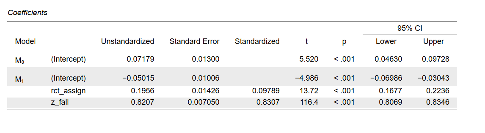
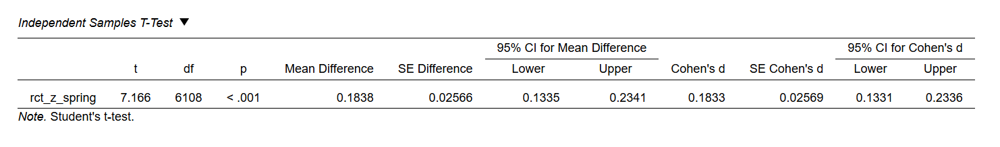

# Module 10: Assignment can be randomized

**Design:** Randomized controlled trial (RCT) · **File:** [m10_randomized_trial.csv](data/m10_randomized_trial.csv) · **JASP analyses:** Independent Samples T-Test, Linear Regression (or ANCOVA)

**This module uses a simulated program.** In the data, half the students in each school and grade were randomly assigned to a made-up program in 2024-25, and a known effect was added to their spring scores. Your instructor will share the true effect when you meet.

## The problem

Every earlier design had to argue that its comparison group was a fair copy of the program group. Here you can make it one.

- **What is missing.** What the program students would have scored in spring without the program.
- **The trial you wish you had.** This one: a coin flip within each school and grade decides who gets the program.
- **The stand-in available.** The control group, which differs from the program group only by chance.

Every design so far has wrestled with one problem. Namely, the groups might have been different **before** the program, in ways we can't fully measure. Random assignment solves this problem by design. When a coin flip decides who gets the program, nothing about the students (motivation, family support, prior skill, anything measured or not) can influence who ends up in which group. On average, the two groups are alike in every way **except** the program.

The stand-in for "what would have happened" is the **control group**, which is a fair copy of the program group thanks to chance alone. A simple difference in average outcomes is then an unbiased estimate of the program's effect.

That's why RCTs are often called the **gold standard**. They are not perfect, they can be costly, sometimes unethical or impractical, and they have their own threats (below). But they rule out selection bias in a way no other design can.

**Blocking.** Here, randomization was done separately within each school and grade (a **block**), so each block has about half program and half control students. This guarantees balance on school and grade, not just on average.

## Picture the design: Filling in the missing world

Like this module's data, this example uses a made-up program. Imagine a coin flip decided which three of the six students got it. The coin chose Ava, Cruz and Dev for the program. Ben, Eli and Fay became the control group.

**The stand-in:** the control group's average spring score. Because a coin decided who was in each group, the control group is a fair copy of the program group, on average.

| Student | Coin flip | Fall score | Spring score, observed | Which world we see |
| --- | --- | --- | --- | --- |
| Ava | Program | 460 | 486 | Y₁ |
| Cruz | Program | 500 | 525 | Y₁ |
| Dev | Program | 430 | 456 | Y₁ |
| Ben | Control | 480 | 498 | Y₀ |
| Eli | Control | 450 | 469 | Y₀ |
| Fay | Control | 470 | 490 | Y₀ |
| **Program average** |  | **463.3** | **489.0** |  |
| **Control average (stand-in)** |  | **466.7** | **485.7** |  |
| **RCT estimate** |  |  | **+3.3** | **True effect +5** |

*A randomized trial in the running example. Illustrative numbers, not ARISE data.*

**Reading the picture.** Our coin flip gave +3.3, not +5. A different flip would have given a different answer. The chart shows all 20 ways a coin could split the six students 3 and 3. Their estimates run from about −31 to +41, but they average exactly +5. That is what unbiased means. Because chance, not the students' characteristics, decided who got the program, nothing about the students can push the estimate in one direction, so the stand-in is right on average. Any single flip can still miss, though, and with only six students it can miss badly. Our flip happened to give the program group a slightly lower fall average (463 versus 467). With thousands of students, as in the module, the dots crowd tightly around the true effect. Blocking by school and grade, and adjusting for fall scores, tighten them further.

**What it can and cannot answer.** An RCT answers "Did the program cause higher scores, on average, for the students in the study?" It cannot by itself say whether the effect would be the same in other schools, and a small trial gives a noisy answer.

**Looking ahead.** Module 11 asks who benefited most from the program and whether more of it helped more. Then the wrap-up puts all ten designs side by side, so you can compare how each one filled in the missing world.

## What must be true to believe it

An RCT asks you to believe that the coin flip, and nothing else, decided who got the program. In symbols, with Z = 1 for students assigned to the program:

$$
(Y_1, Y_0) \text{ independent of } Z \quad\Longrightarrow\quad E[Y_0 \mid Z = 1] = E[Y_0 \mid Z = 0]
$$

Read it as: a student's potential outcomes had nothing to do with which group the coin put them in, so the control group's average Y₀ is a fair stand-in for the program group's missing Y₀. This is exchangeability, and here it holds by design rather than by argument. Positivity holds too, because every student had a real chance of either group. Two things can still break it after the coin is flipped. If students leave the study unevenly (attrition), the students who remain may no longer be alike. If the program spills over to control students, their Y₀ is no longer the world without the program, which breaks the consistency condition from Part 1.

**How you could check it.** Largely. You cannot see Y₀, but you can check that the groups are balanced on fall scores and other characteristics, check how many students in each group are missing a spring score, and ask whether control students could have received the program another way.

**When the stand-in can be believable.** When the randomization was done properly, attrition is low and similar in both groups, and the program did not spill over to the control group.

**How the What Works Clearinghouse would judge it.** An RCT with low attrition, overall and in the difference between groups, can earn Meets WWC Standards Without Reservations, the highest rating. An RCT with high attrition is treated like a QED: it must show baseline equivalence, and its best rating is With Reservations (*WWC Handbook, Version 5.0*, Chapter III, Steps 2 and 3, and Appendix C).

## The design and its model: comparing randomized groups

**The analysis is simple:** an independent samples t-test comparing program and control students (Module 2). Because of randomization, the posttest-only comparison that was untrustworthy in Module 2 is now trustworthy.

**Adding a baseline covariate improves precision.** Including fall scores in a regression does **not** change what is being estimated (randomization already balanced fall scores), but it explains much of the variation in spring scores, so the estimate becomes much **more precise** (smaller standard error, narrower CI). This is the main reason RCT analysts adjust for a pretest.

**Two versions of the outcome.** rct\_spring is the spring score in i-Ready points, which are easy to picture. rct\_z\_spring is the same score as a z-score within grade, built with the same norms as z\_spring in the other modules, so its effect is already in SD units and can be compared with Modules 2 to 9. Because randomization was done within each school and grade, the two groups have the same grade mix, so both versions give a fair comparison. Use rct\_z\_spring for your main estimate. Do not use the Cohen's d from the rct\_spring t-test as the effect size. It divides by an SD that mixes kindergartners with 5th graders (about 81 points), so it makes the effect look smaller than it is within any one grade, where the SD is about 40 to 60 points.

**The model, in symbols.** The t-test and the two regressions in this module are the same comparison, written two ways. Without and with the fall score:

$$
\begin{gathered}
Y_i = \beta_0 + \beta_1 Z_i + \varepsilon_i \\[6pt]
Y_i = \beta_0 + \beta_1 Z_i + \beta_2\,\text{Fall}_i + \varepsilon_i
\end{gathered}
$$

| Symbol | What it means | Where it shows up in JASP |
| --- | --- | --- |
| Yᵢ | Student i's spring score | Dependent Variable (rct\_z\_spring) |
| Zᵢ | 1 if the coin assigned the student to the program, 0 for control | rct\_group (Grouping Variable or Fixed Factor) |
| Fallᵢ | The student's fall score | Covariates (z\_fall) |
| β₀ | The control group's average (in the first model) | Intercept row |
| β₁ | The difference between the groups: the effect estimate | rct\_group row, or the t-test's mean difference |
| β₂ | How much spring scores rise with each SD of fall score | z\_fall row |

**Which effect does it estimate?** In the first model, β₁ is the difference in group means. Because of random assignment, each step below is justified:

$$
\beta_1 = E[Y \mid Z=1] - E[Y \mid Z=0] = E[Y_1 \mid Z=1] - E[Y_0 \mid Z=0] = E[Y_1] - E[Y_0] = \text{ATE}
$$

The first step holds because the program group shows Y₁ and the control group shows Y₀. The second step is where randomization does its work: since Z is independent of both potential outcomes, each group's average is the average for the whole study. In Part 1's decomposition, the selection-bias term is zero on average. And because the program and control groups are fair copies of each other, the ATE, the ATT and the ATU are all the same number in expectation. In the running example, the coin flip gave 489.0 − 485.7 = +3.3. Across all 20 possible flips, the estimates average exactly +5, the true effect.

**Behind the scenes: what JASP computes.** The t-test computes the difference in means and its SE, as in Module 2. Adding z\_fall barely moves the estimate, because randomization already balanced fall scores (0.184 SD without it and 0.196 SD with it), but it removes much of the noise in spring scores. A useful rule of thumb links the two SEs:

$$
\text{SE}_{\text{adjusted}} \;\approx\; \text{SE}_{\text{unadjusted}} \times \sqrt{1 - R^2_{\text{fall}}}
$$

Here R² is the share of the variation in spring scores that fall scores explain, about 0.69 in this file. So the SE shrinks to about 0.026 × √(1 − 0.69) ≈ 0.026 × 0.56 ≈ 0.014, which is what JASP reports. That is roughly the precision you would get from three times as many students without the covariate.

## Example scenarios

**Scenario A: A charter school lottery.** A charter school has 100 seats and 300 applicants, so it holds a lottery. Compare lottery winners with lottery losers four years later. Question answered: *For students who applied, did winning a seat raise achievement?* *Not answered:* *Would the school help students whose families never applied?*

**Scenario B: Instructional coaching.** A district randomly assigns half of its 80 K–3 teachers to receive weekly coaching. Compare their students' spring reading scores with those of uncoached teachers. Question answered: *Did coaching raise students' scores?* *Threat:* Coached teachers share tips with uncoached colleagues down the hall (spillover), shrinking the difference.

## Your question in this module

*Did students randomly assigned to the simulated program score higher in spring 2025 than students randomly assigned to the control group?*

## Get to know the data

**Data dictionary.** The variables you will use in this module.

| Variable | Definition | Data type |
| --- | --- | --- |
| rct\_group | "1 Program" or "2 Control", assigned at random within each school and grade. JASP sorts text labels alphabetically, and the numbers put the program group first, so differences come out as program minus control. | Category, text (Nominal) |
| rct\_assign | 1 = randomly assigned to the program, 0 = control. It is the number version of rct\_group. | Binary 0/1 (Scale) |
| rct\_spring | Spring 2025 i-Ready scale score, with the simulated program's effect added for program students. This is the outcome in i-Ready points. | Continuous (Scale) |
| rct\_z\_spring | The same spring score as a z-score: standard deviations above or below the 2022-23 spring average for the student's grade, using the same norms as z\_spring in the other modules. This is the main outcome. | Continuous (Scale) |
| score\_fall | Fall 2024 i-Ready scale score, measured before the program. It is missing for 206 students. | Continuous (Scale) |
| z\_fall | Fall 2024 reading z-score within grade, measured before the program. Missing for the same 206 students. | Continuous (Scale) |
| el | 1 = English learner, 0 = not | Binary 0/1 (Scale) |
| swd | 1 = student with a disability, 0 = not | Binary 0/1 (Scale) |

1. Open **m10\_randomized\_trial.csv**. Each row is one student.
2. Click **Descriptives**. Move **rct\_z\_spring, rct\_spring, score\_fall, el** and **swd** into **Variables** and **rct\_group** into **Split**. Under **Plots**, tick **Distribution plots**.

**What to look for:** Two groups of about 3,000 students each. Look at the **Missing** row for **score\_fall**: some students have no fall score (this is why the regression later has fewer students than the t-test). Is the share missing **about the same in both groups**? If one group is missing many more fall scores, that is worth noticing, even in a randomized trial. Otherwise, the two groups should look very alike on everything measured before the program, which is the whole point of random assignment.

## Step by step in JASP

**Where the variables go, and why.**

| Variable | JASP box | Role and why |
| --- | --- | --- |
| score\_fall, el, swd | Dependent Variables (Part A) | Characteristics measured before the program. The balance check asks whether random assignment predicts them, and it should not. |
| rct\_z\_spring, rct\_spring | Dependent Variable (Parts B and C) | The outcome. rct\_z\_spring, in SD units, is the main estimate and can be compared with the other modules; rct\_spring gives the same result in i-Ready points. |
| rct\_group | Grouping Variable (t-test); Fixed Factors (ANCOVA) | The treatment, assigned at random. It defines the two groups. |
| rct\_assign | Covariates (regression) | The treatment as 0/1, so its coefficient is the program-minus-control difference |
| z\_fall | Covariates (Part C) | A pretest covariate. Random assignment has already made the groups comparable, so it is not there to remove bias. It explains much of the variation in spring scores, which makes the estimate more precise. |

**Setup**

1. Open **m10\_randomized\_trial.csv**.
2. Set **rct\_group** to **Nominal**. Set **rct\_z\_spring, rct\_spring, score\_fall, z\_fall, rct\_assign, el** and **swd** to **Scale**.

**Part A: Check that randomization worked (balance)**

3. Click **T-Tests**, then **Independent Samples T-Test**. Put **score\_fall, el** and **swd** in **Dependent Variables** and **rct\_group** in **Grouping Variable**.
4. Tick **Descriptives** and **Effect size**. You are hoping for **tiny** differences (Cohen's d close to 0). Cohen's d here is the SMD from Module 3; with random assignment and about 3,000 students per group, expect every SMD to be small, mostly under 0.05.

**Part B: Estimate the effect**

5. Start a new **Independent Samples T-Test** with **rct\_z\_spring** as the Dependent Variable and **rct\_group** as the Grouping Variable. Add **rct\_spring** as a second Dependent Variable to see the same result in i-Ready points.
6. Tick **Location parameter** and its **Confidence interval**, **Effect size** and its **Confidence interval**, and **Descriptives**.

**Part C: Adjust for the fall score**

7. Click **Regression**, then **Linear Regression**. Put **rct\_z\_spring** in **Dependent Variable** and **rct\_assign** and **z\_fall** in **Covariates**. To see the adjusted effect in i-Ready points, run it again with **rct\_spring** and **score\_fall**.
8. Under **Statistics**, tick **Estimates, Confidence intervals** and **Model fit**.
9. Compare the **rct\_assign** coefficient and its **standard error** with the t-test's mean difference and **SE Difference**.

*Alternative for Part C:* ANOVA → **ANCOVA**, with rct\_z\_spring as Dependent Variable, rct\_group as Fixed Factor and z\_fall as Covariate. Tick **Marginal means** for rct\_group; the difference between the two adjusted means is the adjusted effect.

Figure 26. t-test (bottom) and regression output (top)

## Checkpoints

- t-test: **Program N = 3,043**, **Control N = 3,067**, **df = 6,108**.
- Balance: mean fall scores of about **458** in both groups.
- Regression: **N = 5,904** (students missing a fall score drop out).

## Reading the output

**Balance t-tests.** Each characteristic should differ very little between groups. With random assignment, any differences are due to chance. (With 20 characteristics, about one would be "significant" at p < .05 by chance alone.)

**Effect t-test.** Read it as in Module 2. The **mean difference** (program minus control) is your estimate, in SD units for rct\_z\_spring and in i-Ready points for rct\_spring. Because the labels put 1 Program before 2 Control, a positive number means the program group scored higher. **Cohen's d** for rct\_z\_spring is nearly the same as its mean difference. That is expected, not a coincidence. Cohen's d is the mean difference divided by the outcome's standard deviation, and rct\_z\_spring is already in SD units, so its standard deviation is about 1 and dividing by it barely changes the number. Ignore Cohen's d for rct\_spring: it divides by an SD that mixes all six grades, so it understates the effect.

**Regression.** The **rct\_assign** coefficient is the effect adjusted for fall scores. Compare:

|  | Estimate | Standard error |
| --- | --- | --- |
| t-test (Part B) | Mean Difference | SE Difference |
| Regression (Part C) | rct\_assign coefficient | Standard Error |

The two estimates should be **similar**. The regression's standard error should be **much smaller**. That is the payoff from adjusting for a strong predictor.

## Explaining it to stakeholders

A principal or school board member will not know what 0.20 SD means. Translate the estimate into terms they already use, and give a range, not only a single number. Use the adjusted estimate from Part C, because it is the more precise one. The table uses an effect of 0.20 SD as an example.

| Translation | How to do it | Example for 0.20 SD |
| --- | --- | --- |
| i-Ready points | Multiply by the grade's SD in points. In this data, 1 SD is about 40 points in kindergarten and about 53 to 58 points in grades 1 to 5. Or read the estimate directly from the rct\_spring version of Part C. | About 8 points in kindergarten and 10 to 11 points in grades 1 to 5 |
| Extra growth | Divide the points by the typical fall-to-spring gain for the grade. In the Module 1 file, students gained about 48 points in kindergarten and grade 1, 37 in grade 2, 33 in grade 3, 26 in grade 4 and 23 in grade 5. | About 16% of a typical year's gain in kindergarten, about a third in grade 3 and about half in grade 5 |
| Students above average | Find the percentile that matches the effect as a z-score. A z of 0.20 is the 58th percentile. | About 8 more students out of every 100 score above the typical control-group student (58 instead of 50) |
| Benchmark | Compare with Kraft's benchmarks (Part 1) | Large, right at Kraft's 0.20 line (0.05 to 0.19 is medium) |

**A sample sentence.** "Students randomly assigned to the program gained about 10 more i-Ready points by spring than similar students who were not. That is roughly a third more growth than usual in the middle grades. Put another way, about 8 more students out of every 100 finished above the typical score."

**Cautions when you translate.**

- Give the range as well as the estimate. Translate both ends of the confidence interval the same way, so an interval of 0.17 to 0.22 SD becomes roughly 9 to 13 points in grades 1 to 5.
- Share of a year's growth is approximate. The fall and spring tests are about seven months apart, and the same effect looks larger in older grades only because older students gain fewer points per year. Avoid converting to "months of learning," which depends heavily on the growth norm you choose.
- Say who the result applies to: the students and schools in the study. In Module 9, it applies only to students near the cutoff.
- The program in this module is simulated, so these numbers are practice. You will use the same steps to explain the ARISE results.

## Assumptions

- **Random assignment was truly random** and followed as planned. Balance checks provide evidence.
- **Everyone received what they were assigned** (full compliance). True in this simulation, rarely in real life.
- **No differential attrition.** Students did not leave the study at different rates in each group, for reasons related to the outcome.
- **No spillover.** One student's assignment did not affect another student's outcome.
- **Independent observations** (or analysis that accounts for clustering when groups, not individuals, are randomized).

## Threats to internal validity

Randomization removes selection bias, but real RCTs still face:

- **Attrition**, especially when more students leave one group than the other.
- **Non-compliance and crossover**: assigned students who never participate, or control students who get in anyway. (Module 9 showed one way to handle this.)
- **Spillover and contamination** between groups in the same school.
- **Expectancy effects**: people behave differently because they know they are being studied (the Hawthorne effect), or the control group works harder to compete (the John Henry effect).
- **Chance imbalance** in small samples. Not a concern with 6,000 students.

## Bring to your instructor

1. Did randomization balance the groups? Report the balance Cohen's d values.
2. Report the unadjusted estimate (CI, p, d) and the adjusted estimate (CI, p), in SD units. Then translate the adjusted estimate into i-Ready points.
3. How much did adjusting for fall scores shrink the standard error? Why didn't it change the estimate much?
4. Of the ten designs, which came closest to an RCT's strength for the ARISE question, and why?
5. **Back to the two worlds.** In the running example, whose spring scores stood in for the missing Y₀ of Ava, Cruz and Dev? The two groups' fall averages differed (463 versus 467). Does that mean the coin flip failed? Explain.
6. Our flip gave +3.3, not +5. Using the chart of all 20 possible flips, explain what it means for an RCT to be unbiased but still wrong in a single study. How would a much larger sample change the chart?
7. Suppose the program had no effect at all, so every student's Y₁ equals their Y₀. What would the 20 possible flips average? Would every flip give zero?
8. Looking back across the ten modules, write each design's stand-in for the missing world in one line. Which design's assumption do you find hardest to believe for ARISE, and why?

## Learn more

- *The Effect*, **Chapter 9, Finding Front Doors:** why randomized experiments remove back-door paths, and their practical limits.
- *The Effect*, **Chapter 15, Simulation:** how researchers create data with a known effect, as your instructor did for Modules 9 and 10, to test whether a method works.
- *What If*, Chapter 2, Randomized Experiments: why randomization gives exchangeability, including conditional randomization within blocks.
- *Mastering 'Metrics*, Chapter 1, Randomized Trials: selection bias and how a coin flip removes it, with a worked health insurance example.
- *Methods Matter*, Chapters 4, 6 and 7: designing a randomized experiment in education, the challenges of carrying one out, and statistical power.
- *Experimental and Quasi-Experimental Designs* (Shadish, Cook and Campbell), Chapter 8, Randomized Experiments: the logic of random assignment and how to carry it out.
- *WWC Handbook, Version 5.0*, Chapter III, Steps 2 and 3, and Appendix C: how attrition is measured and how it affects an RCT's rating.

