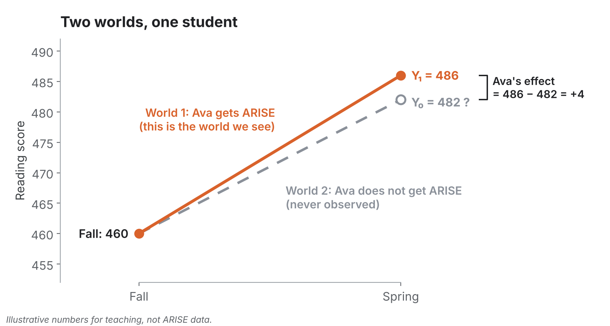

# Part 1: Foundations

Every design in this course tries to answer the same question: **W****hat would have happened without the program?** Read this part before Module 1 and come back to it often.

## What is a causal effect?

A program's **causal effect** is the difference between what happened *with* the program and what *would have happened* to the same people without it. That second outcome is called the **counterfactual**. We can never observe it, because the same students cannot both get and not get the program in the same year.

**Example.** Maria joins a reading program and her score rises 40 points. Was the program responsible? Only if she would have gained fewer than 40 points without it. If students like Maria usually gain 40 points a year anyway, the program's effect was zero.

## Two worlds, one student

Every student has two possible futures, and a program's effect is the difference between them. Researchers call these two futures **potential outcomes**:

- **Y₁** ("Y-one"): the student's spring reading score if they get ARISE.
- **Y₀** ("Y-zero"): the same student's spring score if they do not.
- The effect of ARISE for that student is Y₁ − Y₀.

*Two worlds, one student. Illustrative numbers, not ARISE data.*

In World 1, Ava attends an ARISE school and scores 486 in spring. In World 2, the same Ava, in the same year, does not get ARISE and would score 482. Her effect is 486 − 482 = +4 points. But Ava lives in only one of these worlds. We can see 486; the 482 is never observed. This is the **fundamental problem of causal inference**. Basically, for every student, we can see at most one of the two outcomes. The other is always a question mark.

## The running example: six students, two futures

To see how each design deals with this problem, the book follows the same six made-up students through every module. Ava, Ben and Cruz attend ARISE schools; Dev, Eli and Fay attend comparison schools. Because we invented them, we can do something no real study can: look at both worlds at once.

**The god's-eye view (impossible in a real study).**

| Student | Group | Fall score | Y₁: spring with ARISE | Y₀: spring without ARISE | Effect (Y₁ − Y₀) |
| --- | --- | --- | --- | --- | --- |
| Ava | ARISE | 460 | 486 | 482 | +4 |
| Ben | ARISE | 480 | 504 | 498 | +6 |
| Cruz | ARISE | 500 | 525 | 520 | +5 |
| Dev | Comparison | 430 | 456 | 451 | +5 |
| Eli | Comparison | 450 | 474 | 469 | +5 |
| Fay | Comparison | 470 | 495 | 490 | +5 |

For the three ARISE students, the average Y₁ is 505 and the average Y₀ is 500, so the true effect of ARISE on ARISE students is +5 points. T*hat is the answer every design in this book is trying to recover.* Two other facts in this table will trip up some designs because everyone grows about 20 points from fall to spring even without ARISE, and the ARISE students started higher (a fall average of 480, versus 450 for the comparison students).

**What we actually get to see.**

| Student | Group | Fall score | Y₁: spring with ARISE | Y₀: spring without ARISE |
| --- | --- | --- | --- | --- |
| Ava | ARISE | 460 | 486 | **?** |
| Ben | ARISE | 480 | 504 | **?** |
| Cruz | ARISE | 500 | 525 | **?** |
| Dev | Comparison | 430 | **?** | 451 |
| Eli | Comparison | 450 | **?** | 469 |
| Fay | Comparison | 470 | **?** | 490 |

Half of the spring outcomes are question marks, and that is true of every study, always. Fall scores are known for everyone because they were measured before ARISE began. This is why causal inference is really a **missing-data problem**. To estimate ARISE's effect, we must fill in the ? for Ava, Ben and Cruz (what they would have scored without ARISE) using something we *can* observe. That something is the stand-in for the counterfactual.

Since we cannot see the counterfactual, every design in this course **builds a stand-in for it**. Which stand-in you can build depends on the problem you face. Each module starts from one of these problems:

| Module | The problem you face | The stand-in for "without the program" | What must be true to believe it | Design |
| --- | --- | --- | --- | --- |
| 1 | We observe only the program group, before and after | The same students, before the program | Nothing would have changed without the program | One-group pre-post |
| 2 | We have an untreated group, but only after the program | A different group that did not get the program | The groups would have scored the same without it | Posttest-only with a comparison group |
| 3 | The groups differ, and we measured how | Untreated students with the same measured characteristics, through a model | No important difference went unmeasured | Regression adjustment |
| 4 | The groups differ on a few things we can match exactly | Untreated look-alikes in the same cell | As in Module 3, and every program student has a look-alike | Exact matching |
| 5 | The groups differ on too many things to match exactly | Untreated students with the same chance of being in the program | As in Module 3, and the groups overlap in that chance | Propensity score matching |
| 6 | We have an untreated group, observed before and after | The untreated group's change, added to the program group's starting point | Both groups would have changed by the same amount | Difference-in-differences |
| 7 | The program starts at a known time, and we have a long history | The program group's own earlier trend, projected forward | The trend would have continued, and nothing else changed at that time | Interrupted time series |
| 8 | The program starts at a known time, and an untreated group shares the same history | The untreated group's departure from its own trend | Anything else that happened at that time hit both groups alike | Comparative interrupted time series |
| 9 | Assignment follows a cutoff score | Students just on the other side of the cutoff | Nothing else changes at the cutoff, and no one can sort around it | Regression discontinuity |
| 10 | Assignment can be randomized | A group created by chance | Randomization was done properly and held | Randomized controlled trial |
| 11 | The program varies in intensity | Students who got less of the program | Students who got more would otherwise be like those who got less | Dose-response and heterogeneity (Module 11) |

The better the stand-in matches the true counterfactual, the more you can trust the answer. Each module opens with a **Picture the design** section that shows how its design fills in Ava's, Ben's and Cruz's ? and how close it comes to the true +5. A design that fills the ? badly misses the true effect, and the size of that miss is called **bias**. Every design also rests on an assumption, a claim about why its stand-in should match the missing world. When the assumption fails, the stand-in fails with it.

**Diagnose the problem before you choose a design.** Methods are often taught as a list: regression, matching, difference-in-differences. Researchers choose among them by first asking what situation they are in and what is missing. The problem decides which stand-ins are possible, and the stand-in decides what must be true. Recognizing the problem matters more than knowing the name of the solution.

**Start from the trial you wish you had.** A useful habit from Hernán and Robins (*What If*, Chapter 3) is to describe the ideal randomized trial first. For ARISE, it would be this: take the 13 Oceanside elementary schools in fall 2024, flip a coin for each school to decide which ones get ARISE, and compare spring reading scores. Nobody ran that trial, but every design in this course tries to come as close to it as the data allow. Asking "How does my study differ from that trial?" points straight to where bias can enter.

## Comparison groups and selection bias

A **comparison group** (or control group) is a group that did not get the program. Comparing the program group to them seems simple, but there is a catch; notably, **people or schools that join programs are often different from those that don't.** A principal who volunteers for a new literacy program may also have stronger teachers, more motivated families, or a bigger budget. If you see a difference later, you cannot tell whether the program caused it or those pre-existing differences did. This is called **selection bias**, and most of this course is about dealing with it.

## What must be true: three conditions

Every design asks you to believe that its stand-in matches the missing world. Hernán and Robins (*What If*, Chapter 3) break that belief into three conditions. Each module's What must be true to believe it section says which one is most at risk.

| Condition | What it means | In the ARISE study |
| --- | --- | --- |
| **Exchangeability** | The comparison group's outcomes stand in for what the program group would have had without the program. The groups are interchangeable except for the program, sometimes only after accounting for measured characteristics. | Would comparison-school students have scored like ARISE students if neither had ARISE? Selection is the main threat. |
| **Positivity** | For every kind of student in the program group, there are similar students who did not get it. Without them, there is no one to compare with. | Every ARISE student needs comparison students with a similar grade, starting score and background. Module 4 drops students where this fails. |
| **Consistency** | The program is well defined, so getting ARISE means the same thing for everyone who got it, and a student's outcome depends only on their own treatment. | If ARISE looked very different from school to school, or if comparison schools borrowed parts of it, the question "What did ARISE do?" gets fuzzy. |

Randomization makes exchangeability true by design (Module 10). Every other design needs an argument for it, and that argument is where your judgment matters most.

## Reading the math

Research articles state their models as equations. They look daunting, but they are built from a handful of symbols, and each module decodes its own equation term by term. You do not need calculus. You need to know what each symbol stands for and what the equation is comparing.

**The symbols you will see.**

| Symbol | Read it as | Example |
| --- | --- | --- |
| Y | The outcome | A spring reading score |
| i, s, t | Which student (i), school (s) or time (t) a value belongs to | Yᵢ is student i's score |
| D | The treatment indicator: 1 if the unit got the program, 0 if not | D = 1 for Ava |
| Y₁, Y₀ | The two potential outcomes, with and without the program | Ava's Y₁ is 486 and her Y₀ is 482 |
| E\[ \] | "The average of" | E\[Y\] is the average score |
| E\[ … ∣ D = 1\] | "The average of … among those with D = 1." The vertical bar means "among." | E\[Y ∣ D = 1\] is the program group's average |
| β (beta) | A coefficient: a number the model estimates | β₁ is the program's estimated effect |
| ε (epsilon) | The error: everything about an outcome that the model does not explain |  |
| A hat, as in β̂ | An estimate from the data, rather than the true value | β̂₁ = 0.083 |

Other books write the same ideas a little differently. The Mixtape writes the potential outcomes as Y¹ and Y⁰, and What If uses A for the treatment.

**The effects you can estimate.** An effect is always an average of Y₁ − Y₀ over some group of people. The group is what separates these four:

$$
\begin{aligned}
\text{ATE} &= E[Y_1 - Y_0] \\
\text{ATT} &= E[Y_1 - Y_0 \mid D = 1] \\
\text{ATU} &= E[Y_1 - Y_0 \mid D = 0] \\
\text{LATE} &= E[Y_1 - Y_0 \mid \text{compliers}]
\end{aligned}
$$

| Effect | Averaged over | In ARISE terms |
| --- | --- | --- |
| **Average treatment effect (ATE)** | Everyone | The effect ARISE would have, on average, for all students in the 13 schools |
| **Average treatment effect on the treated (ATT)** | Those who got the program | The effect ARISE had on students in the four ARISE schools. Most designs in this course estimate this one. |
| **Average treatment effect on the untreated (ATU)** | Those who did not get the program | The effect ARISE would have had on comparison students if their schools had adopted it. It matters when deciding whether to expand a program. |
| **Local average treatment effect (LATE)** | Compliers: those whose participation was changed by an offer or a rule | In Module 9, the effect for students near the cutoff who took part only because they were offered the program |

In the running example all four equal +5, because we built it that way. In real programs they often differ. If ARISE helped struggling readers most, and struggling readers were more common in the comparison schools, the ATU would be larger than the ATT. Knowing which effect a design gives you is part of reading its result.

**The equation behind every design.** A simple comparison of two groups' averages can always be split into two parts:

$$
\underbrace{E[Y \mid D=1] - E[Y \mid D=0]}_{\text{what you can compute}}
= \underbrace{E[Y_1 - Y_0 \mid D=1]}_{\text{ATT}}
+ \underbrace{E[Y_0 \mid D=1] - E[Y_0 \mid D=0]}_{\text{selection bias}}
$$

Read it from left to right. The left side is what the data give you: the program group's average minus the comparison group's average. The first piece on the right is the effect you want, the ATT. The second piece is selection bias: how differently the two groups would have scored if neither had the program. It contains E\[Y₀ ∣ D = 1\], the program group's missing world, which no one can observe.

The split comes from one move: add and subtract that missing E\[Y₀ ∣ D = 1\]. Adding and subtracting the same amount changes nothing, but it separates the part you want from the part that gets in the way. In the running example, 505 − 470 = (505 − 500) + (500 − 470), so 35 = 5 + 30. The 30 points are the head start you will meet in Module 2. The Mixtape (Chapter 4) writes the same split with the ATE and one more term for when effects differ between groups. The idea is the same.

**Every design is a plan for the selection-bias term.**

| Design | How it deals with selection bias |
| --- | --- |
| Pre-post (Module 1) | Replaces the missing E\[Y₀ ∣ D = 1\] with the same students' earlier scores |
| Posttest-only (Module 2) | Assumes selection bias is zero |
| Regression and matching (Modules 3 to 5) | Makes it zero within groups of students who share measured characteristics |
| Difference-in-differences (Module 6) | Assumes it stays the same over time, then subtracts it |
| Time series (Modules 7 and 8) | Uses past trends to predict the missing world |
| Regression discontinuity (Module 9) | Makes it zero right at the cutoff |
| Randomized trial (Module 10) | Makes it zero, on average, by chance |

**The statistics behind every estimate.** Once a design produces an estimate, JASP asks how much that estimate could bounce around by chance. Two formulas do most of the work, and you will see them in every module:

$$
t = \frac{\text{estimate}}{\text{SE}} \qquad\qquad \text{95\% CI} \approx \text{estimate} \pm 2 \times \text{SE}
$$

The standard error (SE) is the typical size of that bounce. The t statistic counts how many SEs the estimate sits from zero, and in large samples about 2 or more means p < .05. The confidence interval reaches about two SEs on either side of the estimate. JASP uses a number slightly different from 2 that depends on the sample size, so its intervals may differ a little from a hand calculation. None of these formulas checks the design. They describe chance, not bias.

## Statistical significance vs. practical significance

These answer two different questions, and you need both.

**Statistical significance (the p-value) asks: Could this difference just be luck?** Even if a program does nothing, two groups of students will never score exactly the same. The p-value is the probability of seeing a difference at least this big *if the program truly had no effect*. Think of a p-value like a smoke alarm. If the p-value is below .05, the alarm goes off, and the difference is too big to easily blame on luck. If it’s above .05, the alarm stays quiet, and luck could explain the difference, but that doesn’t prove there’s no fire.

- A small p-value (by convention, **p < .05**) means "this would be surprising if there were no effect." We call it statistically significant.
- A large p-value means the difference could easily be chance.
- A p-value does **not** tell you how big or important the effect is. With thousands of students, even a tiny, meaningless difference can have p < .001.
- A p-value does **not** tell you whether the design is trustworthy. A biased comparison can produce a very small p-value.

**The confidence interval (CI) shows a plausible range for the effect.** A 95% CI of 0.02 to 0.14 means the true effect is plausibly anywhere in that range. If the interval includes 0, the result is not statistically significant. A wide interval means you have little precision.

**Practical significance (the effect size) asks: Is the difference big enough to matter?** In this course most outcomes are on a **standard deviation (SD) scale**, which makes effects comparable across grades and tests. You will see this as a z-score difference or as Cohen's *d*. An effect of 0.10 SD means the program moved the average student about one-tenth of a standard deviation.

Going back to the smoke alarm analogy. The alarm tells you there’s probably a fire, but not how big it is. That’s the effect size’s job. A small effect is a candle; a large effect is a bonfire. There are a dozen or so types of effect sizes, and many have their own rules for what counts as small or large. In education, real programs rarely produce bonfires. An effect of 0.10 SD is often a meaningful result, and 0.20 or more is considered large. The key idea is a larger effect means a bigger difference between the two groups we are comparing.

How big is big? Effects of real school programs are usually much smaller than older rules of thumb suggest. Based on hundreds of randomized trials in education, [Kraft (2020)](https://www.matthewakraft.com/interpreting-effect-sizes-of-educational-attainments) proposed these benchmarks for effects on standardized achievement tests:

| Effect size (SD) | Kraft's label for education programs |
| --- | --- |
| Less than 0.05 | Small |
| 0.05 to 0.19 | Medium |
| 0.20 or more | Large |

The median effect in those studies was about 0.10 SD. Use these benchmarks in every module, and always report **both** the p-value and the effect size.

## Reading a result that is not significant

Many of the ARISE estimates will not be statistically significant. It is tempting to read that as "ARISE had no effect," but that is a mistake. A non-significant result means only that the data cannot rule out zero. Whether the data also rule out an effect that would matter depends on the confidence interval.

Before you look at any result, decide on the smallest effect that would matter to the people making decisions. In this course, use 0.05 SD, the line between small and medium on Kraft's benchmarks. Then compare the whole confidence interval with that line, not only the p-value.

| What the 95% CI looks like | What you can conclude | Example from this book |
| --- | --- | --- |
| Entirely above 0 (or entirely below) | Evidence of an effect. Use the interval to say how large it could plausibly be. | Module 9: 0.05 to 0.17 SD |
| Includes 0, and every value is smaller than the effect that would matter | Evidence of no meaningful effect. The data rule out effects large enough to matter. | Module 3: −0.015 to 0.043 SD rules out anything bigger than about 0.04 SD |
| Includes 0 and reaches past the effect that would matter | Inconclusive. The study cannot tell a meaningful effect from none. | Module 8: −0.13 to 0.20 SD runs from meaningful harm to meaningful benefit |

**Say it the right way.** "We found no evidence of an effect" is true of both of the last two rows, but they mean very different things. For a result like Module 3's, say "The data rule out effects larger than about 0.04 SD." For a result like Module 8's, say "The study was too imprecise to tell." Never conclude "the program had no effect" from a single non-significant result.

**Two cautions.** First, a narrow interval is only as good as the design behind it. Module 3's interval rules out large effects only if its assumption of no unmeasured differences holds, and it is too narrow because it ignores clustering (see "One more idea," below). Second, a significant result is not automatically believable. A biased comparison can produce a confident wrong answer, as Module 1 shows.

## Internal validity and common threats

**Internal validity** is how confident you can be that the program, and not something else, caused the difference you see. A threat is an alternative explanation. These are the threats you will meet most often:

| Threat | What it means | School example |
| --- | --- | --- |
| Maturation | People change naturally over time | Students read better in May than September, program or not |
| History | Something else happened at the same time | A new district curriculum launched the same year |
| Testing | Taking a test changes later scores | Students do better the second time they see i-Ready |
| Instrumentation | The measuring tool changed | The test, its scoring, or testing dates changed |
| Regression to the mean | Extreme scores drift back toward average on retest | Students chosen for low fall scores rise partly by chance |
| Selection | Groups differed before the program | Schools that volunteered already had stronger readers |
| Attrition | People leave the study unevenly | Struggling students moved away or missed the spring test |
| Diffusion | The comparison group got some of the program | A comparison-school teacher borrowed ARISE materials |

Each module lists the threats that matter most for its design.

## Who does the estimate describe?

Every estimate answers the causal question for a particular group of students. Before you report a result, say which group it describes. Designs that look alike can describe different people.

| Module | The estimate describes | In plain words |
| --- | --- | --- |
| 1 | Growth, not an effect | How much ARISE students' scores rose, including normal growth |
| 2, 3, 6 | ARISE students | How ARISE students did compared with their stand-in for "without ARISE" |
| 4, 5 | Matched ARISE students (the ATT for students with a match) | ARISE students who had a close match. Students who were dropped are not described. |
| 7, 8 | The four ARISE schools, as school averages | How the ARISE schools' averages moved compared with their own trend (and, in Module 8, with the comparison schools' change) |
| 9 | Students near the cutoff | The ITT describes offering the program to students near the 25th percentile. The effect of receiving it describes students who took part because they were offered it. |
| 10 | Students in the trial | The effect of being assigned to the program, for students in these schools and grades |

**Beyond the study.** All of these estimates describe Oceanside students in 2024-25, the first year of ARISE. Whether a result would hold in other schools, in later years or for a more mature program is a separate judgment, called **external validity**, and the data cannot settle it. A first-year result deserves extra care. A null result could mean the program does not work, that it was not yet fully in place (teachers were still learning it), or that its effect takes more than a year to appear. Name these possibilities instead of concluding that the program does not work. Information about implementation, such as how much of ARISE teachers actually delivered, is what helps you tell them apart.

## Matching your words to the evidence

The words you choose tell your audience how much to trust a result. Choose words that claim no more than the design supports.

| Design | Words that fit | Words to avoid |
| --- | --- | --- |
| Pre-post (Module 1) | "ARISE students' scores rose by about \_\_\_ points." | "ARISE raised scores by \_\_\_ points." |
| Posttest-only (Module 2) | "ARISE students scored \_\_\_ higher than comparison students." "ARISE was associated with ..." | "ARISE caused ..." |
| Regression and matching (Modules 3 to 5) | "After accounting for fall scores, English learner status and disability status, ARISE students scored ..." | "The effect of ARISE was ..." without naming what was not measured |
| DiD, ITS and CITS (Modules 6 to 8) | "Compared with the change in comparison schools (or with their own earlier trend), ARISE schools' scores changed by ...", along with the assumption in plain words | Causal language without saying what the design assumes |
| RDD and RCT (Modules 9 and 10) | "Offering (or assigning) the program raised scores by about \_\_\_ for ...", naming the group the estimate describes | Claims about students outside that group |

**Decide your main estimate before you look.** Several modules ask you to run more than one version of a model: z-scores and raw scores, a regression and a mixed model, several bandwidths. Before you run them, write down which one is your main estimate and why, for example the mixed model in Module 6 because it accounts for schools. Report that one, and present the others as checks. If you pick whichever version has the smallest p-value after seeing them all, the p-value no longer means what it claims.

**Be wary of hunting in subgroups.** After a null overall result, it is tempting to look for a group where the program worked, such as one grade, English learners or one school. Test enough subgroups and some will look significant by chance, just as about 1 in 20 balance checks will (Module 10). Treat a subgroup result as a question for the next study, not a finding, unless you planned to test that subgroup in advance.

## One more idea: Students are grouped in schools

ARISE was given to whole schools, not individual students. Students in the same school share teachers, leaders and resources, so their scores are not fully independent. Standard tests in JASP treat each student as an independent piece of information, which makes results look more certain than they really are (p-values too small). In this course only 13 schools are compared, so this matters a lot. You will see what to do about it in Module 6.

**What this means for power.** Clustering also limits what this evaluation can detect. ARISE was given to only four schools. Even with thousands of students, the evidence about a school-level program comes mostly from comparing a handful of schools, and schools differ for many reasons besides ARISE. A study like this can easily miss a real, moderate effect, which is why confidence intervals that account for schools are wide (compare the regression and mixed-model rows in Module 6). Keep this in mind when you read a non-significant result: with four program schools, "we couldn't detect it" is a likely outcome even if ARISE helps.

