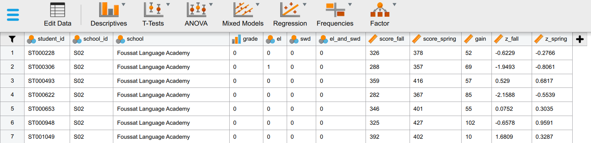
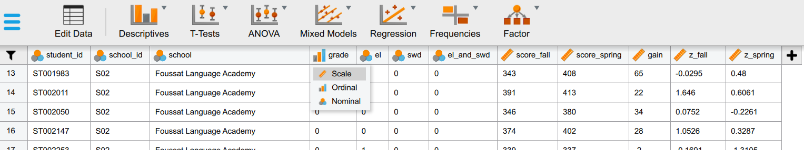
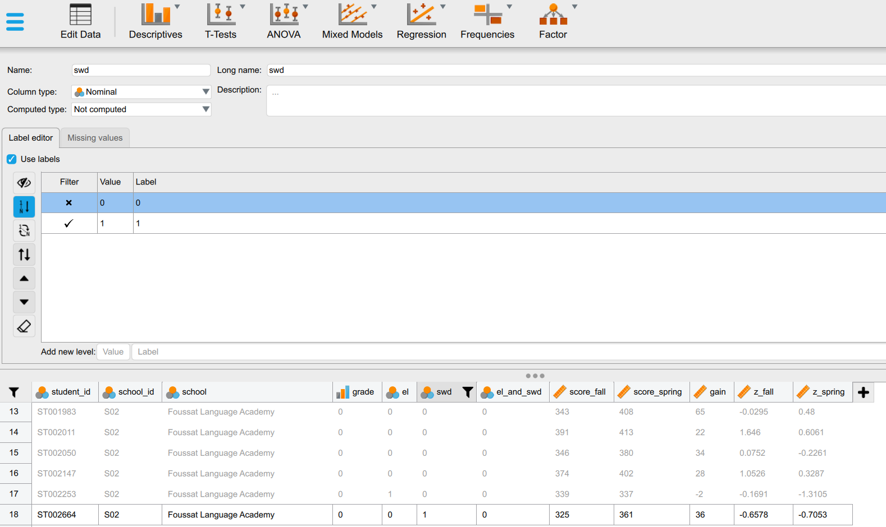

# Part 2: The ARISE data and getting started in JASP

## The story

In 2024-25, four Oceanside elementary schools started ARISE, a literacy program. Nine other Oceanside elementary schools started it a year later, in 2025-26. That means in 2024-25, those nine schools had not started yet, so they can serve as a **comparison group**.

Students in grades K to 5 take the i-Ready reading test three times a year: fall, winter and spring. The data are real and de-identified, so no student can be identified.

Modules 1 to 8 ask one question: Did ARISE improve students' spring reading scores in 2024-25?

Modules 9 and 10 use a simulated program. Your instructor added a made-up program effect to real student scores, so the true answer is known. After you finish those modules, your instructor will share it so you can see how close each design came.

| Group | Schools | When ARISE started |
| --- | --- | --- |
| ARISE | Foussat Language Academy, Ivey Ranch, Pablo Tac, South Oceanside | 2024-25 |
| Comparison | Christa McAuliffe, Del Rio STEM, Laurel, Libby, Mission, Nichols Leadership, North Terrace, Palmquist, Santa Margarita | 2025-26 (after our outcome year) |

ARISE schools chose to adopt the program; it was not assigned at random. Keep that in mind in every module.

**One more thing about the comparison schools.** The nine comparison schools knew they would start ARISE in 2025-26. Some may have begun planning, training teachers or trying ARISE materials during 2024-25, our outcome year. If so, the comparison group got some of the program, which is diffusion (Part 1). That would make the comparison schools look more like the ARISE schools and push the estimates in Modules 2 to 8 toward zero. Keep this in mind whenever a result is close to zero.

## Two kinds of scores

| Variable name | What it is | When to use it |
| --- | --- | --- |
| score\_fall, score\_spring | i-Ready **scale score**, roughly 200 to 750 | When everyone is in one grade, or for raw growth |
| z\_fall, z\_spring | **z-score**: the scale score compared with all Oceanside students in the same grade and season in 2022-23 | When comparing students across grades |

Scale scores rise with grade, so an average kindergartner scores near 390 in spring and an average 5th grader near 565. If one group has more older students, its raw average looks higher for that reason alone. A **z-score** fixes this issue. A z of 0 means "average for your grade," +1 means one standard deviation above average, and -0.5 means half a standard deviation below. A difference in z-scores between groups is already an effect size in SD units.

**Translating z-score results into real-world terms.** A difference in z-scores is in SD units, which researchers can compare across studies but most people cannot picture. When you report a result to a principal, a school board or families, translate it. The first table gives the conversions for this data. Scale the last two columns to your own estimate, so an effect of 0.20 SD is twice the 0.10 SD column.

| Grade | 1 SD in i-Ready points (spring) | Typical fall-to-spring gain | 0.10 SD in points | 0.10 SD as a share of the gain |
| --- | --- | --- | --- | --- |
| K | 40 | 48 | 4 | 8% |
| 1 | 53 | 48 | 5 | 11% |
| 2 | 54 | 37 | 5 | 15% |
| 3 | 57 | 33 | 6 | 17% |
| 4 | 58 | 26 | 6 | 22% |
| 5 | 58 | 23 | 6 | 25% |

The SDs are the spread of 2022-23 spring scores used to build the z-scores, and the gains are the average fall-to-spring gains of ARISE students in Module 1. Share of a year's growth is approximate, because the fall and spring tests are about seven months apart. The same effect also looks larger in older grades only because older students gain fewer points per year.

Percentiles are another option. The second table shows where an effect moves a student, assuming every student shifts by the same amount.

| Effect | A typical student moves from the 50th percentile to | A student at the 25th percentile moves to |
| --- | --- | --- |
| 0.05 SD | 52nd | 27th |
| 0.10 SD | 54th | 28th |
| 0.20 SD | 58th | 32nd |
| 0.30 SD | 62nd | 35th |

Moving a typical student from the 50th to the 58th percentile is the same as saying that about 8 more students out of every 100 score above the typical comparison student. Each module's Explaining it to stakeholders section shows how to put its estimate into a sentence.

## The data files

Each module has its own file, already trimmed to the students and variables you need. Every yes/no variable is coded 1 = yes, 0 = no. An empty cell means the value is missing.

| File | Module | Rows are | Rows |
| --- | --- | --- | --- |
| m01\_pre\_post.csv | 1 | Students in ARISE schools, 2024-25 | 2,082 |
| m02\_posttest\_only.csv | 2 | Students in both groups, 2024-25 | 5,746 |
| m03\_regression\_adjusted.csv | 3 | Same, with fall scores | 5,584 |
| m04\_exact\_matching.csv | 4 | Same, with matching information | 5,584 |
| m05\_propensity\_matching.csv | 5 | Same, with propensity scores | 5,584 |
| m06\_diff\_in\_diff.csv | 6 | Students in both groups, 2022-23 to 2024-25 | 17,645 |
| m07\_interrupted\_time\_series.csv | 7 | Test windows (school averages) | 12 |
| m08\_comparative\_its.csv | 8 | Test windows for both groups | 18 |
| m09\_regression\_discontinuity.csv | 9 | All students, 2022-23 to 2025-26 (simulated program) | 22,528 |
| m10\_randomized\_trial.csv | 10 | All students, 2024-25 (simulated program) | 6,110 |

## Getting started in JASP

**Opening a file**

1. Open JASP.
2. Click the **menu button** (three lines) in the top-left corner.
3. Choose **Open**, then **Computer**, then **Browse**, and select the module's .csv file.
4. The data appear as a spreadsheet. The analysis menus run across the top: **Descriptives, T-Tests, ANOVA, Regression** and others.

Figure 1. JASP main window with a data file open and the analysis menus labeled

**Adding a module.** Some analyses live in add-on modules. Click the **+** icon at the top right of the menu bar and tick the module's name. It then appears in the menu bar. There's nothing to add now, but this is how you would do it. Click on the + icon to close the menu.

**Checking variable types.** Every column has a small icon beside its name. This matters: JASP only lets a variable into certain boxes if it has the right type.

| Symbol | Icon | Type | Use it for |
| --- | --- | --- | --- |
|  | Ruler | Scale | Numbers you can average: scores, z-scores, weights, time |
|  | Bar chart | Ordinal | Ordered categories |
|  | Three circles (Venn) | Nominal | Groups and labels: arise\_group, school, filters |

To change a type, click the icon beside the column name and pick the new type. A common rule in this course is outcomes, covariates and 0/1 predictors in regressions should be **Scale**. Grouping variables for t-tests and ANOVA factors (like arise\_group or period) should be **Nominal**. JASP sometimes guesses wrong, so check before every analysis.

Figure 2. Column header with the variable-type icon and its drop-down

**Using a filter.** Some modules analyze only some rows (for example, only matched students).

1. Click the name at the top of the column you want to filter on (in some versions, double-click it). A panel opens listing the column's values.
2. In the **Filter** column of that panel, **untick** the value you want to leave out (for example, untick 0 to keep only rows where the value is 1).
3. Excluded rows turn grey in the spreadsheet, and every analysis now ignores them.
4. To remove the filter, tick the value again.
5. Use the ^ in the right hand corner to minimize the filter screen.

FIgure 3. The value panel with the Filter checkboxes, showing 0 unticked

**Reading results.** Output appears in the right-hand panel and updates as soon as you change a setting, so there is no Run button. Each table has a title; this book tells you which tables to look at. To keep your work, save it as a **.jasp file** (menu, then Save As). That file keeps your data, settings and output together, which is useful to bring to your instructor. Each analysis provides its own result table, chart, or figure.

## Where variables go in JASP, and why

Every JASP analysis has boxes such as Dependent Variable, Covariates and Grouping Variable. Each box tells JASP what job a variable does in the analysis. To fill the boxes correctly, decide two things about each variable first: what kind of data it is, and what role it plays in the evaluation. This section explains both and then matches each role to its JASP box. In each module, the Get to know the data section has a data dictionary for the variables you will use, and the Step by step in JASP section starts with a short table showing where those variables go and why. The files also contain a few columns you will not use (such as student\_id and school), and you can ignore them.

**Kinds of data**

| Kind | What it looks like | Examples | Set it to |
| --- | --- | --- | --- |
| Continuous | Numbers on a scale, where differences mean something and averages make sense | score\_spring, z\_fall, mean\_z | Scale |
| Binary (0/1) | Two values, coded 1 = yes and 0 = no | arise, el, post | Scale in regressions and Descriptives; Nominal as a grouping variable, a filter or a Flexplot line |
| Category, text | Labels with no order | arise\_group, period, rct\_group | Nominal |
| Category, number code | Numbers that are labels, not amounts | grade, year, school\_id | Nominal |
| Count or time index | Whole numbers that count steps in time | time, time\_after | Scale |
| Weight | How much a row counts in an analysis | em\_weight, rdd\_tri\_w050 | Scale |

**Why the kind matters.** JASP decides how to handle a variable from its type. It treats a Scale variable as an amount, so it can average it and fit a line to it. It treats a Nominal variable as a set of groups, so it compares the groups. If grade were set to Scale and used as a predictor, JASP would treat grade 4 as "twice" grade 2 and fit one straight line through the grades. Set to Nominal, each grade becomes its own group. Binary variables are a special case. With 0/1 coding, the mean is the share of 1s, so a mean of 0.25 for el means 25% of students are English learners. In a regression, the coefficient of a 0/1 variable is the difference between the 1 group and the 0 group. That is why the files carry both arise (0/1, set to Scale for regressions) and arise\_group (text, set to Nominal for t-tests). They hold the same information in two forms.

**Why some categories are set to Scale.** It can seem odd to call el or swd Scale when they are categories. The rule in this course is to set a variable's type by what you need JASP to do with it, not by what it measures. A 0/1 variable is the one kind of category that also works as a number. Set it to Scale when you want JASP to treat it as a number: to average it (its mean is the share of 1s), to compare it between groups in a t-test's Dependent Variables, or to put it in a regression's Covariates box, which takes only Scale variables. Set it to Nominal when you want JASP to treat it as groups: in Split, Grouping Variable or Fixed Factors, as the dependent variable of a logistic regression, or as a Flexplot line. Changing the type does not change the data, because the 0s and 1s stay the same. In a linear regression you would get the same coefficient by setting el to Nominal and putting it in Factors instead; JASP would only label the row with the level, such as el (1). This course uses Scale and Covariates so that every predictor appears the same way. This works only for two categories coded 0 and 1. A category with more than two values, such as grade or school\_id, should stay Nominal, because its numbers are labels, not amounts. The same rule explains why a few variables change type within a module, such as arise in Module 5 and rdd\_eligible in Module 9.

**Roles in an evaluation**

| Role | What it is | How to recognize it | Examples |
| --- | --- | --- | --- |
| Outcome (dependent variable, DV) | The variable you are trying to explain. Its values depend on the other variables in the analysis. In an evaluation, it is what the program is meant to change. | Measured after the program started. Ask: is this the result the program is supposed to improve? | z\_spring, mean\_z, rdd\_z\_spring, rct\_z\_spring |
| Treatment (an independent variable, IV) | Records who got the program, or who was offered or assigned it. An independent variable, also called a predictor or explanatory variable, is any variable used to explain the outcome. The treatment is the one the evaluation is about. | Ask: does this say which group a row is in? | arise, arise\_group, rdd\_eligible, rct\_group |
| Covariate (control variable) | Another independent variable, included to adjust for differences between the groups or to make the estimate more precise | Measured before the program, so the program could not have changed it, and related to the outcome | z\_fall, el, swd, score\_fall |
| Design variable | A variable built to carry the design's logic, such as when the program started, how time passes, or the product of two variables (an interaction) | Usually created by the evaluator rather than collected | post, time, time\_after, arise\_x\_post, rdd\_running, rdd\_elig\_x\_running |
| Cluster | The larger unit that rows belong to. Rows in the same cluster share influences, so they are not independent. | Many rows share each value | school\_id |
| Sample or weight variable | Decides which rows are analyzed, or how much each row counts. It is not a predictor. | Usually made during matching or design | em\_matched, ps\_matched, rdd\_bw050, em\_weight, rdd\_tri\_w050 |

**A worked example: why z\_spring goes in the Dependent Variable box.** Our question is "Did ARISE improve spring reading scores in 2024-25?" Read it as a sentence about cause and effect. ARISE is the possible cause, so the variable that records it (arise or arise\_group) is the treatment, an independent variable. Spring reading is the possible effect. It was measured after ARISE began, and it is what ARISE is meant to change, so z\_spring is the outcome and goes in the Dependent Variable box. The fall score, z\_fall, was measured before ARISE could change it and helps predict spring scores, so it is a covariate. A covariate must come before the program. If you adjusted for a winter score, which ARISE could already have raised, you would remove part of the effect you are trying to measure.

**One variable, different roles.** A variable's role depends on the question you are asking, not on the variable itself. In a balance check you ask, "Did ARISE and comparison students start with different fall scores?" Now z\_fall is the thing being compared, so it goes in Dependent Variables and arise\_group goes in Grouping Variable. In Module 5's propensity model the question is "What predicts being in an ARISE school?", so arise becomes the dependent variable. In Module 9's first stage, rdd\_received is the dependent variable, because you are asking how much being eligible changed who took part.

**JASP's boxes**

| Box | Where you see it | What it means | What goes there in this course |
| --- | --- | --- | --- |
| Variables | Descriptives, Correlation | The columns to summarize or plot | Any variable you want to look at |
| Split | Descriptives | A categorical variable. JASP repeats every summary for each of its groups. | arise\_group, year, rdd\_eligible, rct\_group |
| Variable Pairs | Paired Samples T-Test | Two measurements of the same people. JASP subtracts the second from the first. | score\_spring, then score\_fall |
| Dependent Variable(s) | T-tests, ANOVA, ANCOVA, regressions, mixed models | The outcome. In a t-test you can list several, and JASP runs a separate test for each. | z\_spring and the other outcomes; pre-program characteristics in balance checks |
| Grouping Variable | Independent Samples T-Test | A Nominal variable with exactly two groups to compare. In a t-test, this is the independent variable. | arise\_group, rct\_group |
| Fixed Factors | ANOVA, ANCOVA | Categorical independent variables. JASP computes a mean for each group, or for each combination of groups. | arise\_group, period, year, rdd\_bin, rct\_group |
| Covariates | ANCOVA, Linear Regression, Logistic Regression | Scale predictors. In JASP's regressions this box holds every numeric predictor, including the 0/1 treatment variable and interaction terms, not only control variables. | arise, z\_fall, el, swd, post, arise\_x\_post, time |
| Factors | Linear and Logistic Regression | Categorical predictors. JASP turns each into a set of 0/1 columns behind the scenes and compares each group with a reference group. | grade (Module 5) |
| WLS Weights | Linear Regression | How much each row counts. WLS stands for weighted least squares. | em\_weight, rdd\_tri\_w050 |
| Fixed Effects Variables | Linear Mixed Models | Predictors whose effects are estimated as one number for everyone | arise, post, arise\_x\_post |
| Random Effects Grouping Factors | Linear Mixed Models | The clusters that rows belong to | school\_id |
| Dependent Variable, Independent Variables, Panels | Flexplot | The outcome goes on the vertical axis. The first independent variable goes on the horizontal axis, and a second one gets its own colored line. Panels draws separate plots side by side, one for each value. | mean\_z by time, with post in Panels |
| Horizontal Axis, Separate Lines | ANOVA, Descriptives Plots | Which factor runs along the bottom of the plot, and which gets its own line | period, arise\_group |
| Filter | The data view (not a box) | Hides rows from every analysis until you remove it | em\_matched, ps\_matched, rdd\_bw050 |

**Fixed effects and random effects.** A **fixed effect** is a single value the model estimates for everyone, such as the DiD estimate in Module 6. It is the number you report and interpret. A **random effect** is a value that is allowed to differ from cluster to cluster, such as each school's own average. The model does not report a separate estimate for each school. Instead, it treats the schools as a sample from a larger set of schools and estimates how much their values vary (the variance). A **random intercept** lets each cluster have its own baseline. A **random slope** lets the effect of a predictor differ from cluster to cluster. In this course you use only a random intercept for school\_id. Economists also use "fixed effects" to mean a separate 0/1 indicator for each unit (Chapter 16 of *The Effect*). In JASP's mixed models, it simply means the effects estimated once for everyone.

**Why random effects matter here.** Students in the same school share teachers, leaders and neighborhoods, so their scores are more alike than the scores of students in different schools. A regular regression treats every row as an independent piece of evidence, which makes the standard error too small. Adding a random intercept for school\_id tells the model that students come in groups, and the standard error becomes more honest (see "One more idea: Students are grouped in schools" in Part 1).

